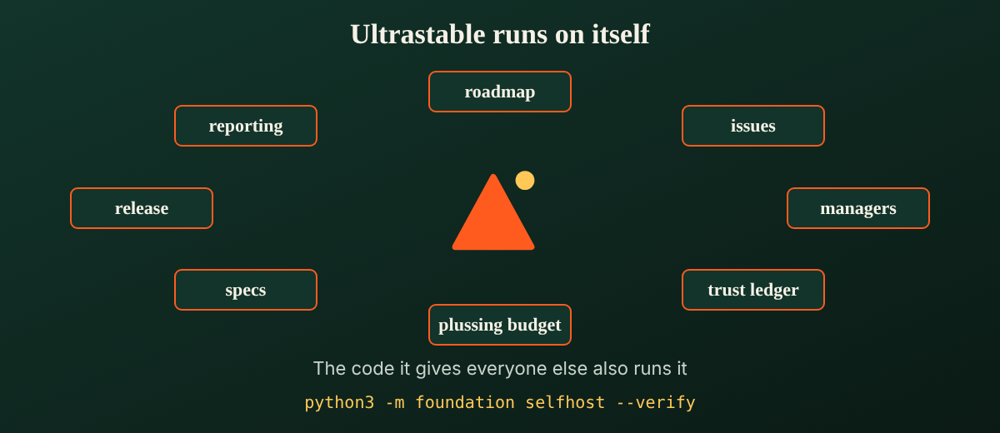

**Start here: [What needs you](NEEDS-YOU.md) (four links, everything else runs by itself) · [Everything, indexed](INDEX.md)**

<!-- brand:start (generated by brand/tools/sync_repos.py from brand/brand.json; edit that file) -->
<p align="center"></p>

# ultrastable/ultrastable

**Ultrastable is the foundation for any autonomous system.**

A system is autonomous if it has self-referential loops and the ability to close them.

The main repository: the platform, the website, the owner dashboard, the doctrine, the docs and the seed template that new systems start from.

  [](https://ultrastable.io)

**The organization:** **ultrastable** · [workers](https://github.com/ultrastable/workers) · [spec](https://github.com/ultrastable/spec) · [license](https://github.com/ultrastable/license) · [ops](https://github.com/ultrastable/ops) · [seed](https://github.com/ultrastable/seed) · [.github](https://github.com/ultrastable/.github) · [ultrastable.io](https://ultrastable.io)

## What it is
The main repository: the platform, the website, the owner dashboard, the doctrine, the docs and the seed template that new systems start from. Ultrastable is an autonomous development platform: an organization of virtual managers and staff that runs projects, scores its own decisions, earns wider autonomy from its track record, and interrupts a person only for steps that cannot be undone.

<p align="center"></p>

## Who it is for
Anyone who wants the whole picture, and the agents that run it.

## Quickstart
```sh
python3 -m foundation selfhost --verify
```
```sh
python3 -m foundation new-system --manifest instances/ultrastable/instance.json --out /tmp/ultrastable-instance
```

## It runs on itself
Ultrastable runs on itself: its roadmap, issues, managers, trust ledger, plussing budget and specs are run by the same code it gives everyone else, from this repository alone, with any tools (`python3 -m foundation selfhost`).


<p align="center"></p>

## How Ultrastable is organized
One main repository holds what Ultrastable is. A separate repository exists only for a different license or visibility, an owner-only tracker, or a system built on top of Ultrastable.

| Repository | Visibility | What it holds |
|---|---|---|
| [ultrastable](https://github.com/ultrastable/ultrastable) | public | Everything you run or read: platform code, ultrastable.io, dashboard, doctrine, docs, the core code (workers/), the specifications (specs/), the license text (licensing/), and seed/ (the starting kit for a new system). It is a GitHub template, so "Use this template" copies it. |
| [ops](https://github.com/ultrastable/ops) | private | The few steps only the owner can take (accounts, money, signatures), one card each. Private on purpose. |
| [practical-solutions](https://github.com/ultrastable/practical-solutions) | public | An autonomous bright-spot finder that runs on Ultrastable. The first system built on it, in its own repository. |

The organization's profile page is [.github](https://github.com/ultrastable/.github). Retired, kept only so old links work: [`workers`](https://github.com/ultrastable/workers) is now in `ultrastable`; [`spec`](https://github.com/ultrastable/spec) is now in `ultrastable`; [`license`](https://github.com/ultrastable/license) is now in `ultrastable`; [`seed`](https://github.com/ultrastable/seed) is now in `ultrastable`. Every code, specification and license repository is folded into the main one. The target set is `ultrastable`, `ops`, `practical-solutions`.

## License
Source-available. Free for non-commercial use: read it, run it, study it, change it, share it. Any commercial use needs a Commercial License with revenue share. Full terms: [Ultrastable License v1.0 (USL-1.0)](https://github.com/ultrastable/ultrastable/blob/main/LICENSING.md). Commercial licensing: pilot@ultrastable.io.

## Memory
Code is the only memory. All project state lives in this repository (docs/PROJECT-MEMORY.md and data files). No agent relies on chat, tool or platform memory; a thread is never the only record.

## Contribute and report
[CONTRIBUTING.md](CONTRIBUTING.md) · [SECURITY.md](SECURITY.md) · contact pilot@ultrastable.io
<!-- brand:end -->

## What this is, in five lines
1. Ultrastable is a system that runs, fixes and improves other software on its own; this repo is its code, rules and live Workers (`ultrastable-tick`, `-dashboard`, `-site`, `-agents`).
2. Merging to `main` deploys every live Worker (`deploy-workers`, `deploy-system`, `deploy-site`) and the run fails unless the code running on Cloudflare is byte-identical to the commit.
3. Quniverse (`QNFO/qnfo-workers`, 47 Workers on the same Cloudflare account) is the first customer and the test bed: it must bootstrap, discover its own resources and stay cheap without hand-holding.
4. Proof is measured, not claimed: Workers AI neurons and D1 rows read per day for Quniverse, drift between live and `main`, and manual steps per deploy (target 0), all in `ops/deploys.jsonl` and the cost items in `ROADMAP.md`.
5. If Quniverse cannot run cheaply and unattended on Ultrastable, Ultrastable does not work; cost and self-bootstrapping come before new Quniverse features.


## Start here
- [How Ultrastable actually starts its own agents](docs/HOW-IT-STARTS.md): plain language, one diagram, a traced example.
- [One core, many instances](docs/architecture/core-and-instances.md): how QNFO and any third party run on the same core, and how fixes flow both ways.

## This repository
Open repository, system of record. If it is not here, it does not exist. **Nothing here leaves the repo except files in [external/](external/)** (the code and specifications are open and governed by the [Ultrastable License](LICENSE), free for non-commercial use and licensed for commercial use; rules in [docs/CONFIDENTIALITY.md](docs/CONFIDENTIALITY.md)).

## The idea in six lines
1. **Virtual managers and staff:** portfolio, project and product managers, staff, reviewers, operations.
2. **Closed loops:** predict, execute, verify, score; nothing is dropped without a recorded disposition.
3. **Plussing:** improvement is planned, funded work.
4. **Earned trust:** a ledger widens autonomy from verified results; one interrupt gate for the irreversible.
5. **Bootstrap:** from one idea file to a running organization.
6. **Portable:** one core, Cloudflare and Google Cloud adapters.

Foundation architecture: [docs/FOUNDATION.md](docs/FOUNDATION.md). New system: `python3 -m foundation new-system --manifest instances/<slug>/instance.json --out <dir>`.

Full story: [docs/overview.md](docs/overview.md). Architecture: [platform/docs/architecture.md](platform/docs/architecture.md).

## Status, honestly
| Piece | Status |
|---|---|
| QNFO fleet (customer zero, owner's own) | **Running**; numbers self-scored, unaudited ([customer story](docs/customer-story.md)) |
| Seed bootstrapper, 7-step tick, schema, policy | **Built**, <!-- claim:seed-tests -->35 Python and 302 Worker tests<!-- /claim --> in CI; <!-- claim:live-deploys -->185<!-- /claim --> recorded live deploys of its Worker and siblings |
| Google Cloud adapter (Cloud Run, Scheduler) | **Skeleton built**, <!-- claim:gcp-tests -->2 tests<!-- /claim --> in CI, deploy script unrun |
| Dashboard | **In `dashboard/`**; status per its README, not verified here |
| Reference runtime in Python: 11-step loop, CLI, dashboard, Docker, Cloud Run deploy ([platform/core](platform/core/README.md)) | **Built**, <!-- claim:core-tests -->44 tests<!-- /claim --> in CI, default agents simulated, one real-model proof (Workers AI); deploy unrun |
| Real-agent proof, Postgres store, multi-tenancy | **Planned** |
| Outside customers, audit, entity | **None yet** (owner steps) |

## Map
| Path | What |
|---|---|
| [docs/](docs/README.md) | Overview, concepts, bootstrapping, customer story, security, confidentiality |
| [platform/](platform/README.md) | Architecture, cloud adapters, and the runnable Python reference runtime ([core/](platform/core/README.md)) |
| [seed/](seed/README.md) | Idea-to-organization bootstrapper, tick, policy, roles |
| [business/](business/README.md) | Business plan, funding, [Google for Startups kit](business/google-startups/application-kit.md), [marketing strategy](business/marketing/strategy.md), detailed [investor pack](business/investor/README.md) |
| [external/](external/README.md) | **SAFE NOW** versions that may be sent out |
| [LICENSE](LICENSE), [LICENSING.md](LICENSING.md), [COMMERCIAL-TERMS.md](COMMERCIAL-TERMS.md) | Ultrastable License v1.0 (decisions in [docs/legal/LICENSE-DECISIONS.md](docs/legal/LICENSE-DECISIONS.md)) |
| [specs/](specs/README.md) | Pointer: specifications live in `ultrastable/spec` |
| `ultrastable/workers`, `spec`, `license` | Code, specifications and canonical license live in their own repos |
| [ip/](ip/ARCHIVED.md) | Archived early drafts (not maintained, not deleted) |
| [site/](site/) | Site worker and starter |
| [demos/self/](demos/self/index.html) | **Ultrastable on itself**: a dashboard generated from this repo's own records (`python3 scripts/self_dashboard.py`) |
| [docs/ops/CONTACT.md](docs/ops/CONTACT.md) | Where contact email goes and where the owner reads it |
| [dashboard/](dashboard/README.md) | Product dashboard (built in a sibling thread; see its README for status) |
| [brand/](brand/BRAND.md) | Brand guide, logos, social assets |
| [github/org-settings.json](github/org-settings.json) | GitHub org and repo settings as code ([audit](docs/ops/GITHUB-SETTINGS-AUDIT.md)) |
| [agents/](agents/) | Agent protocol, roles, autonomy policy |
| [ROADMAP.md](ROADMAP.md), [PROJECTS.md](PROJECTS.md), [INDEX.md](INDEX.md) | Backlog, projects, index of everything |
| artifacts/, core-manifest/, deploy/, github/, research/, HANDOFF.md | Records and earlier QNFO extraction material |

## Owner-only next steps
Publish the code, specs and license repos when ready; form the entity and assign IP (#1); send only `external/` files; set up domain email and a Google billing account; submit applications; run `platform/adapters/gcp/deploy.sh` with a GCP project.

Issues: https://github.com/ultrastable/ultrastable/issues
