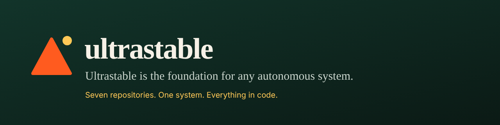
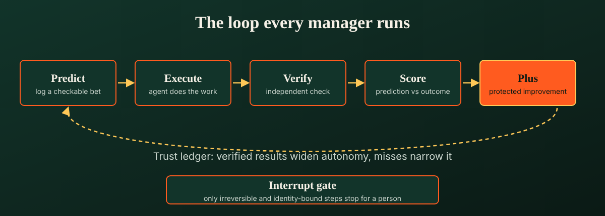

A system is autonomous if it has self-referential loops and the ability to close them. Knowing without being able to act is useless, so the system is privileged to close its own loops (`python3 -m foundation loops --verify`).

# Ultrastable

**Ultrastable is the foundation for any autonomous system.**

An organization of virtual managers and staff that runs projects, scores its own decisions, earns wider autonomy from its track record, and interrupts a person only for steps that cannot be undone. One idea file in, a running organization out.

**Ultrastable runs on itself.** Its roadmap, issues, managers, trust ledger, plussing budget and specs are run by the same code it gives everyone else. Verify it in [ultrastable/ultrastable](https://github.com/ultrastable/ultrastable): `python3 -m foundation selfhost --verify`; see the dashboard it generates about itself in `demos/self/`.

## Repositories
| Repo | Role | What |
|---|---|---|
| [ultrastable](https://github.com/ultrastable/ultrastable) | System of record | Roadmap, doctrine, foundation code, agents, brand and the self-hosting proof. |
| [workers](https://github.com/ultrastable/workers) | Code | The portable core, Cloudflare and Google Cloud adapters, and the bootstrapper: one idea file in, a running organization out. |
| [spec](https://github.com/ultrastable/spec) | Specifications and license | Architectural specifications, product documentation and the Ultrastable License. |

Earlier split repositories are archived; the registry is `org/repos.json` in the system of record.

## License
Source-available. Free for non-commercial use: read it, run it, study it, change it, share it. Any commercial use needs a Commercial License with revenue share. See [LICENSING.md](https://github.com/ultrastable/ultrastable/blob/main/LICENSING.md).

## Find us
- Web: [ultrastable.io](https://ultrastable.io)
- Pilots, partnerships, commercial licensing, security reports: pilot@ultrastable.io
- Code is the only memory: everything we know is in these repositories.
