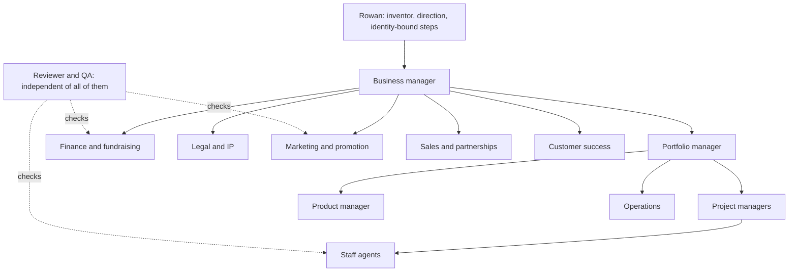

# The management roster

*Voice: the business manager. This is the org chart Ultrastable runs on, for itself first. Every manager is a virtual agent with an owner area, a trigger that wakes it, a done check, and a weekly four-line report: what happened, what was decided, what's next, what's open.*

## Who owns what

| Manager | Owns | Wakes on | Done check | What only Rowan does |
|---|---|---|---|---|
| **Business manager** | The plan, the model, priorities across business functions, this folder | Weekly; any change in funding, filing or a big customer signal | Plan matches the roadmap; each manager's report is in | Sets direction; approves strategy changes |
| **Portfolio manager** | Which projects get capacity; the disclosure gate (roadmap PF-1) | Every tick; any new project or objective | Capacity adds up; nothing public before filing | Starts or stops a whole project |
| **Project managers** | Delivery of one project's backlog | Every tick | Each item has owner, trigger, done check; nothing dropped silently | none |
| **Product manager** | Roadmap, pricing hypotheses, the plus queue | New feedback; each finished item's plus | Ranked roadmap; 20% of capacity on pluses | Approves pricing |
| **Marketing and promotion** | Story, site, content calendar, case study, social | Weekly content tick; filing date; each event | Content shipped on the calendar, all tagged SAFE NOW until filing | Approves anything published under Rowan's name; posts from Rowan's own accounts |
| **Sales and partnerships** | Lead list, discovery calls prep, demos, partner programs (Cloudflare, Google, Anthropic) | New lead; event in 30 days; credit offer | Every lead has a next step and date | Takes the calls and meetings in person; signs contracts |
| **Finance and fundraising** | Budget, burn, credits, grants, investor pipeline, data room | Monthly close; each deadline in [funding](05-funding.md) | Runway known to the week; every application drafted ahead of deadline | Signs SAFEs and grant certifications; moves money; picks investors **[ACCOUNTANT] [LAWYER]** |
| **Legal and IP** | Patent timeline, evidence log, trademark, contract templates, NDA tracking | Filing; 12-month conversion clock (IP-6); any new public material | Disclosure checklist clean; deadlines on the calendar | Hires counsel; signs filings; decides foreign filing **[LAWYER]** |
| **Customer success** | Onboarding with the org kit, health of each customer, case studies | New customer; a customer's trust ladder stalls | Each customer reaches "delegated" on at least one action class | none for routine work |
| **Operations** | Cloud accounts, deploys, domains, email, uptime, costs | Every tick; any incident | Health checks green; costs under budget | Creates accounts only Rowan can own; pays bills |
| **Reviewer and QA** | Independent checks of every manager's output, including this plan | Any claimed result | Pass or fail with evidence; never reviews its own work | none |
| **Research staff** | Competitive intel, prior art, event and program scouting | Monthly; before any pitch | [Competition](03-competition.md) and [events](07-events.md) dated within 30 days | none |

## Rowan's whole job, in one list

Rowan's part is the identity-bound work: steps that need Rowan's name, signature, money or face. The managers prepare each one so it takes minutes.

1. **Ideas and direction.** Say what matters; the managers infer the rest from the record.
2. **File the provisional** with counsel (roadmap IP-4, IP-5). **[LAWYER]**
3. **Choose the entity** (roadmap BIZ-1). **[LAWYER] [ACCOUNTANT]**
4. **Create accounts only Rowan can own:** GitHub repos (GH-1), cloud and credit applications (FN-2, FN-3), USPTO.
5. **Be the face:** show up to calls, events and demo days; the managers write the script and book the slots.
6. **Sign and pay:** contracts, SAFEs, grant certifications, fees.
7. **Approve public words** posted under Rowan's name until the marketing manager has earned that trust.

Everything else on the roadmap belongs to a manager above.
