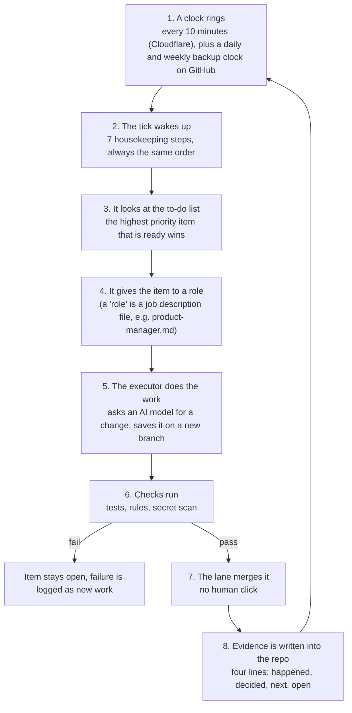

# How Ultrastable actually starts its own agents

> Ultrastable is the foundation for any autonomous system.

Plain version, no jargon. Everything below exists in this repository today; where something has not run for real yet, it says so.

## The short story

A clock rings. Something looks at a to-do list, picks the most important item, hands it to a worker, a checker tests the result, and if the tests pass the change is merged. Then the clock rings again. No person needs to be awake.

## Step by step

1. **What triggers a tick.** A schedule. The main one is a Cloudflare cron (`*/10 * * * *`, set in `seed/ultrastable.json`). Backups: GitHub's daily schedule runs the executor (`.github/workflows/executor.yml`) and a weekly one runs every loop (`loop.yml`), so if one clock stops another still rings. A person or script can also run `python3 -m foundation launch` on any computer.
2. **What the tick does.** Seven steps in order (`seed/worker/src/tick.js`): reconcile (nothing may vanish without a recorded reason), release stuck claims, close finished owner cards, grade past predictions, update trust scores, dispatch work, check the improvement budget. A failing step is logged and the rest still run.
3. **What picks the work.** The to-do list is a table of items. The top ready item by priority (p0 first, then oldest) wins. Items waiting on something else are not ready.
4. **Which agent runs.** A role picks it up. Roles are plain files in `agents/roles/` (portfolio manager, project manager, product manager, operations, reviewer, staff). The model behind a role is chosen from the budget: budget zero uses the smallest model. For code work the executor (`foundation/executor.py`) calls the model with the role rules and the item text.
5. **Where it runs.** The clock and the list live on Cloudflare (a Worker and a database). The code-changing work runs as a GitHub Actions job, because it needs a checkout and a test runner. The Worker only rings that job (`seed/worker/src/executor.js`); if the Worker is silent, GitHub's own daily clock does it. Same command either way.
6. **Guard rails.** The executor can never touch workflows, policy files, git internals or secrets (`DENY_PREFIXES` in `executor.py`), changes at most 8 files, and claims the item first so two agents never do the same work.
7. **How it is verified and merged.** The change goes onto a branch and a draft pull request. The check suite runs. Another process (the lane, `scripts/lane.sh`) marks it ready and merges it when checks are green. A different actor than the author does the merge, which is the review rule.
8. **How it is remembered.** Each run appends a row to a log and the loops write evidence under `ops/loop-evidence/`. Anything not in the repo does not exist.

## A real trace from this repository's history

**2026-11-11, the first full pass of the loops (`ops/loop-evidence/2026-11-11.jsonl`, commit b88ab3d, "Launch the self-bootstrap loops").** Host: a Claude session running `python3 -m foundation launch`.

- Clock: the launch command (standing in for the cron).
- Tick: "tick 1 ran 7/7 steps; reconciled: 0 reopened, 50 became ready; dispatched 3 item(s)". The data: 9 roles, 56 items from `docs/issues/`, 11 trust rows.
- Pick: 3 items dispatched in priority order to the roles whose turn it was.
- Verify: the probes loop reported no verifier problems and listed three open gaps (SG-1, SG-2, SG-8), the plussing loop showed 5 of 6 finished items were improvements.
- Write-back: four lines saved to `ops/loop-evidence/LATEST.md` ("Open: 3 gap(s) in the register, 0 failing loop(s)").
- Follow-up in history: gap SG-2 ("nothing changes code by itself") is the one the next commits closed: `b9154cb` added the executor and the Worker dispatch (#202), and `5d3dbbe` merged the lane into the same line (#203).

**What has not happened yet, said plainly.** The executor has not yet produced a merged pull request on its own, because the model key (`ANTHROPIC_API_KEY`) is not bound in the repository; without it each run records `no-model-credential` and the next host with a key takes the item. Until a key is bound, the model-writing step is built and tested with a fake model, not proven live. The tick, the list, the checks and the merge lane are running. The very first real `--apply` of a brand-new organization on a fresh Cloudflare account is also still open (`docs/bootstrapping/bootstrapping.md`, last section).

## How a brand-new idea gets here

`IDEA.md` goes in. The seed reads it, finds out which accounts and tools exist (never reading secret values), picks models from the budget, plans roles and a first to-do list, writes the files, creates the database and Worker, and arms the clock. After that it is the loop above. A third party with an existing repo runs `python3 -m foundation upstream adopt` instead (see `docs/architecture/core-and-instances.md`).
