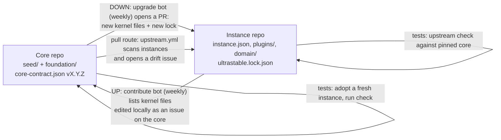

# One core, many instances

> Ultrastable is the foundation for any autonomous system.

Decision (2026-11-12, Rowan's request: "split cleanly, then merge so we work exclusively in Ultrastable"). Code: `foundation/upstream.py`, `core-contract.json`, `seed/instance-template/`, `.github/workflows/upstream.yml`, `scripts/upstream_scan.py`, `tests/foundation/test_upstream.py`.

## The rule

**Ultrastable core is the only place the platform is developed. QNFO is an instance: a repo that pins a core version and holds only config, plugins and domain content.** A third party with their own repo or a new idea is the same shape as QNFO. Nothing QNFO-specific lives in the core (`upstream leaks` fails the build if it does).

| Layer | Lives in | Owned by | Changes by |
|---|---|---|---|
| Core (kernel `seed/`, `foundation/`, contract) | `ultrastable/ultrastable` | the platform | PR to core only |
| Instance config | `instance.json` | the instance | PR in the instance |
| Instance plugins | `plugins/` (adapters behind the plugin boundary, `docs/architecture/plugins.md`) | the instance | PR in the instance |
| Instance domain content | `domain/`, `docs/PROJECT-MEMORY.md` | the instance | PR in the instance |
| Pinned kernel copy | `agents/`, `autonomy/`, `worker/`, ... (list in `core-contract.json`) | the core, copied | **only** by the upgrade bot |

## What the research says, and what was chosen

Each row cites a page that was fetched on 2026-11-12. Where the page did not cover a point, the row says so.

| Question | Finding (source) | Choice here |
|---|---|---|
| Template copy vs live link | Backstage: an app made from a template "doesn't receive template changes automatically"; you bump packages with `backstage-cli versions:bump`, read the `create-app` changelog for template changes, and run versioned codemods; the current version sits in `backstage.json` ([Keeping Backstage updated](https://backstage.io/docs/getting-started/keeping-backstage-updated)) | Copy once, then a versioned bump: `ultrastable.lock.json` plays the role of `backstage.json`, `upstream sync` the role of `versions:bump` |
| Template update that records the template version | Copier: `copier update` regenerates a project from the current template version, diffs it against yours and reapplies the diff; it needs the answers file and says never to edit it by hand; conflicts become inline markers or `.rej` files; versions come from the template's git tags; `copier check-update` signals an update through its exit code ([Copier: updating](https://copier.readthedocs.io/en/stable/updating/)) | Same idea, simpler: per-file digests in the lock instead of a regenerate-and-diff. A file the instance edited is never overwritten; it is reported as a conflict and as an upstream candidate. `upstream drift --fail` is the check-update equivalent |
| Staged upgrades and migrations | Nx: `nx migrate` first only rewrites `package.json` and writes `migrations.json`, then `nx migrate --run-migrations` applies them; each migration is tied to a version; moving one major at a time is "the safest path" ([Nx: update dependencies](https://nx.dev/docs/features/automate-updating-dependencies)) | Two stages as well: `sync` without `--apply` reports, with `--apply` writes. A major bump fails `upstream check` until a migration note exists; minor and patch flow automatically |
| Shared module layout | Terraform: reusable modules live in their own repository with the root module as the only required element, plus README, LICENSE, `main.tf`, `variables.tf`, `outputs.tf`, nested `modules/` and `examples/` ([Terraform module structure](https://developer.hashicorp.com/terraform/language/modules/develop/structure)). That page does **not** cover version pinning | Core is one repo with a stated public surface (`core-contract.json`). Version pinning is taken from Backstage and Copier above, not from Terraform |
| Monorepo vs polyrepo, submodule vs subtree, consumer-driven contract tests | Not yet sourced (the search returned titles only; the Spring Cloud Contract and Pact pages were not fetched) | Choices stand as engineering judgement, marked UNSOURCED: polyrepo with one source of truth, no submodules or subtrees because digests make local edits visible, contract tests in both repos |

Still unsourced and open: Cloudflare templates (for example the Deploy to Cloudflare button and `wrangler` templates) were not fetched; they matter for the third-party adoption path and are filed as a follow-up in the open items below.

## The two-way channel



- **Down (improvements to instances).** `ultrastable-upgrade.yml` in the instance checks out the core, runs `upstream sync` (copies changed kernel files, rewrites the lock, never overwrites a file the instance edited), runs `upstream check`, opens a PR. The instance's own lane merges it on green.
- **Up (fixes to the core).** A kernel file edited in an instance shows as a `local_edits` entry in `upstream drift`. `ultrastable-contribute.yml` files it as an issue (own repo always; core repo too when `CORE_WRITE_TOKEN` is bound). The executor on the core turns the issue into a PR; once merged and released, the next upgrade PR removes the difference.
- **Drift detector, two routes.** Pull: `upstream.yml` on the core scans every `instances/*/instance.json` that names a repo and opens an issue per diverged instance (needs `INSTANCE_READ_TOKEN`; otherwise the row is recorded as `unreachable`, never skipped). Push: the instance's contribute bot. Either route alone is enough.
- **Contract tests against both repos.** Core CI: `upstream contract --check` (kernel changed means a version bump and refreshed digests), `upstream leaks` (no instance values in the kernel), and the unit tests adopt a fresh instance, change the core, sync, and run `check`. Instance CI: the upgrade workflow runs `upstream check` with the core it just pulled.

## Bring your own repo

```
python3 -m foundation upstream adopt --out ../my-repo --name "My Project" --slug my-project
```

Additive and idempotent: existing files are never overwritten (they are reported as conflicts), the lock is written, and the two workflows are added. A new idea with no repo uses the same command on an empty folder, or the seed interview (`seed/bootstrap`). A third party needs no change to the core.

## QNFO cutover (ties to the account-transfer plan)

1. The current QNFO workers are classified in `core-manifest/boundary.json`: `core` workers move into the Ultrastable core, `app` workers stay with QNFO as its domain content and plugins, `personal` never moves.
2. Cloud move is `scripts/cf_account.py transfer` (inventory, copy, verify, cutover, rollback; nothing is deleted). The QNFO-side extraction PR (QNFO/qnfo-workers #103) is outside this session's repository scope and was not read; the stage list in `deploy/transfer/plan.json` is the only cutover plan checked here. Closing probe for the QNFO side: `python3 -m foundation upstream adopt --out <qnfo checkout> --name QNFO --slug qnfo` produces a PR whose `python3 -m foundation upstream check` passes, then `core` workers are removed from `qnfo-workers` in the same PR series.
3. After that PR merges, development of anything in the `core` class happens only in `ultrastable/ultrastable`; QNFO receives it through the weekly upgrade PR, and its own fixes come back through the contribute bot.

## Open items (each has a closing probe)

- Apply the adopt command to QNFO (blocked by repository scope; owner: cutover thread; probe: `instances/qnfo/README.md`).
- Source the UNSOURCED rows above and the Cloudflare template flow (probe: no `UNSOURCED` string in this file).
- Core releases are the `version` in `core-contract.json`; tagging a GitHub release on merge is a plus (probe: `git tag` lists the version).
