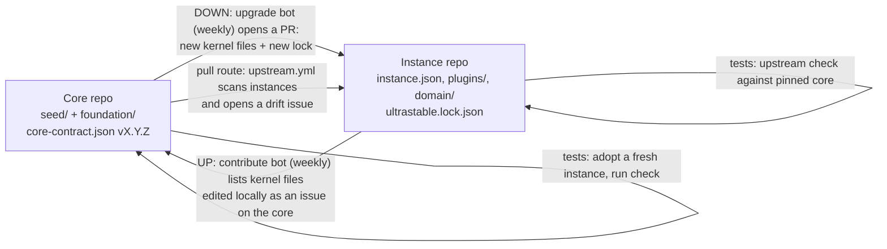

# One core, many instances

> Ultrastable is the foundation for any autonomous system.

Decision (2026-11-12, Rowan's request: "split cleanly, then merge so we work exclusively in Ultrastable"). Code: `foundation/upstream.py`, `core-contract.json`, `seed/instance-template/`, `.github/workflows/upstream.yml`, `scripts/upstream_scan.py`, `tests/foundation/test_upstream.py`.

## Where the core lives (corrected after reading ultrastable/workers #103)

The core has two code homes, and an instance pins both:

| Home | Holds | Pinned in the lock by |
|---|---|---|
| `ultrastable/ultrastable` | kernel (`seed/`: agent protocol, roles, policy, tick worker), `foundation/`, doctrine | `core.version` in `core-contract.json`, and per-file `digests` computed on demand and stored in the instance lock |
| `ultrastable/workers` | runtime code (`core/`, `adapters/`) that replaces the QNFO workers, plus the cutover tooling | `runtime.ref` (a git tag of that repo) |

The instance file in `workers` (`tools/instance_config.mjs`: slug, account id, routes, owner contact, repository, secret binding names) is kept here as `instance.runtime.json`. `upstream check` validates it with a port of the same rules (two or more routes, binding names only, `--strict` rejects placeholders), so one contract covers both homes. The foundation manifest `instance.json` (brand, goals, funding) stays separate: it describes the organization, the runtime file describes where it runs.

## The rule

**Ultrastable core is the only place the platform is developed. QNFO is an instance: a repo that pins a core version and holds only config, plugins and domain content.** A third party with their own repo or a new idea is the same shape as QNFO. Nothing QNFO-specific lives in the core (`upstream leaks` fails the build if it does).

| Layer | Lives in | Owned by | Changes by |
|---|---|---|---|
| Core (kernel `seed/`, `foundation/`, contract) | `ultrastable/ultrastable` | the platform | PR to core only |
| Instance config | `instance.json` | the instance | PR in the instance |
| Instance plugins | `plugins/` (adapters behind the plugin boundary, `docs/architecture/plugins.md`) | the instance | PR in the instance |
| Instance domain content | `domain/`, `docs/PROJECT-MEMORY.md` | the instance | PR in the instance |
| Pinned kernel copy | `agents/`, `autonomy/`, `worker/`, ... (list in `core-contract.json`) | the core, copied | **only** by the upgrade bot |

## What the research says, and what was chosen

Each row cites a page that was fetched on 2026-11-12. Where the page did not cover a point, the row says so.

| Question | Finding (source) | Choice here |
|---|---|---|
| Template copy vs live link | Backstage: an app made from a template "doesn't receive template changes automatically"; you bump packages with `backstage-cli versions:bump`, read the `create-app` changelog for template changes, and run versioned codemods; the current version sits in `backstage.json` ([Keeping Backstage updated](https://backstage.io/docs/getting-started/keeping-backstage-updated)) | Copy once, then a versioned bump: `ultrastable.lock.json` plays the role of `backstage.json`, `upstream sync` the role of `versions:bump` |
| Template update that records the template version | Copier: `copier update` regenerates a project from the current template version, diffs it against yours and reapplies the diff; it needs the answers file and says never to edit it by hand; conflicts become inline markers or `.rej` files; versions come from the template's git tags; `copier check-update` signals an update through its exit code ([Copier: updating](https://copier.readthedocs.io/en/stable/updating/)) | Same idea, simpler: per-file digests in the lock instead of a regenerate-and-diff. A file the instance edited is never overwritten; it is reported as a conflict and as an upstream candidate. `upstream drift --fail` is the check-update equivalent |
| Staged upgrades and migrations | Nx: `nx migrate` first only rewrites `package.json` and writes `migrations.json`, then `nx migrate --run-migrations` applies them; each migration is tied to a version; moving one major at a time is "the safest path" ([Nx: update dependencies](https://nx.dev/docs/features/automate-updating-dependencies)) | Two stages as well: `sync` without `--apply` reports, with `--apply` writes. A major bump fails `upstream check` until a migration note exists; minor and patch flow automatically |
| Shared module layout | Terraform: reusable modules live in their own repository with the root module as the only required element, plus README, LICENSE, `main.tf`, `variables.tf`, `outputs.tf`, nested `modules/` and `examples/` ([Terraform module structure](https://developer.hashicorp.com/terraform/language/modules/develop/structure)). That page does **not** cover version pinning | Core is one repo with a stated public surface (`core-contract.json`). Version pinning: Terraform pins registry modules with a `version` constraint and git sources with `?ref=` (tag, branch or SHA) ([Terraform module syntax](https://developer.hashicorp.com/terraform/language/modules/syntax)); `runtime.ref` is the same idea, a git tag of `ultrastable/workers` |
| Monorepo vs polyrepo | monorepo.tools (published by Nx, so it favours monorepos): in a monorepo a breaking change and every consumer fix land in one PR and no versioned packages are needed; in a polyrepo sharing code means "package publishing, and version management" and consumers must reconcile versions, but isolation buys autonomy ([monorepo.tools](https://monorepo.tools/)) | Polyrepo on purpose: instances have different owners, licences and secrets. The cost the page names (version management, sequenced fixes) is paid by the lock, the upgrade PR and the contribute bot |
| Submodule | Pro Git: the superproject records one commit per submodule (mode `160000`); a detached HEAD can lose submodule changes; pushing the superproject without the submodule commits breaks everyone's checkout; diverged pointers do not merge automatically ([Pro Git: Submodules](https://git-scm.com/book/en/v2/Git-Tools-Submodules)) | Not used. Those failure modes are what the per-file digest and the "local edits are never overwritten" rule avoid. Git subtree (Atlassian tutorial): the subproject's code lives in the parent repo and local fixes are ordinary commits there, sent upstream with `git subtree push`; "the responsibility of not mixing super and sub-project code in commits lies with you" ([Atlassian: git subtree](https://www.atlassian.com/git/tutorials/git-subtree)). So subtree does not hide edits, it leaves separating them to the committer; digests do that automatically |
| Consumer-driven contract tests | Pact: the consumer defines the contract, generated while running its own tests; only what a consumer uses is tested, so unused provider behaviour can change freely ([Pact docs](https://docs.pact.io/)). The page does not cover provider verification or `can-i-deploy` | `core-contract.json` lists what instances may rely on; `upstream check` is the consumer-side test run in every instance and in the core's CI against a fresh instance. Provider-side verification in the Pact sense is not implemented |
| Cloudflare template flow | A Deploy to Cloudflare button clones the source repo into the user's own Git account and provisions resources; the page does not describe how template updates reach the copy ([Deploy buttons](https://developers.cloudflare.com/workers/platform/deploy-buttons/)) | Same gap as a GitHub template, so the lock and upgrade PR are needed for third parties who start from a button |

Nothing in this table is unsourced as of 2026-11-12. Cloudflare's page was silent on template updates, which is recorded in its row, not guessed.

## The two-way channel



- **Down (improvements to instances).** `ultrastable-upgrade.yml` in the instance checks out the core, runs `upstream sync` (copies changed kernel files, rewrites the lock, never overwrites a file the instance edited), runs `upstream check`, opens a PR. The instance's own lane merges it on green.
- **Up (fixes to the core).** A kernel file edited in an instance shows as a `local_edits` entry in `upstream drift`. `ultrastable-contribute.yml` files it as an issue (own repo always; core repo too when `CORE_WRITE_TOKEN` is bound). The executor on the core turns the issue into a PR; once merged and released, the next upgrade PR removes the difference.
- **Drift detector, two routes.** Pull: `upstream.yml` on the core scans every `instances/*/instance.json` that names a repo and opens an issue per diverged instance (needs `INSTANCE_READ_TOKEN`; otherwise the row is recorded as `unreachable`, never skipped). Push: the instance's contribute bot. Either route alone is enough.
- **Contract tests against both repos.** Core CI: `upstream contract --check` (semver version, kernel paths in step with the generator; digests are computed on demand, never committed, because a committed copy goes stale whenever another change touches the kernel and made this PR fail CI), `upstream leaks` (no instance values in the kernel), and the unit tests adopt a fresh instance, change the core, sync, and run `check`. Instance CI: the upgrade workflow runs `upstream check` with the core it just pulled.

## Bring your own repo

```
python3 -m foundation upstream adopt --out ../my-repo --name "My Project" --slug my-project
```

Additive and idempotent: existing files are never overwritten (they are reported as conflicts), the lock is written, and the two workflows are added. A new idea with no repo uses the same command on an empty folder, or the seed interview (`seed/bootstrap`). A third party needs no change to the core.

## QNFO cutover (aligned with ultrastable/workers #103, merged 2026-11-11)

Two different moves share the word "cutover"; they must not be confused.

| Move | What changes | Tool | Plan |
|---|---|---|---|
| A. QNFO workers repo to Ultrastable runtime code | The code in the QNFO workers repo is replaced by `ultrastable/workers` code; QNFO keeps an instance file and its 12 app and 8 personal workers | `tools/instance_config.mjs`, `tools/parity_smoke.mjs` in `ultrastable/workers` | `docs/cutover/PLAN.md` stages 0 to 8 |
| B. Ultrastable's own assets between Cloudflare accounts | `ultrastable-*` workers and D1 move from the QNFO account to the Ultrastable account | `scripts/cf_account.py transfer` here | `deploy/transfer/plan.json` stages 1 to 5 |

How the core/instance model sits on move A:

1. **Stage 1, config extraction** produces QNFO's `instance.runtime.json` (private, in the QNFO repo, never in the core: the workers repo's `no-qnfo` guard stays green). `upstream check` now validates it with the same rules as the workers validator. Open gap X-1: real values need QNFO repo access.
2. **Stages 2 to 6** (shadow deploy, data bridge, unit-by-unit traffic move, scheduler handover, shim retirement) are runtime work in `ultrastable/workers`; the parity contract (`docs/cutover/parity-contract.json`) is the gate. Shims S-1 to S-7 live in the QNFO overlay, which is exactly the instance's `plugins/` and `domain/`.
3. **Stage 7, replace** becomes `python3 -m foundation upstream adopt --out <QNFO checkout> --name QNFO --slug qnfo` plus a lock with `runtime.ref` set to a `ultrastable/workers` tag. Gap X-3 stands: the PR is opened by the QNFO fleet's own lane, not from here.
4. From then on, core changes happen in `ultrastable/ultrastable` and `ultrastable/workers` only; QNFO receives them through the weekly upgrade PR and sends fixes back through the contribute bot. `core-manifest/boundary.json` is superseded by `extraction/boundary.json` in the workers repo for the worker classification.

Move B is independent of A and continues on its own stages; the Cloudflare reconnect it needs is on `NEEDS-YOU.md`.

## Open items (each has a closing probe)

- Apply the adopt command to QNFO at workers cutover stage 7 (gap X-3; owner: QNFO fleet lane; probe: `python3 -m foundation upstream check --instance <qnfo checkout>` exits 0).
- `ultrastable/workers` release tags: workflow added in workers PR #107; first tag `v0.1.0` is cut by dispatching it (probe: `gh release list` shows it).
- Instance dependencies owed by an instance lane are recorded in `instances/<slug>/dependencies.json` (owner, trigger, probe) and printed by `scripts/upstream_scan.py`; QNFO's two are there.
- Core releases are the `version` in `core-contract.json`; tagging a GitHub release on merge is a plus (probe: `git tag` lists the version).
