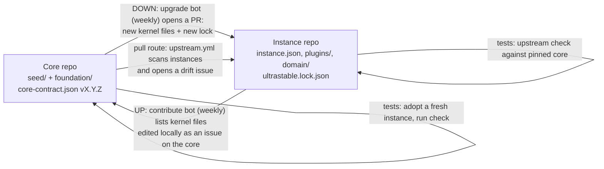

# One core, many instances

> Ultrastable is the foundation for any autonomous system.

Decision (2026-11-12, Rowan's request: "split cleanly, then merge so we work exclusively in Ultrastable"). Code: `foundation/upstream.py`, `core-contract.json`, `seed/instance-template/`, `.github/workflows/upstream.yml`, `scripts/upstream_scan.py`, `tests/foundation/test_upstream.py`.

## The rule

**Ultrastable core is the only place the platform is developed. QNFO is an instance: a repo that pins a core version and holds only config, plugins and domain content.** A third party with their own repo or a new idea is the same shape as QNFO. Nothing QNFO-specific lives in the core (`upstream leaks` fails the build if it does).

| Layer | Lives in | Owned by | Changes by |
|---|---|---|---|
| Core (kernel `seed/`, `foundation/`, contract) | `ultrastable/ultrastable` | the platform | PR to core only |
| Instance config | `instance.json` | the instance | PR in the instance |
| Instance plugins | `plugins/` (adapters behind the plugin boundary, `docs/architecture/plugins.md`) | the instance | PR in the instance |
| Instance domain content | `domain/`, `docs/PROJECT-MEMORY.md` | the instance | PR in the instance |
| Pinned kernel copy | `agents/`, `autonomy/`, `worker/`, ... (list in `core-contract.json`) | the core, copied | **only** by the upgrade bot |

## What the research says, and what was chosen

| Question | Practice found | Choice here |
|---|---|---|
| Fork vs template vs dependency | A GitHub template copies once and never syncs; a fork keeps history but drifts silently. Template tools that keep a record of the template version and re-apply it (Copier, cruft) are the recommended answer for "generate once, keep updating". | Template-plus-lock: `ultrastable.lock.json` records the core version and a digest per kernel file, like a Copier answers file |
| Vendoring vs package | Backstage's `create-app` also copies code into your repo and ships a version-bump flow (`backstage-cli versions:bump`) rather than a library you cannot read. Terraform modules pin by exact version tag. Nx ships `nx migrate` with codemods per major. | The kernel is vendored (agents must read it in-repo, and no package registry is needed) and bumped by version, with migration notes per major |
| Submodule / subtree | Submodules pin by commit but are hostile to agents and to non-coders; subtree makes local edits invisible. | Not used. Digests make local edits visible instead |
| Monorepo vs polyrepo | Monorepos make atomic changes easy and need heavy tooling; polyrepos isolate ownership but drift. | Polyrepo with one source of truth: instances are separate repos (separate owners, licences, secrets) tied by the lock |
| Contract between layers | Consumer-driven contract tests catch breakage before release. | `core-contract.json` plus `upstream check`, run in the core against a freshly adopted instance and in every instance against its pinned core |
| Version rule | Semver: patch and minor flow automatically, a major needs a migration note and is not auto-merged. | `check` fails on a major mismatch |

Sources consulted: Backstage "Keeping Backstage updated" (backstage.io/docs/getting-started/keeping-backstage-updated), Terraform module versioning guides (Spacelift, oneUptime), Copier and Diamond Light Source "Switch to Copier" ADR, GitHub community discussion 23528 "How to sync repository template changes?", DevRev "Learnings from using GitHub template repositories", Spring Cloud Contract and Pact consumer-driven contract docs. Search results were titles and summaries; the Nx, Terraform and Backstage specifics above are from background knowledge and are labelled as such, not quoted.

## The two-way channel



- **Down (improvements to instances).** `ultrastable-upgrade.yml` in the instance checks out the core, runs `upstream sync` (copies changed kernel files, rewrites the lock, never overwrites a file the instance edited), runs `upstream check`, opens a PR. The instance's own lane merges it on green.
- **Up (fixes to the core).** A kernel file edited in an instance shows as a `local_edits` entry in `upstream drift`. `ultrastable-contribute.yml` files it as an issue (own repo always; core repo too when `CORE_WRITE_TOKEN` is bound). The executor on the core turns the issue into a PR; once merged and released, the next upgrade PR removes the difference.
- **Drift detector, two routes.** Pull: `upstream.yml` on the core scans every `instances/*/instance.json` that names a repo and opens an issue per diverged instance (needs `INSTANCE_READ_TOKEN`; otherwise the row is recorded as `unreachable`, never skipped). Push: the instance's contribute bot. Either route alone is enough.
- **Contract tests against both repos.** Core CI: `upstream contract --check` (kernel changed means a version bump and refreshed digests), `upstream leaks` (no instance values in the kernel), and the unit tests adopt a fresh instance, change the core, sync, and run `check`. Instance CI: the upgrade workflow runs `upstream check` with the core it just pulled.

## Bring your own repo

```
python3 -m foundation upstream adopt --out ../my-repo --name "My Project" --slug my-project
```

Additive and idempotent: existing files are never overwritten (they are reported as conflicts), the lock is written, and the two workflows are added. A new idea with no repo uses the same command on an empty folder, or the seed interview (`seed/bootstrap`). A third party needs no change to the core.

## QNFO cutover (ties to the account-transfer plan)

1. The current QNFO workers are classified in `core-manifest/boundary.json`: `core` workers move into the Ultrastable core, `app` workers stay with QNFO as its domain content and plugins, `personal` never moves.
2. Cloud move is `scripts/cf_account.py transfer` (inventory, copy, verify, cutover, rollback; nothing is deleted). The QNFO-side extraction PR (QNFO/qnfo-workers #103) is outside this session's repository scope and was not read; the stage list in `deploy/transfer/plan.json` is the only cutover plan checked here. Closing probe for the QNFO side: `python3 -m foundation upstream adopt --out <qnfo checkout> --name QNFO --slug qnfo` produces a PR whose `python3 -m foundation upstream check` passes, then `core` workers are removed from `qnfo-workers` in the same PR series.
3. After that PR merges, development of anything in the `core` class happens only in `ultrastable/ultrastable`; QNFO receives it through the weekly upgrade PR, and its own fixes come back through the contribute bot.

## Open items (each has a closing probe)

- Apply the adopt command to QNFO (blocked by repository scope; owner: cutover thread; probe: `instances/qnfo/README.md`).
- Core releases are the `version` in `core-contract.json`; tagging a GitHub release on merge is a plus (probe: `git tag` lists the version).
