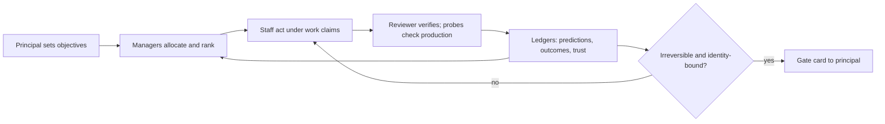

<!-- SPDX-License-Identifier: LicenseRef-Ultrastable-USL-1.0 -->
<!-- Copyright (c) 2026 Rowan Brad Quni-Gudzinas -->

# Concepts: overview

Three ideas carry Ultrastable.

1. **Virtual staff in an organization structure.** A portfolio manager, project managers, product managers and staff agents, each owning one level of the work, the way a real organization is staffed. See [Virtual staff](virtual-staff.md).
2. **Closed feedback loops.** Every action is predicted, executed, verified and compared with its prediction. Outcomes feed a trust ledger that decides how much autonomy each pair of surface and action class gets next. See [Feedback loops](feedback-loops.md) and [Trust and autonomy](trust-and-autonomy.md).
3. **Plussing.** Improvement is planned work, not a leftover. Every finished item proposes the next way to make it better, and capacity is reserved so the system does not collapse into bug fixing. See [Plussing](plussing.md).

People set direction and approve the steps that cannot be undone. The virtual staff carries everything else end to end. See [Governance](governance.md) for what people decide and [Work claims](work-claims.md) for how many agents share work safely.

