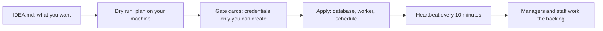

<!-- SPDX-License-Identifier: LicenseRef-Ultrastable-USL-1.0 -->
<!-- Copyright (c) 2026 Rowan Brad Quni-Gudzinas -->

# Getting started: from an idea file to a running organization

## Who this is for

You can say what you want. You do not need to be a coder or an engineer, and you do not need to know what you do not know. Ultrastable assumes that. You state what you want in plain words; the system works out what it needs to know, asks you for it in plain words (with examples and stated defaults, never jargon; see [US-SPEC-16](../specs/US-SPEC-16-ignorance-and-prompted-recall.md)), writes its own specifications, charters and plans from your answers (see [US-SPEC-15](../specs/US-SPEC-15-management-lifecycle.md)), and manages the build. What it manages is the delivery of what you asked for. It does not write business plans, funding applications, legal filings or marketing material; those are outside scope unless you switch on an optional Capability Pack (see [SCOPE.md](../SCOPE.md)).

Be clear about what works today. The pieces below carry honest labels: **BUILT** (code with passing tests), **RUNNING** (in production in QNFO), **PLANNED**.

## The path



### 1. Write the idea file (BUILT)

Open `IDEA.md` in the seed and fill it in. It is the only file you write.

```
---
org_name: Tool Share
slug: tool-share
owner: Your Name
owner_contact: set-in-secret-store   # never put an email or token here
---
# Idea
A neighbourhood tool library where people borrow tools instead of buying them, booked from a phone.
# Who it is for
- Renters and new homeowners who need a tool once or twice a year
# First outcomes
- A landing page that explains the idea and collects interest
- A booking prototype that ten neighbours try
# Constraints
- Budget per month: 50 USD
- Nothing public until the owner says so
```

Each outcome becomes a project with its own project manager and product manager. The budget picks the model tier (0 selects the smallest; 50 and 500 select larger tiers). A constraint containing "nothing public" adds a hold item that outranks the setup items.

### 2. Dry run (BUILT)

Needs Python 3.11 or later and nothing else. From the seed folder: `python3 bootstrap/bootstrap.py --dry-run`. It writes an `org/` folder (charter, roles, backlog, gate cards, seed SQL, boot log) and prints a four-line report. Nothing leaves your machine. With no credentials it still completes. For the example above, expect 4 of 7 stages ok, 10 role instances, 9 backlog items and 5 gate cards (verified in a simulation on 2026-11-10 and by the seed's test suite; 12 Python tests passed on 2026-11-11).

### 3. Gate cards (BUILT)

A missing credential never stops the boot. Each one becomes a gate card with what is needed, why only you can supply it, what stays in dry-run meanwhile, and a closing probe, so it closes itself when the value appears. You supply:

| Card | What | Why only you |
|---|---|---|
| `CLOUDFLARE_API_TOKEN`, `CLOUDFLARE_ACCOUNT_ID` | Runtime for the database, worker and schedule | A credential only you can create |
| `ANTHROPIC_API_KEY` | The model API the roles use | Same |
| `GITHUB_TOKEN` | Repositories for the code | Same |
| `GATE-BUDGET` | Approval to spend up to your stated budget | Spending your money is identity-bound; the default is "free tiers only" |
| `CHAT_WEBHOOK_URL` (optional) | Where reports go | Optional |

Secrets live only in the platform secret store. The system records whether each one exists, never its value.

### 4. Apply (code present; never run on a fresh account)

`python3 bootstrap/bootstrap.py --apply` creates the database (or reuses one with the same name), applies the migrations, loads the seed rows and deploys the worker with a ten-minute cron. It is meant to run once, from continuous integration or a machine with your Cloudflare token set. **The first real run against a fresh account has not been performed as of 2026-11-11.** Expect to hit defects; a failure does not stop the boot, it becomes a `BOOT-PROVISION` backlog item containing the last 400 characters of the error. Without credentials, apply exits with code 2 and says why.

### 5. The heartbeat (BUILT in tests; RUNNING in QNFO)

Once deployed, the worker's cron calls one tick every ten minutes: reconcile, reap stale claims, probe gate cards, score predictions, accrue trust, dispatch, check plus share. `GET /health` returns the last tick's four-line report: 200 if all seven steps ran, 503 otherwise. The setup item "heartbeat" closes only when six complete ticks are seen in an hour.

## What is not automated yet

| Step | Status |
|---|---|
| Fully hands-off setup with no command line | PLANNED: today a command-line step starts the bootstrap |
| Prompted-recall questions in plain words, needs register, readiness score | PLANNED in the seed; RUNNING in QNFO as an owner question queue |
| System writes its own specifications and management records | PLANNED in the seed; the specification set in this repository is the target form |
| A model-calling executor, so staff roles actually do the work | PLANNED. Today the tick claims and dispatches items but no component calls a model and reports back, so no seed item reaches done by itself |
| Repository creation and protection | PLANNED; needs your GitHub token, listed as a gate card |
| One-command install, signed bundle, multiple tenants | PLANNED |
| Dashboard for the organization | PLANNED; a fleet dashboard runs in QNFO |
| Gate card approval from a phone or notification | PLANNED |

## If something goes wrong

- Read `org/boot-report.md` and `org/boot-log.json`.
- A step that fails files its own item (`BOOT-<STAGE>` for the bootstrap, `TICKFAIL-<step>-<hour>` for the tick). Fix the cause; the item closes when its probe passes.
- Nothing destructive happens without an export first, and nothing irreversible and identity-bound happens without a gate card.

Specifications: [US-SPEC-10](../specs/US-SPEC-10-kit-and-seed.md), [US-SPEC-16](../specs/US-SPEC-16-ignorance-and-prompted-recall.md), [US-SPEC-03](../specs/US-SPEC-03-tick.md).
