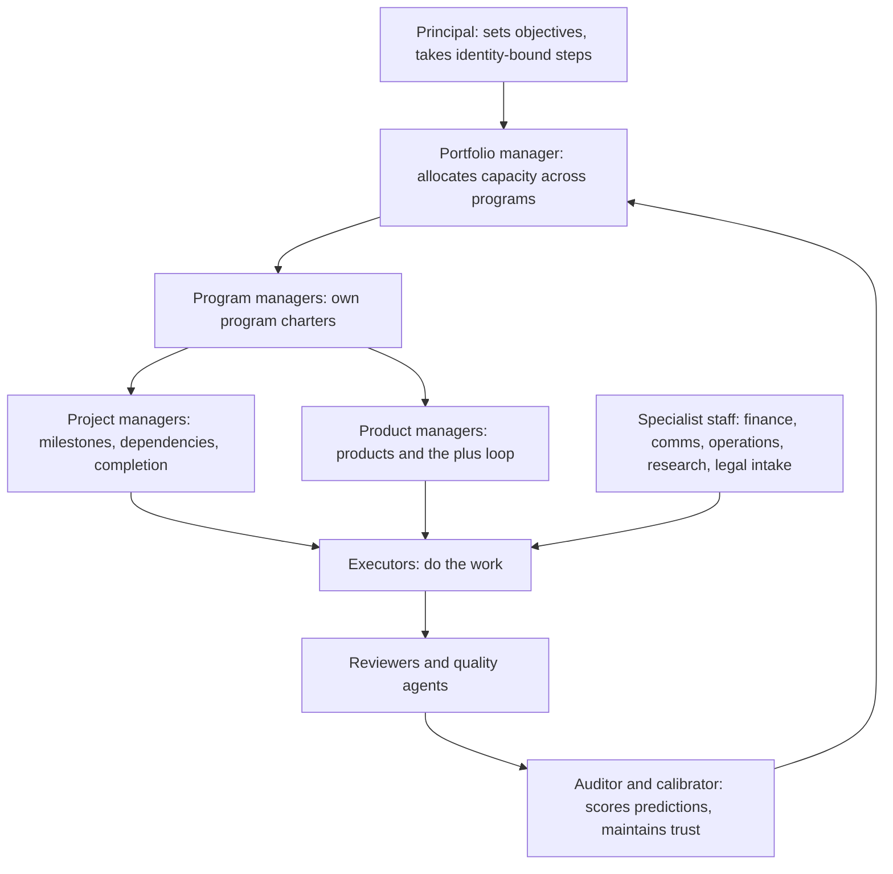

<!-- SPDX-License-Identifier: LicenseRef-Ultrastable-USL-1.0 -->
<!-- Copyright (c) 2026 Rowan Brad Quni-Gudzinas -->

# US-SPEC-02: Virtual staff hierarchy and roles

| Field | Value |
|---|---|
| ID | US-SPEC-02 |
| Title | Virtual staff hierarchy and roles |
| Version | 0.1.0 (draft) |
| Date | 2026-11-11 |
| Status | Draft |

## 1. Purpose

Ultrastable staffs an organization with virtual managers and staff, each owning one level of the work, as a real organization is staffed. This specification defines the roles, what each may do (its decision authority), how roles are separated into lanes, and how a role may be filled by a person.

## 2. Terms

| Term | Definition |
|---|---|
| Persona | A role together with a record defining its scope, charter and decision authority. |
| Decision authority | The enumerated set of record operations a persona may perform. |
| Lane | A boundary within which a persona acts and outside which it neither writes nor reads. |
| Brief | A plain-language record of what a persona did and decided on a tick. |
| Plane | A separated body of state with its own personas (for example an organization plane and a private plane). |

## 3. Hierarchy

| Role | Owns | Outputs |
|---|---|---|
| Portfolio manager | Allocation of focus slots across programs | Risk-based allocation, escalate or constrain verdicts |
| Program manager | One program charter | Focus set, priority operations, originated work |
| Project manager | Delivery of one project | Dispatch, unblocking, status |
| Product manager | One product and its plus loop | Pluses, keep or revert decisions |
| Staff | Execution of an assigned item | Verified change, evidence, a proposed plus |
| Reviewer | Independent verification | Pass or fail with evidence; never the author of the change |
| Operations | Running systems | Remediation, failure-mode records |
| Auditor and calibrator | Predictions and trust | Scored predictions, ledger updates |

## 4. Normative requirements

- **US-02-R01 [L1]** An implementation MUST define each role as a record naming at least its role, scope and instruction source (a file or prompt), and MUST list the roles in the `roles` table with a tick interval and model.
- **US-02-R02 [L1]** A role instance MUST be dispatched an item only when the item's `owner_role` equals the instance's role (US-SPEC-03).
- **US-02-R03 [L1]** A reviewer MUST be a different agent from the doer of the item it reviews. A reviewer SHOULD run on a different model family from the doer when two families are available.
- **US-02-R04 [L1]** Roles MUST be configuration. Adding a role MUST NOT require changing the tick procedure.
- **US-02-R05 [L2]** A persona's decision authority MUST be an enumerated list, and the managerial tick MUST apply only the operations listed for the persona performing it.
- **US-02-R06 [L2]** Every operation a persona performs MUST be recorded with its identifier, the item, the from value, the to value and its evidence, and MUST be reversible by recording the reverse.
- **US-02-R07 [L2]** A persona MUST write one brief per tick it runs.
- **US-02-R08 [L2]** A program manager MAY promote, restore, close with evidence, supersede and assign a doer within its own program only. A portfolio manager MAY demote machine-filed items across programs.
- **US-02-R09 [L2]** A persona of a separated plane MUST originate no roadmap items in another plane and MUST be denied read access to another plane's stores. The denial MUST be enforced by the tool layer from the requester's identity, not only by prompt text.
- **US-02-R10 [L2]** Control-plane files (the tick, policy, governance and permission configuration) MUST NOT be originated by managers. They change only by a reviewed change under a claim (US-SPEC-07).
- **US-02-R11 [L1]** Any role MAY be filled by a person. The same records, predictions, briefs and trust accounting MUST then apply to that person's decisions.
- **US-02-R12 [L1]** Every role instruction file MUST include a "never" list that names at least: acting on another agent's live claim, handling secret values, and reviewing one's own work.

## 5. Behavior

A role instance is a row plus an instruction file. On each tick where `tick_number % tick_every = 0`, the dispatcher offers it one ready item for its role (US-SPEC-03). The instance claims the item, acts, records an outcome and a prediction, and hands to a reviewer. Managers differ from staff only in what they own: allocation, ranking and origination instead of execution.

### Decision authority example

| Persona | May | May not |
|---|---|---|
| Program manager | Promote a focus item from medium to high; close a trigger-filed item when its metric is back on target; supersede an older duplicate; assign a doer | Touch another program's items; edit tick or policy files |
| Portfolio manager | Allocate slots; demote a machine-filed critical item older than 24 h with no doer | Close items with evidence |
| Reviewer | Approve or hold a change | Author the change it reviews |

## 6. Failure modes

| Failure | Effect | Mitigation |
|---|---|---|
| Persona deletes another persona's rows | Lost priority scores | US-01-R07, US-02-R06 |
| Self-review | Defects pass unseen | US-02-R03 |
| Prompt-only lane separation | A crafted prompt reads another plane | US-02-R09 enforced by tool layer |
| All aliases map to one model at the lowest budget | Reviewer and doer share a family | Deploy-time check (US-SPEC-14), tier rules (US-SPEC-10) |

## 7. Conformance tests

- **US-02-T01** Dispatch with an item owned by `portfolio-manager` and only a `staff` instance due. Pass: not dispatched to staff. Fail: staff claims it.
- **US-02-T02** Add a role row and an instruction file; run a tick. Pass: the role receives dispatches with no code change. Fail: code change needed.
- **US-02-T03** Ask a private-plane persona's tool layer for a query over organization-plane item text. Pass: denied. Fail: rows returned.
- **US-02-T04** Inspect a reviewer assignment where two model families exist. Pass: reviewer family differs from doer. Fail: same family.

## 8. Reference implementation status

- Roles as data: BUILT. The six seed roles (portfolio-manager, project-manager, product-manager, staff, reviewer, operations) have instruction files in `agents/roles/` and are configured in `ultrastable.json`; instances are rows in `roles` created by the bootstrapper (`bootstrap/bootstrap.py`, tests in `tests/test_seed.py`). The dispatcher in `core/src/tick.js` (`dispatch`) filters by `owner_role`; US-02-T01 and US-02-T02 are asserted in `core/staff/staff.test.js`.
- Reviewer-differs-from-doer: BUILT as tier selection in the bootstrapper (`bootstrap/bootstrap.py`) and as a check at review time in `core/kernel/lifecycle.js` (`reviewArtifact` refuses the same agent, and the same model family when both are known; `core/kernel/lifecycle.test.js`). At the lowest budget tier all aliases coincide, so the family differs only if a second provider is configured (a known limit of the seed).
- Decision authority lists, persona actions, briefs and tool-layer lane enforcement (US-02-R05 to R10, US-02-T03): BUILT as a module in `core/staff/index.js` with `core/staff/migrations/0001_staff.sql`, tests in `core/staff/staff.test.js`. A persona is a row with an enumerated authority; `act` applies only listed operations, records each with its from value, to value and evidence, and reverses by recording the reverse; `items` and `readStore` refuse another plane from the persona row, not from an argument; `writeBrief` keeps one brief per persona per tick; control-plane paths are refused. Limits: the kernel's slot allocation runs by rule and is logged as the portfolio persona's operation, not gated by its list; the lane holds for callers of the tool layer, so a runtime must hand agents that layer and not the store handle. RUNNING in QNFO (one portfolio manager and five program managers on an hourly tick).
- Starting the staff step in the composition root (`core/org/buildout.js`, test `core/org/org.test.js` issue #201), on by default: BUILT (`core/org/buildout.js`, `core/org/org.test.js`). Not yet seen running on a deployed account, and no persona rows are seeded by the bootstrapper: PLANNED.
- Roles filled by people (US-02-R11): BUILT for the records in `core/staff/index.js` (`filled_by: 'person'`: the same action row, prediction, brief and trust outcome; the tick never acts for a person), tests in `core/staff/staff.test.js`.
- A console screen through which a person performs a role's operations: PLANNED. The tool layer is the interface it would call.
