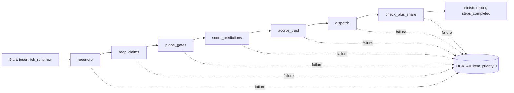
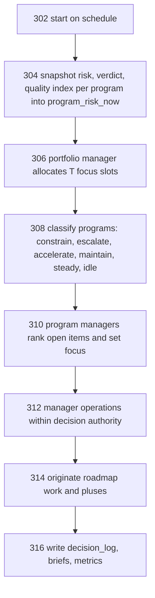

<!-- SPDX-License-Identifier: LicenseRef-Ultrastable-USL-1.0 -->
<!-- Copyright (c) 2026 Rowan Brad Quni-Gudzinas -->

# US-SPEC-03: The tick and its state machine

| Field | Value |
|---|---|
| ID | US-SPEC-03 |
| Title | The tick (the periodic manager tick and state machine) |
| Version | 0.1.0 (draft) |
| Date | 2026-11-11 |
| Status | Draft |

## 1. Purpose

The tick is the heartbeat of the organization. One call is one tick: an ordered list of guarded steps that reconciles state, scores predictions, updates trust and dispatches work. The heartbeat runs on the platform, not in a person's session, so the organization operates when nobody is present. This specification defines the L1 tick (seven core steps every implementation carries, and the longer ordered step list the seed runs, section 3.3), the L2 managerial tick (risk, slot allocation, focus, operations, origination) and the L3 kernel step list.

## 2. Terms

| Term | Definition |
|---|---|
| Tick | One execution of the step list. |
| Step | One named, guarded unit of the tick. |
| Slot | One expected time-aligned firing of a tick. |
| Focus slot | A unit of capacity a portfolio manager grants a program (L2). |
| Four-line report | What happened, what was decided, what is next, what is open. |
| Core steps | The seven steps of section 3.1. An implementation MAY run more steps around them (section 3.3). |
| Deferred step | A step the tick decides not to run on this slot because of a cost level. It counts as completed (section 3.4). |
| Second producer | A route other than the scheduler that starts a tick when the newest one is too old (section 3.6). |

## 3. L1 tick

Each step is wrapped in its own guard. A failing step appends to the tick's error list and files `TICKFAIL-<step>-<hour>` (owner `operations`, priority 0); the remaining steps still run. The diagram shows the seven core steps; `steps_total` is the length of the step list the implementation declares, not the constant seven (US-03-R17).

### 3.1 Core step definitions

| # | Step | Behavior |
|---|---|---|
| 1 | `reconcile` | Every item with status `done`, `superseded` or `cancelled` and no disposition is set to `open` and a `silent_drop` outcome is recorded; every `open` item whose `trigger_on` is null or names a `done` item becomes `ready`. A runtime reads and changes only its own tenant's rows (US-01-R12). In the seed the step also hires every manager the register switches on that has no `roles` row (US-02-R13). |
| 2 | `reap_claims` | Claims whose `heartbeat_at` is older than the claim time-to-live (default 120 minutes) are deleted and their `claimed` items return to `ready`. In the seed the item's queued `dispatches` row is marked `released`, which the metric `claims_released_unworked_24h` counts (target 0). |
| 3 | `probe_gates` | Each open gate card's closing probe is evaluated (`env:<NAME>` is satisfied if the secret binding exists; `item_done:<id>` if the item is done; `manual` never by the tick; in the seed also `owner_items:<n>`, satisfied when no item is parked as owner-only, and `connector:<provider>`, satisfied when every stored credential of that provider is ok). A satisfied card is closed. |
| 4 | `score_predictions` | Predictions with null verdict and `due_at` not after now are evaluated against the built-in metric table; verdict `hit` or `miss`. An unknown metric or operator scores `miss`. |
| 5 | `accrue_trust` | Outcomes are grouped by (surface, action class) into reliability, upserted to the ledger; a promotion or demotion indication opens a `LADDER-*` item (US-SPEC-06). |
| 6 | `dispatch` | For each role due on this tick and under its work-in-progress cap, claim the highest-priority ready item for that role and write a `dispatches` row. In the seed an event may wake one role out of turn, a manager switched off in the register is skipped, and while k_eff is under its floor a role takes an item that raises it first and falls back to the head of its queue. The `dispatches` row carries the model `pending` until the doer records what ran. |
| 7 | `check_plus_share` | If at least 10 items are done and the plus share of the last 20 is below half of target, open `REBALANCE-<date>` (US-SPEC-04). |

### 3.2 Report

The tick ends by writing a four-line report to `tick_runs.report`, plus `finished_at`, `steps_completed` and `errors`. A health route returns the latest row, status 200 if `steps_completed = steps_total`, otherwise 503. The row judged is the newest finished tick; a tick still unfinished after 5 minutes is itself the newest row and reads as a failure (US-03-R20). In the seed the health answer also carries the ignition stage the system read for itself and `claims_released_unworked_24h`, and a halted system answers 200 with `halted: true`.

### 3.3 The seed step list

The seed runs the core steps inside a longer list. The order below is `STEP_ORDER` in `seed/worker/src/tick.js`; the relative order of the core steps is the order of section 3.1.

| # | Step | Behavior |
|---|---|---|
| 1 | `migrate` | Applies pending schema migrations through the tick's own store handle, each recorded once with the hash of its file. An applied file whose text changed is drift: reported, never re-run. A file that drops a table or column without a copy is refused (US-01-R13). A failed or drifted file files `MIGRATION-<file>`. |
| 2 | `reconcile` | Core step 1. |
| 3 | `reap_claims` | Core step 2. |
| 4 | `connector_health` | Reads every stored connector: last good refresh, expiry and consecutive failed refreshes. Two failed refreshes in a row open one gate card `GATE-RECONNECT-<provider>` whose prepared step is the consent link; `probe_gates` closes it when the connector is ok again. |
| 5 | `probe_gates` | Core step 3. |
| 6 | `score_predictions` | Core step 4. |
| 7 | `measure` | Reads every metric of this tenant through its probe (US-SPEC-05 section 3.5). A metric outside its healthy condition files `BREACH-<metric>` and the item closes when the probe passes again; a reading older than twice the tick cadence files `STALE-<metric>`. The liveness metrics are seeded by the step itself when absent. |
| 8 | `accrue_trust` | Core step 5. |
| 9 | `selfaudit` | Probes the failure-mode register (US-SPEC-17) and runs the dispatch loop-breaker (US-08-R18). |
| 10 | `unknowns` | Files at most a configured number of inverted questions about the system's own open items as plus items (US-SPEC-16). |
| 11 | `goals` | Reads every goal, moves at most one bounded knob per goal one step toward its target, reviews earlier moves and reverts those that did not help. |
| 12 | `dispatch` | Core step 6. |
| 13 | `execute` | The in-tick doer: every claimed item ends done, parked with a reason, superseded, or waiting with its claim kept, each with an outcome row (US-08-R16). |
| 14 | `check_plus_share` | Core step 7. |
| 15 | `age_sla` | Items `open` or `ready` for more than 120 minutes are raised to priority 5 and one `AGE-120M-<date>` item names the cause to find (US-08-R17). |
| 16 | `cost_probe` | Once a day, while the cost level is ok, each breached cost sample becomes a `COST-BREACH-<target>-<date>` item (US-SPEC-09). |
| 17 | `pulse` | Compares each loop's expected slots with the slots it ran in; a loop that did not run files `MISSED-<loop>` (US-SPEC-11). |
| 18 | `criticality` | Computes k_eff over the rolling window; a tick may not end idle or under the floor without originating the highest-value item (US-SPEC-23). |
| 19 | `ignition` | Reads the stage from bootstrap to criticality from the system's own tables; the first unmet stage is filed as `IGNITE-<stage>`. |

A step whose configuration is absent (no failure-mode register, no goals, no unknowns doctrine, no criticality thresholds) records that in the report and completes.

### 3.4 Deferral under cost levels

Before the steps run the tick reads three levels: a breach of a per-database read budget, the account's daily free-allowance level (`ok`, `degrade`, `shed`) and the soft spend level (`full`, `throttle`, `crawl`). No level stops the clock and no step is skipped for good.

| Condition | Steps that run every tick | The other steps |
|---|---|---|
| Lean (a read-budget breach, or the free allowance at `shed`) | `migrate`, `reconcile`, `measure`, `criticality` | Run on the first tick of every third hour |
| Spend `crawl` | The four above plus `reap_claims`, `dispatch`, `execute` | Run every third hour, or at the interval the spend knobs set |
| `degrade`, or spend `throttle` or `crawl` | Everything except the wide readers | The wide readers (`probe_gates`, `score_predictions`, `accrue_trust`, `selfaudit`, `pulse`, `ignition`, `check_plus_share`, `goals`, `age_sla`, `cost_probe`) run once an hour |

A deferred step counts as completed: it is a decision, not a failure, so the health route stays green. Under lean or degrade the `goals` step still runs on the first tick of each hour, and its goal rows are seeded if the table is empty, so a cost breach cannot freeze the knobs that answer it. A read-budget breach is also recorded in `org` under `cost_breach` with the time it lapses.

### 3.5 Schema heal and origination cap

A step that throws because a table or column is missing does not file a failure at once: `migrate` runs again and the step is retried once in the same tick. Only a second failure, or any other error, files `TICKFAIL-<step>-<hour>`.

Items the tick files for itself go through one function that refuses a duplicate identifier and counts each filing against a daily cap (default 20). Past the cap the item is not filed and the refusal is counted in the budget ledger. The unknowns step and findings that must not be lost draw from their own reserve outside this cap.

### 3.6 Second producer

The scheduler is not the only trigger. A route (`POST /pulse/watch` in the seed) leaves a beat every time it is called and runs a tick itself when the newest `tick_runs` row is older than two tick intervals. The interval is read from the tick's own history. The halt switch stops this route with the scheduler (US-SPEC-09).

## 4. L2 managerial tick

An hourly tick for the portfolio manager and program managers, in this order.

**Risk.** `risk = 3*H + 0.3*O + 15*G + 2*S`, where H is open high-priority items, O open items, G guard-metric breaches, S stalled projects. Verdict is RED if a guard or the primary metric is in breach, AMBER if H > 0 or S > 0, otherwise GREEN. The quality index is the percentage of the program's metric triggers that are on target.

**Allocation.** With total slots T (default 25): half of T is divided evenly among programs with open work and half in proportion to each program's share of total risk, rounded so the total does not exceed T.

**Classification.** `constrain`: highest risk. `escalate`: risk up more than 10% in 24 h, or quality index down 5 points or more in 24 h (slots raised by half). `accelerate`: risk down more than 20% in 24 h. `maintain`: GREEN (one slot). `steady`. `idle`: no open work.

**Worked example.** Risks OPS 120, INFRA 40, REACH 20, RSCH 15, PRIVATE 5 (total 200), T = 25. Even part: 12 slots (2.4 each). Risk part: 13 slots split 60, 20, 10, 7.5, 2.5 percent: 7.8, 2.6, 1.3, 0.98, 0.33. After rounding: OPS 10, INFRA 5, REACH 4, RSCH 3, PRIVATE 3 (25). OPS is `constrain`. If INFRA's risk rose from 30 to 40 in 24 h (+33%), it is `escalate`: slots become 7, and the excess is removed from the lowest-risk programs so the total stays 25.

**Ranking.** Tier 0: items tied to the charter's primary metric; tier 1: guard metric; tier 2: critical; tier 3: high; tier 4: other; then priority and age. The top items up to the program's slots form the focus set.

**Queue score.** `s = impact * probability * (capability_gain + reach_gain) * (1 / remediation_cost) * trust * (1 + direction)`. Worked example: a focus item scores 5*5*(5+5)*1*0.47*1 = 117.5; an unfocused high item with impact 4, probability 3, gains 4 and 1, cost 2, trust 0.5, direction 0.2 scores 4*3*5*0.5*0.5*1.2 = 18.

**Operations (each logged).** Promote and restore; close with evidence (a trigger-filed item closes when its metric is back on target, the reading is fresh, the item is old enough and no remediation contract is failing); supersede duplicates; demote stale machine-filed criticals; assign a doer (validated: not a control-plane path, anchor occurs exactly once in the target); reroute parked tasks. **Origination:** once a day, a program with fewer than 3 open roadmap items asks a research agent for one improvement in fields TITLE, WHY, code-task, code-anchor, EDIT, bounded by a daily cap (default 4).

## 5. L3 kernel step list

The kernel tick extends the manager tick to every loop and session, in this order: reconcile; recognize and redirect (US-SPEC-07); update inferred direction; pull from the queue; dispatch or execute; verify; compare prediction; log provenance; self-adoption gate; report; accrue trust; probe failure modes; scan capability gaps; coin terms; author metrics; refresh assets; advance horizon; audit autonomy; evolve policy; emit tick evidence. A tick ends with each item done, remediated, or backlogged with a trigger; a tick MUST NOT leave an item without a disposition.

## 6. Normative requirements

- **US-03-R01 [L1]** One tick MUST be one call of a function over a store handle; the same function MUST run in production and in tests.
- **US-03-R02 [L1]** A tick MUST insert its `tick_runs` row before running any step.
- **US-03-R03 [L1]** Each step MUST be guarded. A failing step MUST NOT prevent later steps from running.
- **US-03-R04 [L1]** A failing step MUST file one work item `TICKFAIL-<step>-<hour>` with priority 0, deduplicated by identifier. Filing MUST itself be guarded, because the store may be what failed.
- **US-03-R05 [L1]** A tick MUST end with a four-line report written to the store.
- **US-03-R06 [L1]** The runtime MUST expose a health route that returns success only if the last tick completed all steps.
- **US-03-R07 [L1]** The step order of section 3.1 MUST be preserved: reconcile before dispatch; score before trust accrual.
- **US-03-R08 [L1]** An unknown metric or operator in a prediction MUST score as a miss, so a prediction cannot stay unscored by naming a metric that does not exist.
- **US-03-R09 [L1]** Dispatch MUST respect each role's `tick_every` and a work-in-progress cap per role (default 3), and MUST NOT dispatch an item that already has a claim.
- **US-03-R10 [L1]** The tick MUST NOT edit the policy file. It MAY only open work items that propose a change.
- **US-03-R11 [L2]** Each tick step SHOULD write an evidence row (tick id, step, ok, evidence, timestamp). A slot with missing step rows MUST be detected as a failure.
- **US-03-R12 [L2]** Risk, verdict and quality index MUST be computed once per tick and written to a snapshot table that later steps read.
- **US-03-R13 [L2]** The portfolio manager's allocation MUST NOT exceed T slots in total.
- **US-03-R14 [L2]** Configuration switches MUST be able to stop manager operations without a deploy while measurement continues, and a schedule switch MUST stop the tick entirely.
- **US-03-R15 [L2]** Every allocation change MUST write a `decision_log` row with a parsable prediction (US-SPEC-05).
- **US-03-R16 [L3]** Two independent schedulers MAY start the tick; a work claim MUST ensure a duplicate firing ends without acting (US-SPEC-11).
- **US-03-R17 [L1]** An implementation MAY run more steps than the seven core steps. `steps_total` MUST equal the length of the step list it declares, and every step in that list MUST be guarded as R03 and R04 require.
- **US-03-R18 [L1]** A step deferred because of a cost level MUST count as completed and MUST run again within a bounded interval. The steps that keep dispositions, measurement and the heartbeat (`reconcile`, `measure`, and schema migration where the tick applies it) MUST NOT be deferred.
- **US-03-R19 [L1]** Where the tick applies its own schema migrations, a step that fails on a missing table or column MUST re-run the migration step and be retried once before a failure item is filed.
- **US-03-R20 [L1]** The health route MUST judge the newest finished tick. A tick in flight MUST NOT read as a failure until it is older than a bound (default 5 minutes).
- **US-03-R21 [L1]** The runtime SHOULD expose a second producer that starts a tick when the newest one is older than two intervals, so one silent trigger does not stop the clock. The halt switch MUST stop it.
- **US-03-R22 [L1]** Items the tick files for itself MUST be deduplicated by identifier and SHOULD be bounded by a daily cap whose refusals are counted.

## 7. Failure modes

| Failure | Effect | Mitigation |
|---|---|---|
| Step throws | Rest of tick lost | Per-step guard, TICKFAIL item (R03, R04) |
| Store down | No evidence | Guarded filing; error still returned in the tick result |
| Slot skipped | Silent stop | Missing-row detection (R11); dead-man check (US-SPEC-11) |
| Nested view re-evaluated | Out-of-memory (observed in QNFO) | Snapshot (R12) |
| Duplicate firing | Double dispatch | Claims (R16) |
| Exact-boundary prediction | One missed tick gives a miss | Intended: the heartbeat prediction `tick_runs_completed_1h >= 6` has no margin. The liveness metric on the same reading allows one missed slot (`>= 5`) |
| Step throws on a table its migration never created | The same failure item every hour | Schema heal (R19) |
| Health probe lands inside a running tick | False 503 | Judge the newest finished tick (R20) |
| Scheduler stops firing | Silent stop | Second producer (R21) |
| A cost breach skips steps for good | Gates, trust and goals freeze | Deferral with a bounded interval (R18) |
| Loops file work about their own tickets without bound | Backlog flood | Origination cap (R22) |

## 8. Conformance tests

- **US-03-T01** Run a tick on a seeded store. Pass: `steps_completed = steps_total`, equal to the length of the declared step list (19 in `seed/worker/src/tick.js`, 8 in `core/src/tick.js`), no errors, report starts with "Happened:". Fail: otherwise.
- **US-03-T02** Drop the `predictions` table and run a tick with no migration list configured. Pass: every other step completes (`steps_completed = steps_total - 1`) and exactly one `TICKFAIL-score_predictions-*` item (priority 0, owner `operations`) exists. Fail: tick aborts or duplicates appear.
- **US-03-T03** Seed items A (ready), B, C (trigger A). Pass: dispatch claims A only; C stays `open`.
- **US-03-T04** Request the health route after a failed step. Pass: 503. After a clean tick: 200.
- **US-03-T05** Create a prediction naming an unknown metric, due now. Pass: scored `miss`.
- **US-03-T06 [L2]** Compute allocation for risks 120/40/20/15/5 with T=25. Pass: 10/5/4/3/3.
- **US-03-T07** Make a step throw on a missing table with the migration list configured. Pass: the migration step runs again, the step completes on its retry and no `TICKFAIL-*` item exists. With any other error: one `TICKFAIL-*` item.
- **US-03-T08** Hold the tick lean and run ticks across three hours. Pass: the cost-essential steps run every tick, every other step runs on the first tick of the third hour, and each tick reports `steps_completed = steps_total`.
- **US-03-T09** Insert a `tick_runs` row started one minute ago with no `finished_at` after a clean tick. Pass: the health read returns the clean tick. Make the unfinished row six minutes old. Pass: it is the row returned.
- **US-03-T10** Call the second producer with the newest tick older than two intervals. Pass: one new `tick_runs` row and a beat naming it. Call it again at once. Pass: a beat and no new tick.

## 9. Reference implementation status

Paths that start with `core/` or `adapters/` are in the `workers/` directory; paths that start with `seed/` are from the repository root. The seed tick is the more developed implementation and is the reference for sections 3.3 to 3.6.

- L1 tick, portable core: BUILT in `core/src/tick.js` (`runTick`, `STEPS`, `STEP_ORDER`), tests in `core/test/tick.test.js`. It runs eight steps: the seven core steps with `execute` after `dispatch`, which settles items whose closing probe the tick can read itself, and it accepts extra steps from the composition root. The entry point `adapters/cloudflare/src/index.js` runs the tick on the platform cron and serves `/health` (200 or 503).
- L1 tick, seed (sections 3.1 to 3.3, R01 to R10, R17, T01 to T05): BUILT in `seed/worker/src/tick.js` (`runTick`, `STEPS`, `STEP_ORDER` of 19 steps), tests in `seed/worker/test/tick.test.js` ("a tick runs every step and dispatches in priority order", "a failing step never kills the tick and becomes a backlog item", "predictions are scored against built-in metrics") and `seed/worker/test/measure.test.js`. The entry point `seed/worker/src/index.js` runs the tick from the platform cron and serves `/health`.
- Built-in metrics: four in `core/src/tick.js` (`tick_runs_completed_1h`, `items_done`, `open_gate_cards`, `silent_drops_7d`); 17 in `seed/worker/src/tick.js` (`METRICS`), which adds dispatch, closing, verification, pace, cost, storage, goal and instrumentation readings.
- Deferral under cost levels (section 3.4, R18, T08): BUILT in `seed/worker/src/tick.js` (`stepPlan`, `COST_ESSENTIAL_STEPS`, `SPEND_KEEP_STEPS`, `FREE_TIER_WIDE_STEPS`), tests "SPEND-SOFT-1: no step is skipped for good; lean defers to every 3 h, spend crawl keeps the queue moving" and "a breached D1 budget skips the non-essential steps, records the breach and caps origination to a cost cut" in `seed/worker/test/tick.test.js`.
- Schema heal (section 3.5, R19, T07): BUILT in `seed/worker/src/tick.js` (`isSchemaError`), tests in `seed/worker/test/schema-heal.test.js`. The migration step is `seed/worker/src/migrate.js`, tests in `seed/worker/test/migrate.test.js`.
- Origination cap (section 3.5, R22): BUILT in `seed/worker/src/tick.js` (`ensureItem`, `ORIGINATE_MAX_PER_DAY`), test "ORIGINATE-CAP-1: the system files at most ORIGINATE_MAX_PER_DAY items of its own a day" in `seed/worker/test/budget.test.js`.
- Health on the newest finished tick (R20, T09): BUILT in `seed/worker/src/tick.js` (`lastTickForHealth`), test "HEALTH-INFLIGHT-1: health ignores a tick in flight, but an unfinished tick older than 5 minutes is the newest row" in `seed/worker/test/tick.test.js`; the stage in the health answer is tested in `seed/worker/test/health-ignition.test.js`.
- Second producer (section 3.6, R21, T10): BUILT in `seed/worker/src/pulse.js` (`watch`) behind `POST /pulse/watch` in `seed/worker/src/index.js`, test "watchdog: a stale heartbeat is restarted by the second producer, and the tick it ran is in the ledger" in `seed/worker/test/pulse.test.js`.
- Disagreements with the QNFO design: (a) both ticks write one `tick_runs` row per tick, QNFO one row per step; (b) each entry point imports `./config.js`, which is rendered by the bootstrapper or the deploy and is not stored beside it, so the Worker cannot start before one of them runs; (c) no tick step updates `claims.heartbeat_at`: in the seed the doer settles a claimed item in the tick that dispatched it, and a claim it keeps for a waiting item expires by the time-to-live (US-SPEC-08).
- Per-step evidence rows in the seed tick (R11): PLANNED. The seed records one row per tick and, for the loops beside the tick, one `loop_beats` row per loop run (`seed/worker/src/pulse.js`); a missed tick slot is found from `tick_runs` by the pulse step, not from step rows. Work item `Q-SPEC-03-R11-seed-step-evidence`.
- L2 managerial tick, steps 304 to 310 (US-03-R11 to R15, US-03-T06): BUILT in `core/kernel/index.js` (`runL2`, one evidence row per sub-step, missing rows filed) and `core/kernel/programs.js` (risk snapshot, allocation half even and half by risk with escalation, classification, tiered focus), tests in `core/kernel/l2.test.js` and `core/kernel/programs.test.js`. It plugs into the L1 tick as an extra step. RUNNING in QNFO as an hourly tick (one portfolio manager, five program managers); the risk snapshot fixed an out-of-memory failure there.
- L2 managerial tick, steps 312 to 316 (operations, queue score, origination, briefs): BUILT as a module in `core/staff/index.js`, `core/staff/score.js`, `core/staff/originate.js` and `core/staff/tick.js`, tests in `core/staff/staff.test.js`. Promote, restore, close with evidence, supersede, demote and assign a doer (anchor exactly once, never a control-plane path) are logged operations; the queue score reproduces both worked examples and its rows carry their writer; origination asks once a day per program under the daily cap.
- Starting the staff step from the composition root: BUILT in `core/org/buildout.js`, test "issue #201: every build-out step is in extraSteps, runs on by default, and an off switch removes its work" in `core/org/org.test.js`.
- Rerouting parked tasks and the research agent behind origination: PLANNED. Origination takes the research agent as a port (a function); a model call needs a provider credential, so none is made in `workers/`. `direction` in the queue score is an input, not inferred.
- L3 kernel step list: RUNNING in part in QNFO. The twenty steps are a description of practice across loops and sessions and not one executable sequence.
- Duplicate scheduler firing ends without acting (US-03-R16): PLANNED in both ticks. The seed's second producer starts a tick only when the newest one is older than two intervals, which makes a duplicate unlikely and does not exclude it: no claim is taken on the slot. Work item `Q-SPEC-03-R16-slot-claim`.
