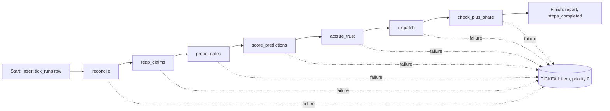
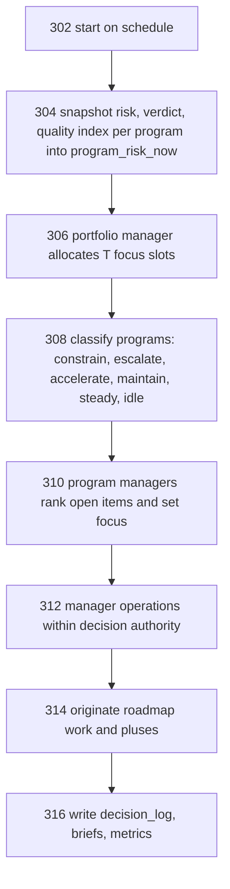

<!-- SPDX-License-Identifier: LicenseRef-Ultrastable-USL-1.0 -->
<!-- Copyright (c) 2026 Rowan Brad Quni-Gudzinas -->

# US-SPEC-03: The tick and its state machine

| Field | Value |
|---|---|
| ID | US-SPEC-03 |
| Title | The tick (the periodic manager tick and state machine) |
| Version | 0.1.0 (draft) |
| Date | 2026-11-11 |
| Status | Draft |

## 1. Purpose

The tick is the heartbeat of the organization. One call is one tick: an ordered list of guarded steps that reconciles state, scores predictions, updates trust and dispatches work. The heartbeat runs on the platform, not in a person's session, so the organization operates when nobody is present. This specification defines the L1 seven-step tick, the L2 managerial tick (risk, slot allocation, focus, operations, origination) and the L3 kernel step list.

## 2. Terms

| Term | Definition |
|---|---|
| Tick | One execution of the step list. |
| Step | One named, guarded unit of the tick. |
| Slot | One expected time-aligned firing of a tick. |
| Focus slot | A unit of capacity a portfolio manager grants a program (L2). |
| Four-line report | What happened, what was decided, what is next, what is open. |

## 3. L1 tick

Each step is wrapped in its own guard. A failing step appends to the tick's error list and files `TICKFAIL-<step>-<hour>` (owner `operations`, priority 0); the remaining steps still run.

### 3.1 Step definitions

| # | Step | Behavior |
|---|---|---|
| 1 | `reconcile` | Every item with status `done`, `superseded` or `cancelled` and no disposition is set to `open` and a `silent_drop` outcome is recorded; every `open` item whose `trigger_on` is null or names a `done` item becomes `ready`. |
| 2 | `reap_claims` | Claims whose `heartbeat_at` is older than the claim time-to-live (default 120 minutes) are deleted and their `claimed` items return to `ready`. |
| 3 | `probe_gates` | Each open gate card's closing probe is evaluated (`env:<NAME>` is satisfied if the secret binding exists; `item_done:<id>` if the item is done; `manual` never by the tick). A satisfied card is closed. |
| 4 | `score_predictions` | Predictions with null verdict and `due_at` not after now are evaluated against the built-in metric table; verdict `hit` or `miss`. An unknown metric or operator scores `miss`. |
| 5 | `accrue_trust` | Outcomes are grouped by (surface, action class) into reliability, upserted to the ledger; a promotion or demotion indication opens a `LADDER-*` item (US-SPEC-06). |
| 6 | `dispatch` | For each role due on this tick and under its work-in-progress cap, claim the highest-priority ready item for that role and write a `dispatches` row. |
| 7 | `check_plus_share` | If at least 10 items are done and the plus share of the last 20 is below half of target, open `REBALANCE-<date>` (US-SPEC-04). |

### 3.2 Report

The tick ends by writing a four-line report to `tick_runs.report`, plus `finished_at`, `steps_completed` and `errors`. A health route returns the latest row, status 200 if `steps_completed = steps_total`, otherwise 503.

## 4. L2 managerial tick

An hourly tick for the portfolio manager and program managers, in this order.

**Risk.** `risk = 3*H + 0.3*O + 15*G + 2*S`, where H is open high-priority items, O open items, G guard-metric breaches, S stalled projects. Verdict is RED if a guard or the primary metric is in breach, AMBER if H > 0 or S > 0, otherwise GREEN. The quality index is the percentage of the program's metric triggers that are on target.

**Allocation.** With total slots T (default 25): half of T is divided evenly among programs with open work and half in proportion to each program's share of total risk, rounded so the total does not exceed T.

**Classification.** `constrain`: highest risk. `escalate`: risk up more than 10% in 24 h, or quality index down 5 points or more in 24 h (slots raised by half). `accelerate`: risk down more than 20% in 24 h. `maintain`: GREEN (one slot). `steady`. `idle`: no open work.

**Worked example.** Risks OPS 120, INFRA 40, REACH 20, RSCH 15, PRIVATE 5 (total 200), T = 25. Even part: 12 slots (2.4 each). Risk part: 13 slots split 60, 20, 10, 7.5, 2.5 percent: 7.8, 2.6, 1.3, 0.98, 0.33. After rounding: OPS 10, INFRA 5, REACH 4, RSCH 3, PRIVATE 3 (25). OPS is `constrain`. If INFRA's risk rose from 30 to 40 in 24 h (+33%), it is `escalate`: slots become 7, and the excess is removed from the lowest-risk programs so the total stays 25.

**Ranking.** Tier 0: items tied to the charter's primary metric; tier 1: guard metric; tier 2: critical; tier 3: high; tier 4: other; then priority and age. The top items up to the program's slots form the focus set.

**Queue score.** `s = impact * probability * (capability_gain + reach_gain) * (1 / remediation_cost) * trust * (1 + direction)`. Worked example: a focus item scores 5*5*(5+5)*1*0.47*1 = 117.5; an unfocused high item with impact 4, probability 3, gains 4 and 1, cost 2, trust 0.5, direction 0.2 scores 4*3*5*0.5*0.5*1.2 = 18.

**Operations (each logged).** Promote and restore; close with evidence (a trigger-filed item closes when its metric is back on target, the reading is fresh, the item is old enough and no remediation contract is failing); supersede duplicates; demote stale machine-filed criticals; assign a doer (validated: not a control-plane path, anchor occurs exactly once in the target); reroute parked tasks. **Origination:** once a day, a program with fewer than 3 open roadmap items asks a research agent for one improvement in fields TITLE, WHY, code-task, code-anchor, EDIT, bounded by a daily cap (default 4).

## 5. L3 kernel step list

The kernel tick extends the manager tick to every loop and session, in this order: reconcile; recognize and redirect (US-SPEC-07); update inferred direction; pull from the queue; dispatch or execute; verify; compare prediction; log provenance; self-adoption gate; report; accrue trust; probe failure modes; scan capability gaps; coin terms; author metrics; refresh assets; advance horizon; audit autonomy; evolve policy; emit tick evidence. A tick ends with each item done, remediated, or backlogged with a trigger; a tick MUST NOT leave an item without a disposition.

## 6. Normative requirements

- **US-03-R01 [L1]** One tick MUST be one call of a function over a store handle; the same function MUST run in production and in tests.
- **US-03-R02 [L1]** A tick MUST insert its `tick_runs` row before running any step.
- **US-03-R03 [L1]** Each step MUST be guarded. A failing step MUST NOT prevent later steps from running.
- **US-03-R04 [L1]** A failing step MUST file one work item `TICKFAIL-<step>-<hour>` with priority 0, deduplicated by identifier. Filing MUST itself be guarded, because the store may be what failed.
- **US-03-R05 [L1]** A tick MUST end with a four-line report written to the store.
- **US-03-R06 [L1]** The runtime MUST expose a health route that returns success only if the last tick completed all steps.
- **US-03-R07 [L1]** The step order of section 3.1 MUST be preserved: reconcile before dispatch; score before trust accrual.
- **US-03-R08 [L1]** An unknown metric or operator in a prediction MUST score as a miss, so a prediction cannot stay unscored by naming a metric that does not exist.
- **US-03-R09 [L1]** Dispatch MUST respect each role's `tick_every` and a work-in-progress cap per role (default 3), and MUST NOT dispatch an item that already has a claim.
- **US-03-R10 [L1]** The tick MUST NOT edit the policy file. It MAY only open work items that propose a change.
- **US-03-R11 [L2]** Each tick step SHOULD write an evidence row (tick id, step, ok, evidence, timestamp). A slot with missing step rows MUST be detected as a failure.
- **US-03-R12 [L2]** Risk, verdict and quality index MUST be computed once per tick and written to a snapshot table that later steps read.
- **US-03-R13 [L2]** The portfolio manager's allocation MUST NOT exceed T slots in total.
- **US-03-R14 [L2]** Configuration switches MUST be able to stop manager operations without a deploy while measurement continues, and a schedule switch MUST stop the tick entirely.
- **US-03-R15 [L2]** Every allocation change MUST write a `decision_log` row with a parsable prediction (US-SPEC-05).
- **US-03-R16 [L3]** Two independent schedulers MAY start the tick; a work claim MUST ensure a duplicate firing ends without acting (US-SPEC-11).

## 7. Failure modes

| Failure | Effect | Mitigation |
|---|---|---|
| Step throws | Rest of tick lost | Per-step guard, TICKFAIL item (R03, R04) |
| Store down | No evidence | Guarded filing; error still returned in the tick result |
| Slot skipped | Silent stop | Missing-row detection (R11); dead-man check (US-SPEC-11) |
| Nested view re-evaluated | Out-of-memory (observed in QNFO) | Snapshot (R12) |
| Duplicate firing | Double dispatch | Claims (R16) |
| Exact-boundary prediction | One missed tick gives a miss | Intended: the heartbeat prediction `tick_runs_completed_1h >= 6` has no margin |

## 8. Conformance tests

- **US-03-T01** Run a tick on a seeded store. Pass: `steps_completed = steps_total = 7`, no errors, report starts with "Happened:". Fail: otherwise.
- **US-03-T02** Drop the `predictions` table and run a tick. Pass: six steps complete and exactly one `TICKFAIL-score_predictions-*` item (priority 0, owner `operations`) exists. Fail: tick aborts or duplicates appear.
- **US-03-T03** Seed items A (ready), B, C (trigger A). Pass: dispatch claims A only; C stays `open`.
- **US-03-T04** Request the health route after a failed step. Pass: 503. After a clean tick: 200.
- **US-03-T05** Create a prediction naming an unknown metric, due now. Pass: scored `miss`.
- **US-03-T06 [L2]** Compute allocation for risks 120/40/20/15/5 with T=25. Pass: 10/5/4/3/3.

## 9. Reference implementation status

- L1 tick: BUILT in `core/src/tick.js` (`runTick`, `STEPS`, `STEP_ORDER`), tests in `core/test/tick.test.js`. The seed now runs eight steps: `execute` follows `dispatch` and settles items whose closing probe the tick can read itself. The entry point `adapters/cloudflare/src/index.js` runs the tick on the platform cron and serves `/health` (200 or 503).
- Built-in metrics: four (`tick_runs_completed_1h`, `items_done`, `open_gate_cards`, `silent_drops_7d`).
- Disagreements with the QNFO design: (a) the seed writes one `tick_runs` row per tick, QNFO one row per step; (b) `index.js` imports `./config.js`, which is rendered by the bootstrapper and is not stored in the seed, so the Worker cannot start before a bootstrap runs; (c) no step in the seed updates `claims.heartbeat_at`, so only a holder that renews the heartbeat itself avoids reaping.
- L2 managerial tick, steps 304 to 310 (US-03-R11 to R15, US-03-T06): BUILT in `core/kernel/index.js` (`runL2`, one evidence row per sub-step, missing rows filed) and `core/kernel/programs.js` (risk snapshot, allocation half even and half by risk with escalation, classification, tiered focus), tests in `core/kernel/l2.test.js` and `core/kernel/programs.test.js`. It plugs into the L1 tick as an extra step. RUNNING in QNFO as an hourly tick (one portfolio manager, five program managers); the risk snapshot fixed an out-of-memory failure there.
- L2 managerial tick, steps 312 to 316 (operations, queue score, origination, briefs): BUILT as a module in `core/staff/index.js`, `core/staff/score.js`, `core/staff/originate.js` and `core/staff/tick.js`, tests in `core/staff/staff.test.js`. Promote, restore, close with evidence, supersede, demote and assign a doer (anchor exactly once, never a control-plane path) are logged operations; the queue score reproduces both worked examples and its rows carry their writer; origination asks once a day per program under the daily cap.
- Rerouting parked tasks, the research agent behind origination, and starting the staff step from `core/org`: PLANNED. Origination takes the research agent as a port (a function); a model call needs a provider credential, so none is made in `ultrastable/workers`. `direction` in the queue score is an input, not inferred.
- L3 kernel step list: RUNNING in part in QNFO. The twenty steps are a description of practice across loops and sessions and not one executable sequence. US-03-R16 (a duplicate scheduler firing ends without acting) is PLANNED in the kernel.
