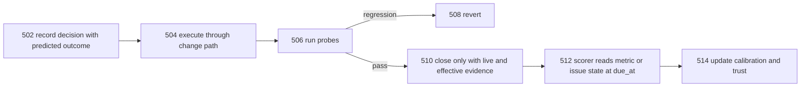

<!-- SPDX-License-Identifier: LicenseRef-Ultrastable-USL-1.0 -->
<!-- Copyright (c) 2026 Rowan Brad Quni-Gudzinas -->

# US-SPEC-05: Predict, act, verify, score

| Field | Value |
|---|---|
| ID | US-SPEC-05 |
| Title | Predict, act, verify, score |
| Version | 0.1.0 (draft) |
| Date | 2026-11-11 |
| Status | Draft |

## 1. Purpose

Every decision states a checkable prediction before it runs. A scorer later reads the real value and records whether the prediction held. Items close only on machine-read evidence that the change is live and effective; a merge alone is not completion. Scored predictions feed calibration and the trust ledger, so the system learns how often its own forecasts are right.

## 2. Terms

| Term | Definition |
|---|---|
| Prediction | A statement `<metric> <op> <value> within <N> h`, or `issue <id> closed within <N> h`. |
| Scorer | The scheduled process that evaluates predictions past due. |
| Matched | The prediction's condition held at scoring time. |
| Provenance | The decision, its reason, predicted outcome and revert path. |
| Map | A representation of the managed system in a repository, registry, staged patch or document. |
| Territory | The managed system's state read from the running system. |
| Deciding query | A statement whose result decides whether an assertion holds, with stated pass and fail conditions. |
| Assertion state | One of `code-only`, `staged`, `inferred`, `observed`. |

## 3. Behavior

### 3.1 Parsed predictions

The accepted forms are `<metric> <op> <number> within <N> h`, `<metric> between <a> and <b> within <N> h`, and `issue <id> closed within <N> h`. Operators: `<`, `<=`, `>`, `>=`, `=`, `between`, `closed`. A trigger copies the parsed form into the prediction table with `due_at = decision time + N hours`. Predictions MAY also be seeded in structured form (origin `seeded`).

**Worked example.** At 10:00 a decision records `program_focus_without_doer <= 1 within 24 h`. The prediction row has subject `program_focus_without_doer`, op `<=`, value 1, due 10:00 next day. At the first scorer run after the due time the metric reads 1: `matched = 1`.

### 3.2 Scoring and calibration

At scoring, store the observed value and `matched`, and write an outcome row. Aggregate calibration views compute the matched share by persona, action class and surface. A binned calibration extension groups predictions with stated confidence p into bins (0.5 to 0.6, ... 0.9 to 1.0), computes the hit rate h per bin, calibration error as the count-weighted mean of |p_bin - h_bin| and a Brier score as the mean of (p - outcome)^2. If 40 predictions in the 0.8 to 0.9 bin (mean 0.85) matched 28 times, h = 0.70 and the confidence cap for that decision type falls by 0.15.

### 3.3 Realization gate (map and territory)

A fix is recorded with an assertion state: `code-only` (exists only in a repository), `staged` (a patch is committed but not applied), `inferred` (the territory shows the effect indirectly, for example silence of an alert), `observed` (a deciding query reads the changed state in production). The agent writes a deciding query, a pass condition, a fail condition and a null expectation (what production would show if the fix were absent). A finding may close only at `observed`; `inferred` closes with an explicit `inferred` label and a scheduled re-test; `code-only` and `staged` leave the finding `pending`.

**Worked example.** A fix to a backlog executor is deployed; the deployment ledger row `75 | 1.2.7 -> 1.2.8 | ok=1` is read after a drift row showed `canonical-ahead`: state `observed`. A tombstone replacing a corrupt file removed 25 hourly failures with none after: `inferred`, because absence of failures is also what a stopped scanner would show.

### 3.4 Probes and revert

A component's declared probes run after deploy. If a probe that passed before the deploy fails after it, the deployment reverts to the prior version and a failure item is filed (US-SPEC-07).

## 4. Normative requirements

- **US-05-R01 [L1]** Every prediction MUST name a metric the scorer can compute, an operator, a target and a due time.
- **US-05-R02 [L1]** The scorer MUST evaluate every prediction with no verdict whose due time has passed, and MUST store the observed value and verdict.
- **US-05-R03 [L1]** An unknown metric or operator MUST score as a miss (US-03-R08).
- **US-05-R04 [L1]** An item MUST NOT close on a merge alone. Its done check MUST be an observed state of the managed system.
- **US-05-R05 [L1]** A done check that was never observed MUST leave the item open.
- **US-05-R06 [L2]** Each decision MUST be stored with a predicted outcome and a revert path before it executes.
- **US-05-R07 [L2]** The implementation MUST accept the parsable forms of section 3.1 and copy them to the prediction table.
- **US-05-R08 [L2]** The implementation MUST publish the share of decisions with a parsable prediction in 7 days, the miss rate in 7 days and the number of predictions unscored beyond their deadline, each with a trigger.
- **US-05-R09 [L2]** Probes that passed before a deploy and fail after it MUST revert the deploy. Probes that depend on a shared resource under load MAY be excluded from revert probes.
- **US-05-R10 [L2]** A finding MUST NOT close on `code-only` or `staged` evidence (section 3.3).
- **US-05-R11 [L2]** A closure at `inferred` MUST carry the label and a re-test date.
- **US-05-R12 [L2]** Verification SHOULD use a path independent of the one that produced the result.
- **US-05-R13 [L3]** Calibration error SHOULD be computed per confidence bin and per decision type, and stated confidence that gates autonomous action SHOULD be corrected by it.
- **US-05-R14 [L2]** A detector that reads the clock MUST read it in the same statement that reads the data it compares to.

## 5. Failure modes

| Failure | Effect | Mitigation |
|---|---|---|
| Item closed on repository evidence while production unchanged | Same alert recurs | Realization gate (R10) |
| Prediction never scored | No learning | R08 metric and trigger |
| Prediction names a nonexistent metric | Stays unscored forever | R03 |
| Aggregate hit rate mistaken for calibration | Overconfidence | R13 |
| Self-scoring | The scorer shares blind spots of the actor | Independent verification path (R12); an outside audit is PLANNED |

## 6. Conformance tests

- **US-05-T01** Seed a prediction `items_done >= 1`, due now, with one done item that carries a disposition (otherwise reconcile reopens it). Run a tick. Pass: verdict `hit`, observed 1.
- **US-05-T02** Seed a prediction with metric `nonexistent`. Pass: verdict `miss`, observed null.
- **US-05-T03 [L2]** Record the decision text `queue_depth <= 5 within 24 h`. Pass: a prediction row with op `<=`, value 5, due 24 h later exists.
- **US-05-T04 [L2]** Deploy a version whose pre-passing probe fails. Pass: prior version restored and a failure item filed.

## 7. Reference implementation status

Paths are relative to the workers repository. A line names a file that exists and a test that passes; code named here has not run in production unless the line says so.

- Prediction scoring in the seed tick: BUILT in `core/src/tick.js` (`score_predictions`, `METRICS`, `OPS`), covered by the test "predictions are scored against built-in metrics" in `core/test/tick.test.js`. Only four built-in metrics exist. Verdicts are `hit` or `miss`; the seed's `predictions` table has no confidence, kind, or origin columns.
- Seed boot prediction `P-KIT-3` (`tick_runs_completed_1h >= 6`): BUILT in the bootstrapper (`bootstrap/bootstrap.py`).
- Decision log, parsed predictions, scorer, outcome rows, calibration views (R01 to R03, R06 to R08, T01 to T03): BUILT in `core/predict/index.js` (`recordDecision`, `parsePrediction`, `seedPrediction`, `scoreDue`, `calibrationViews`, `health`, `checkHealth`) with schema `core/predict/migrations/0001_predict.sql`, tests in `core/predict/predict.test.js`. The parsed form is copied to the prediction table by the function that records the decision, not by a database trigger. Predictions carry origin (`parsed`, `seeded`), confidence and decision type. A second decision log with guard metrics is BUILT in `core/kernel/decisions.js` (`core/kernel/metrics-decisions.test.js`).
- Decision log, parsed predictions by trigger, calibration views, scorer: RUNNING in QNFO. Owner-reported, self-scored figure as of 2026-11-10: 1,056 predictions scored, 771 matched (73%). This is an aggregate hit rate scored by the same system, not a binned calibration and not an outside audit.
- Probes with revert on regression (R09, T04): BUILT in `core/deploy/index.js` and `core/deploy/probes.js`, tests "US-05-T04, US-07-T05" and "US-05-R09" in `core/deploy/deploy.test.js`. The rule is stricter than R09: any revert probe failing after the deploy reverts it, and a reverted deploy files a failure item. A probe marked `revert: false` is excluded. Tested with a fake deployer; not run against a live account.
- Probes with revert on regression: RUNNING in QNFO.
- Realization gate, enforcement of assertion states by a program (R04, R05, R10, R11, R12): BUILT in `core/predict/index.js` (`recordAssertion`, `observe`, `closeFinding`, `retestDue`), tests in `core/predict/predict.test.js`. `observed` is reachable only by running the deciding query; `code-only` and `staged` leave the finding pending; `inferred` closes with the label and a re-test that upgrades or reopens it. It governs findings closed through `closeFinding`; items closed by other code paths are not routed through it.
- Realization gate: RUNNING as policy and audit practice in QNFO.
- Binned calibration (R13): BUILT in `core/predict/index.js` (`binnedCalibration`, `calibrate`, `gateConfidence`; view `predict_v_calibration_bins`), test "US-05-R13" in `core/predict/predict.test.js`: per decision type and confidence bin, calibration error, Brier score, and a correction subtracted from stated confidence before it clears a gate.
- PLANNED: an outside audit of the scorer (needs a party other than the system that acts); running `core/predict` in an organization (its `step` runs in the composition root but no real decision has been scored by it on a deployed account); gating a real autonomous action on `gateConfidence` (no caller yet).
