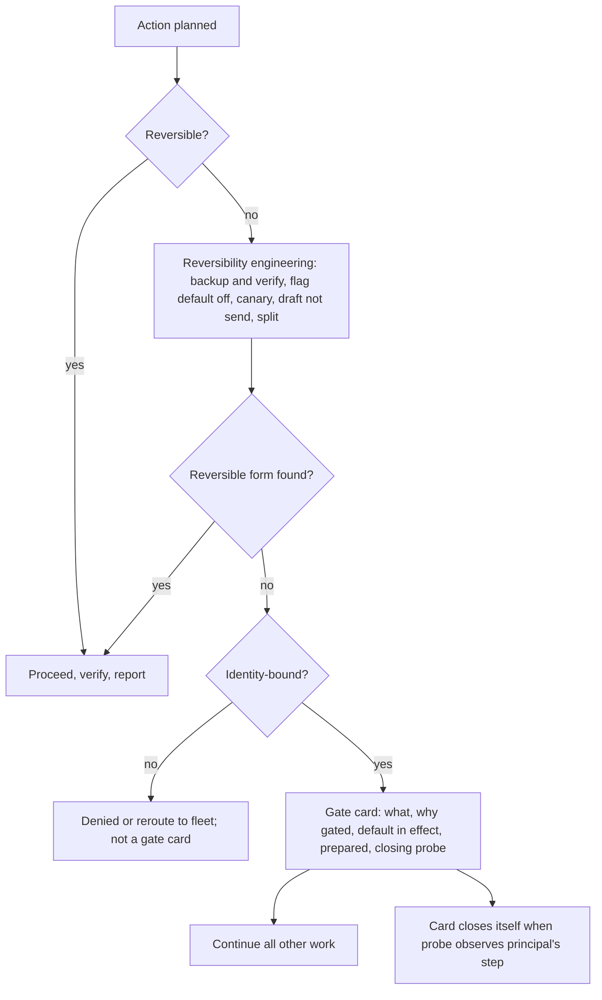

<!-- SPDX-License-Identifier: LicenseRef-Ultrastable-USL-1.0 -->
<!-- Copyright (c) 2026 Rowan Brad Quni-Gudzinas -->

# US-SPEC-06: Trust ledger, autonomy ladder and interrupt gate

| Field | Value |
|---|---|
| ID | US-SPEC-06 |
| Title | Trust ledger, autonomy ladder, interrupt gate |
| Version | 0.1.0 (draft) |
| Date | 2026-11-11 |
| Status | Draft |

## 1. Purpose

Authority is earned and computed, not granted. A trust ledger scores each (surface, action class) pair from verified outcomes, a ladder maps the score to how much autonomy the pair has, and one narrow interrupt gate is the only place the system stops for the principal. Over-caution is treated as a defect and measured the way errors are.

## 2. Terms

| Term | Definition |
|---|---|
| Reliability | A score in [0, 1] for a (surface, action class) pair computed from outcomes. |
| Rung | A position on the autonomy ladder. |
| Surface ceiling | The maximum permission (`none`, `propose`, `execute`) a surface may ever reach. |
| Severe outcome | `hidden_failure` or `silent_drop`. |
| Gate card | A record of an interrupt-eligible step with what, why, default in effect, what the fleet prepared, and a closing probe. |
| Standing limit | A limit that outranks trust, rung and policy. |
| Reversibility engineering | Constructing a reversible form of an action before classifying it irreversible. |

## 3. Trust computation

For each pair let `ok` be verified successes, `n` all recorded outcomes and `severe` the severe outcomes.

`reliability = (ok + b * w) / (n + w)`

with prior baseline `b` and prior weight `w`. The seed uses b = 0.5, w = 2: 10 of 10 gives 11/12 = 0.917; 9 of 10 gives 0.833; 8 of 10 gives 0.75; 3 of 8 gives 0.40; no outcomes gives 0.5. QNFO uses b = 0.5, w = 10, which is the form `(ok + 5) / (ok + fail + 10)`: `code-loop:merge` with ok 30, fail 35 gives 35/75 = 0.467; `migration:apply` with ok 59, fail 11 gives 64/80 = 0.80.

Alternative computations an implementation MAY use: decay toward the prior per unexercised tick or day (default 0.01); event weights (verified autonomous action +0.02, clean self-remediation +0.03, closure of a principal friction signal +0.10; silent drop -0.20, hidden failure -0.30, unnecessary question -0.05, handoff of an executable step -0.10); a lower confidence bound; per-executor scores (key adds executor id; effective rung is the minimum of executor and pair rung).

### 3.1 Ladder

| Rung | Meaning |
|---|---|
| observed | Agent proposes; a reviewer executes and records |
| assisted | Agent executes in a branch or preview; a reviewer merges |
| delegated | Agent executes and merges after a different agent's review passes |
| autonomous | Agent executes and merges on green checks; a reviewer audits after |
| self-directed | Agent also chooses its own next items from the queue |
| self-modifying | Agent may open changes to its own role file and the policy, merged by review |
| self-extending | Agent may propose new roles, surfaces and connectors, merged by review |

**Promotion (default).** n >= 10, reliability >= 0.8 and no severe outcome, and the target rung is not above the ceiling for the surface's `max_permission` (`none` to observed, `propose` to assisted, `execute` to self-extending). **Demotion.** Rung above `observed` and (reliability < 0.6 or any severe outcome).

**Banded alternative (QNFO).** observed < 0.3; assisted 0.3 to 0.5; delegated 0.5 to 0.6; autonomous 0.6 to 0.7; self-directed 0.7 to 0.8; self-modifying 0.8 to 0.9; self-extending 0.9 or more.

**Rung moves by reviewed change.** In the seed the tick never changes a rung. A crossed threshold opens an item `LADDER-<surface>-<action>-<target rung>` (kind `ladder`, owner `operations`, priority 0 for demotion and 20 for promotion). The rung changes only when a different agent merges the change to the policy file. Rising trust widens only the system's own loop scopes. No rung reaches harness permissions, secret stores, the interrupt gate's classification rule or the standing limits.

### 3.2 Interrupt gate

An action that remains irreversible and identity-bound produces one card and the system continues all other work. Examples: minting a credential only the principal can create, paying, signing, acting in the principal's personal accounts, destroying unbacked data, sending a message outside the organization on the principal's behalf.

**Self-adoption.** A conclusion that would be returned to the principal as a question, offer or choice among options is, when the action is reversible and in scope, executed with the recommended default in the same cycle and reported as done, with a decision log row and its revert path.

### 3.3 Policy as data

For each surface the policy states `max_permission`, `start_rung` and per action class `reversible`, `identity_bound`, optionally `reversible_path`, `denied`, `reason` and `harness_deny` (shell-command patterns). A validator returns problems when: a start rung is not on the ladder; `max_permission` is not `none`, `propose` or `execute`; a start rung is above its ceiling; an irreversible, identity-bound action carries a reversible path (then it would not be gated); an irreversible, not identity-bound action has neither a reversible path nor `denied`; the standing limits lack entries naming the harness, the secret lock and the override.

**Mirror rule.** Every `harness_deny` pattern of a gated action reachable through a shell command MUST appear in the harness's deny list.

## 4. Standing limits

These outrank trust: the agent harness's permission checks; classifier and safety refusals; the secret lock (no agent reads, prints, commits or moves a secret value); consent, suppression and opt-out for any outreach; the principal's override, always honored and recorded; another agent's live claim. A refusal is an input: if its condition lies in the system's own text or change, correct it and try once more; a refusal that stands is recorded with its reason and the next path is taken. The same action is never resubmitted in different words to pass the same check.

## 5. Normative requirements

- **US-06-R01 [L1]** An implementation MUST keep a trust ledger keyed by (surface, action class) and recompute it from recorded outcomes on each tick.
- **US-06-R02 [L1]** A pair with no outcomes MUST have reliability equal to the baseline.
- **US-06-R03 [L1]** The reliability formula and its prior (baseline and prior weight) MUST be stated in the policy.
- **US-06-R04 [L1]** A rung MUST NOT exceed the ceiling of its surface.
- **US-06-R05 [L1]** The tick MUST NOT change a rung or edit the policy. A threshold crossing MUST open a ladder item proposing the change.
- **US-06-R06 [L1]** A rung change MUST be merged by an agent different from the one that opened the item.
- **US-06-R07 [L1]** A severe outcome SHOULD demote. Whether severe outcomes are counted over all time or a window MUST be stated; a window (default 14 days) is RECOMMENDED.
- **US-06-R08 [L1]** Actions that are irreversible and identity-bound MUST NOT be executable at any rung; they MUST produce a gate card.
- **US-06-R09 [L1]** A gate card MUST have a closing probe and a default in effect, and MUST close itself when its probe passes. A `manual` probe MUST NOT be closed by the tick.
- **US-06-R10 [L1]** The bootstrapper MUST record only the presence of a secret, never its value.
- **US-06-R11 [L1]** The policy validator of section 3.3 MUST run at boot and in tests; an invalid policy MUST block the boot.
- **US-06-R12 [L1]** Money, legal, outreach and secrets surfaces MUST have a ceiling below `execute`.
- **US-06-R13 [L1]** Standing limits (section 4) MUST take precedence over rung and score.
- **US-06-R14 [L2]** Before classifying an action irreversible the system MUST attempt to construct a reversible form (section 3.2).
- **US-06-R15 [L2]** A step routed to the principal without an identity-bound line MUST be rerouted to the staff. The number of open cards without an identity-bound line SHOULD have a metric with target zero.
- **US-06-R16 [L2]** A reversible, in-scope question MUST be answered by executing the recommended default, with a decision log row and revert path.
- **US-06-R17 [L2]** Ladder transitions MUST be recorded with evidence.
- **US-06-R18 [L2]** Trust MAY multiply a queue item's score by the pair's reliability (US-SPEC-03).
- **US-06-R19 [L3]** Per-executor trust SHOULD use the minimum of executor and pair rungs.
- **US-06-R20 [L1]** A threshold crossing that repeats after its earlier ladder item was closed MUST open a new ladder item (for example by a dated id); it MUST NOT be absorbed by the closed one.
- **US-06-R21 [L2]** Where one database holds rows of several tenants, the trust ledger, gate cards, items and claims MUST carry the tenant in their key, and a runtime MUST read, accrue and close only its own rows.
- **US-06-R22 [L2]** A linked credential whose silent refresh failed on consecutive attempts MUST become one gate card that carries a consent link, states the default in effect (loops that need the connector skip their step; every other loop runs) and closes itself when a probe reads the connector as healthy again. The card MUST NOT ask a person to copy, paste or mint a secret value.
- **US-06-R23 [L2]** Trust MUST NOT allow an egress action (credentials, money, the principal's accounts, public publishing, other parties' systems) or a reserved action class at any rung; a decision function MUST deny them at the top rung as at the bottom.

## 6. Failure modes

| Failure | Effect | Mitigation |
|---|---|---|
| One early silent drop demotes forever | Trust never recovers | Windowed severe count (R07). The running kit's tick reads the window from the policy (`ladder.demote_when.severe_window_days`, else `ladder.promote_when.no_hidden_failure_days`); a policy that states neither counts all time |
| Repeated promotion not reopening | Ladder item id has no date | A crossing that repeats after its item closed opens a dated item (R20) |
| Idle decay unevaluated in the tick | Stale promotions | "No hidden failure for N days" is the tick's severe window (R07). `decay_per_idle_day` is carried in the policy and evaluated only by `core/trust` (`decayToward`), not by the tick |
| Over-cautious pause treated as safe | Autonomous loop stalls | False-stop detection (US-SPEC-07) |
| Policy and harness drift | Gated action reachable | Mirror rule test |

## 7. Conformance tests

- **US-06-T01** Reliability with 0 outcomes. Pass: 0.5 (baseline).
- **US-06-T02** 12 verified outcomes on a surface with ceiling `propose` at start rung `observed`. Pass: a `LADDER-*-assisted` item exists, and the ledger rung is unchanged. Fail: rung changed by the tick.
- **US-06-T03** Add one `hidden_failure` to a pair above `observed`. Pass: a demotion item at priority 0.
- **US-06-T04** Set money start rung above its ceiling. Pass: validator returns a problem.
- **US-06-T05** Boot without a credential. Pass: a gate card with probe `env:<NAME>` and a stated default; exit code signals blocked, not crash.
- **US-06-T06** Plant a secret value in the environment and search all outputs. Pass: no hit.
- **US-06-T07** Record a `hidden_failure` older than the stated window on a pair above `observed` with otherwise verified outcomes. Pass: no demotion item. Record a severe outcome inside the window. Pass: a demotion item.
- **US-06-T08** Close a ladder item, then make the same crossing again. Pass: a new ladder item with a different id exists and the ledger rung is unchanged.
- **US-06-T09** Ask the decision function for an egress action at the top rung. Pass: denied.

## 8. Reference implementation status

Paths in 8.1 are relative to `workers/` in the platform repository (the kit's composable modules); paths in 8.2 are relative to the platform repository root. A line names a file that exists and a test that passes; code named here has not run in production unless the line says so. Re-verified against the code on 2026-11-26.

### 8.1 Composable modules (`workers/`)

- Ledger, promotion and demotion indications, ceilings, ladder items: BUILT in `core/src/tick.js` (`reliability`, `accrue_trust`), tests "trust promotes only inside the surface ceiling and only by opening a PR item", "a hidden failure demotes", "reliability starts at the baseline and moves with outcomes" in `core/test/tick.test.js`.
- Gate cards and closing probes: BUILT in `core/src/tick.js` (`probe_gates`; test "gate cards close when their probe shows the owner step is done" in `core/test/tick.test.js`). Policy validator and mirror test: BUILT in `bootstrap/bootstrap.py` (`validate_policy`, `gated_actions`) and `tests/test_seed.py`; policy file `autonomy/policy.json`.
- Beta-prior ledger with the prior read from the policy, recorded transitions, promotion and demotion rules, rung bounded by ceiling (R01 to R07, R17, R18, T01 to T04): BUILT in `core/trust/index.js` (`settings`, `recompute`, `applyRungChange`, `queueMultiplier`) with schema `core/trust/migrations/0001_trust.sql`, tests in `core/trust/trust.test.js`. `recompute` never writes a rung; a crossing records a `proposed` transition with its evidence and opens a ladder item; `applyRungChange` refuses a merge by the agent that opened the item and a target above the ceiling. Severe outcomes are counted over a stated window (default 14 days, or all time when set so). A repeated crossing gets an item id with the date. Both the threshold rule and the banded alternative are implemented.
- Gate card queue, interrupt-gate classification, reversibility engineering, reroute of steps with no identity-bound line, self-adoption (R08, R09, R14, R15, R16): BUILT in `core/trust/index.js` (`authorize`, `openCard`, `gateQueue`, `rerouteUnbound`, `cardsWithoutIdentityLine`, `adoptDefault`), tests in `core/trust/trust.test.js`. Reversible forms are ports the caller supplies; each attempt is recorded.
- Standing limits above any rung, and refusals as inputs (R13, section 4): BUILT in `core/trust/index.js` (`authorize`, `recordRefusal`, `maySubmit`), tests "US-06-R13" and "section 4, US-07-R08" in `core/trust/trust.test.js`. The harness and classifier results reach the function as inputs; it does not call a harness.
- Policy validator of section 3.3 in JavaScript, with the ceilings of R12 and the mirror rule as a function (R11, R12): BUILT in `core/trust/index.js` (`validatePolicy`, `assertPolicy`, `mirrorProblems`), tests in `core/trust/trust.test.js` against `autonomy/policy.json`.
- Event weights and decay toward the prior (per idle day or per idle tick): BUILT in `core/trust/index.js` (`recordEvent`, `decayToward`), tests "event weights move the score by the stated amounts" and "decay moves an unexercised score toward the prior" in `core/trust/trust.test.js`.
- Per-executor trust (R19): BUILT in `core/trust/index.js` (`effectiveRung`, table `trust_executor_rungs`), test "US-06-R19" in `core/trust/trust.test.js`.
- Disagreements with the QNFO design: (a) formulas differ by prior weight (2 in the seed, 10 in QNFO), both expressible by the form in section 3; (b) QNFO bands the ladder by score, the seed promotes by threshold (`core/trust` implements both, chosen by configuration); (c) the tick in `core/src/tick.js` counts severe outcomes over all time and does not evaluate `no_hidden_failure_days` or `decay_per_idle_day`; `core/trust` evaluates both, and the running kit's tick (8.2) evaluates the window but not the decay.
- Beta-prior ledger and transitions hourly, gate card queue, reversibility engineering practice: RUNNING in QNFO.
- PLANNED: running `core/trust` in an organization (its `step` runs in the composition root (`core/org/buildout.js`) only when `config.policy` passes `assertPolicy`, otherwise the tick notes say why it skipped; no deployed account runs it yet); a consumer of `authorize` in the runner and the deploy path; use of `queueMultiplier` by a queue; the lower confidence bound is computed and stored but no rule uses it; the mirror rule in JavaScript needs the harness deny list from its caller.

### 8.2 Running kit and platform (`seed/`, `foundation/`)

The kit every system is seeded from carries its own tick, which is the more developed implementation of sections 3 and 3.2 and is the one a deployed system runs.

- Ledger recomputed each tick from outcomes, ceilings, ladder items, rung never written by the tick (R01 to R05): BUILT in `seed/worker/src/tick.js` (`reliability`, step `accrue_trust`), tests "trust promotes only inside the surface ceiling and only by opening a PR item", "a hidden failure demotes" and "reliability starts at the baseline and moves with outcomes" in `seed/worker/test/tick.test.js`.
- Severe outcomes counted over the window the policy states (R07, T07): BUILT in `seed/worker/src/tick.js` (step `accrue_trust`; the window is `ladder.demote_when.severe_window_days`, else `ladder.promote_when.no_hidden_failure_days` from `seed/autonomy/policy.json`; the cut-off is bound from the tick's clock in the same statement as the data), test "US-06-R07: a severe outcome older than the stated window no longer demotes, and one inside it does" in `seed/worker/test/tick.test.js`.
- Dated ladder item on a repeated crossing (R20, T08): BUILT in `seed/worker/src/tick.js` (step `accrue_trust`), test "US-06-R05: a crossing that repeats after its ladder item closed opens a new dated item; the rung is still not changed by the tick" in `seed/worker/test/tick.test.js`.
- Gate cards that close themselves by probe (R09): BUILT in `seed/worker/src/tick.js` (step `probe_gates`; probe kinds `env`, `owner_items`, `connector`, `item_done`; any other kind, `manual` included, is never closed by the tick), test "gate cards close when their probe shows the owner step is done" in `seed/worker/test/tick.test.js`.
- Tenant in the key of the trust ledger, gate cards, items and claims (R21): BUILT in `seed/worker/src/tenant.js` and `seed/worker/src/tick.js`, test "accrue_trust: a trust row of another tenant is neither read nor overwritten; an own row accrues and carries no tenant" in `seed/worker/test/tenant-isolation.test.js`.
- Reconnect gate card for a connector whose refresh keeps failing (R22): BUILT in `seed/worker/src/tick.js` (steps `connector_health` and `probe_gates`), test "connector health: last_ok and expires_at each tick; two failed refreshes raise one reconnect card that closes when the connector is ok" in `seed/worker/test/tick.test.js`.
- Policy validator at boot and in tests, ceilings below `execute` for money, legal, outreach and secrets (R11, R12, T04): BUILT in `seed/bootstrap/bootstrap.py` (`validate_policy`) with `seed/autonomy/policy.json`, tests in `seed/tests/test_seed.py`.
- Egress and reserved classes denied at every rung, trust widening only inside the boundary (R23, T09): BUILT in `foundation/boundary.py` (`decide`, data `doctrine/boundary.json`), tests `test_egress_and_reserved_never_allowed_even_at_top_trust` and `test_trust_widens_inside` in `tests/foundation/test_boundary.py`.
- PLANNED in the running kit: evaluating `decay_per_idle_day` in the tick (item `Q-SPEC-06-idle-decay`); R06 as code (the tick opens the item; that a different agent merges the policy change is held by the review rule, not by the tick); R18 and R19 (the kit's dispatch does not multiply by reliability and keeps no per-executor rung); a tick-side metric for open cards without an identity-bound line (R15).
