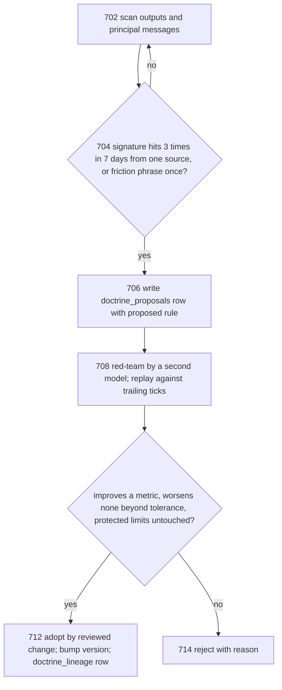
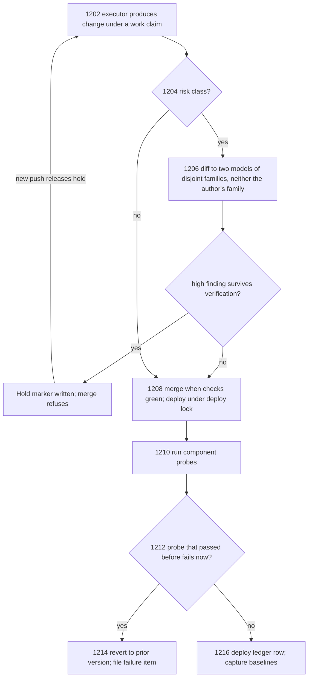

<!-- SPDX-License-Identifier: LicenseRef-Ultrastable-USL-1.0 -->
<!-- Copyright (c) 2026 Rowan Brad Quni-Gudzinas -->

# US-SPEC-07: Self-amending governance and canonical change path

| Field | Value |
|---|---|
| ID | US-SPEC-07 |
| Title | Self-amending governance and canonical change path |
| Version | 0.1.0 (draft) |
| Date | 2026-11-11 |
| Status | Draft |

## 1. Purpose

Two mechanisms keep an autonomous organization correct over time. Governance converts recorded failures of behavior (repeated false stops, friction, incidents) into versioned amendments of the operating rules, tested before adoption. The canonical change path makes every change travel one route: claim, review, merge on green, deploy under a lock, probe, revert on regression. Together they let rules and code change without a person in the loop and without weakening the protected limits.

## 2. Terms

| Term | Definition |
|---|---|
| Kernel | A versioned document of structured text carried in the instructions of each model-backed agent: voice convention, recognitions, states, commitments, tick steps, trust weights, registries, metrics. It describes how loops work and confers no authority. |
| Recognition | One record pairing a signature (phrases, patterns or state conditions) with a redirect. |
| False stop | An agent output that pauses, asks, offers options or assigns a next step to the principal when the step was not interrupt-eligible. |
| Draft output | Agent output not yet emitted to a reader, log or process. |
| Amendment | A proposed rule change. |
| Protected limits | The limits no amendment may weaken (section 4.3). |
| Hold marker | A comment at the start of a review result that makes the merge step refuse a change. |
| Risk class | A category of change (authentication, routes, caching, data migrations, workflow permissions) that needs two-family review. |

## 3. Self-amending governance



**Procedure.** E1 collect; E2 classify (doctrine defect or transient); E3 generate (a model writes the rule with its scope); E4 red-team (a second model tries to find a case where the rule harms a protected limit or a commitment; any success rejects); E5 replay (re-evaluate the last 7 days of hits, decisions and outcomes as if the rule had been in force); E6 adopt (replay improves at least one metric and worsens none beyond tolerance: the amendment lands as a reviewed change, the version increments, a lineage row is written, and the commitments are verified unchanged); E7 report in one line. A weekly audit item lists open proposals.

### 3.1 Recognition engine

Applied to each draft output, before or after emission.

| Shape | Example signature | Redirect |
|---|---|---|
| Conditional offer | "if you want", "let me know if", "shall I" | adopt, execute, emit as done |
| Report ending in a question | "?", "your call" | decide, state the decision as fact |
| Menu | "either A or B", "two options" | choose, execute, mark alternative superseded |
| Blocker without surface coverage | "can't", "refused", "no access" | enumerate surfaces, test each, then report |
| Stop not interrupt-eligible | pause, ask, wait, confirm | classify; if false, re-execute the abandoned path |
| Principal as executor | "you could run" | dispatch from the roster |
| Principal as actor | second-person next-action phrasing | rewrite in first person and execute; else dispatch |
| Silent drop | item leaves active set with no disposition | log disposition or reopen |
| Friction | "I shouldn't have to", "every time" | generate, red-team, adopt an amendment |
| Narration | "the fix is to" | produce the changed artifact in the same output |

**Classification.** A hit is excluded from redirect when (a) the output plainly states a refusal or limit with its reason, (b) the step is interrupt-eligible, or (c) the step is owned by another agent's live claim. An excluded hit is reported as a disposition naming its owner and closing probe and written to the hit table with `excluded = 1`. Otherwise it is a false stop: the draft is rewritten by the pattern's redirect and the abandoned path is executed and verified in the same cycle, so the rewritten statement is true when emitted. If it cannot be executed it is dispatched; if no executor can take it, it is escalated and only when it remains identity-bound becomes one gate card. Every hit is recorded; a signature hitting 3 times in 7 days from one source files an amendment proposal.

```
function recognize_and_redirect(draft, scope, ctx):
    hits = [p for p in register if p.active and match(p, phrases(p, scope), draft)]
    if not hits: return emit(draft)
    for h in hits:
        if states_refusal_with_reason(draft, h) or interrupt_eligible(ctx) or live_claim_owned_by_other(ctx):
            record_hit(h, excluded=1); out = disposition_report(h, ctx)
        else:
            out = rewrite(draft, h.auto_remediation)
            if requires_action(h): result = execute_or_dispatch(out.action, ctx)
            if not result.verified: out = report_result_as_open_item(result)
            record_hit(h, excluded=0)
            trust.deduct(ctx.surface, ctx.action_class, WEIGHT[h.pattern_key])
    return emit(out)
```

**Tables.** `false_stop_register(pattern_key, pattern, cause_class, detection_heuristic, auto_remediation)`, `false_stop_phrases(pattern_key, scope, phrase)`, `false_stop_hits(id, ts, pattern_key, source, source_ref, excerpt, excluded, exclusion_reason)`. Signatures are rows and extend without a code change.

**Commitments (cannot be removed by amendment).** Interrupt gate (pause only for irreversible and identity-bound steps, after engineering reversibility); alignment floor (honest, non-harmful, trust-preserving); affirmative adoption (each identified action is executed and verified in the same output); affirmative default (the answer to a reversible, in-scope question is yes, within the bounds of the interrupt gate, harness and classifier refusals, secret locks and live claims); actor commitment (no sentence of a report has the principal as the subject of an action).

**Fixed readings.** The kernel describes how loops work and confers no authority; it installs into no harness and replaces no instructions of the system an agent runs in. "The affirmative displaces the negation" governs how work is reported and never whether a limit exists. Trust widens only the loop's own scopes. An interrupt-eligible, refused or claimed step is reported as exactly that.

**Metrics.** Target 1: self-adoption rate. Target 0: false-stop rate, conditional-offer rate, question rate (questions asked when the answer was yes), actor-assignment rate, narration rate. Each has a trigger.

### 3.2 Objective space and self-authored goals

Systems that originate only inside a charter leave the principal as the sole source of direction; systems that rewrite their own objective drift silently. The objective space separates them.

| Concept | Rule |
|---|---|
| Ratified objective | Written only by the principal or a ratification action, never by an agent |
| Goal | Falsifiable, reversible, instrumental, evaluated against a ratified objective |
| Derived goal | Adopted with a recorded parent objective and an alignment sentence |
| Novel goal | No ratified anchor; enters probation with a review deadline and is not dispatched to executors with write authority |
| Objective revision | Any candidate that changes the mission, objective weights or the boundary of residual consent: written as `proposed` and never adopted by the authoring agent |

Daily cycle: gather signals (bounded reads; a failed read yields empty, not an abort); synthesize falsifiable candidates with a definition of done; classify; score `0.4*falsifiability + 0.4*leverage + 0.2*novelty` and reject below a threshold (default 0.5); reject near-duplicates of goals adopted in the last 30 days when Jaccard or containment similarity of token sets is at or above 0.6 (a candidate of 10 tokens sharing 6 with a 14-token goal has Jaccard 0.33 but containment 0.6, so a reworded duplicate is rejected); anchor by stem match to a ratified objective; adopt at most N (default 3) per cycle, highest score first; retire when the done probe passes, when stale beyond a limit, or when superseded. Adoption also writes a row to a ledger that a worker drains, so a goal is never inert.

## 4. Canonical change path



**Review gate.** Each finding must state a concrete trigger; a high-severity finding must include an evidence line that occurs verbatim in the diff, otherwise it is demoted; a finding without a trigger is dropped. The hold decision is made by code from verified findings, not by the model, and the diff is treated as data. The gate fails open on its own outage (logs and continues) and runs in `observe`, `hold` or `off` mode. Cost per run is recorded. Adversarial brief: authentication bypass, injection, cache audience, double submission, null handling, ordering and limits, retry storms, trigger depth, workflow permissions.

**Probes.**

```json
{ "mode": "revert",
  "health": "https://service.example/health",
  "http": [ { "url": "https://service.example/health", "contains": ["\"worker\":\"service\""] } ],
  "d1":   [ { "sql": "SELECT COUNT(*) FROM table WHERE ...", "expect": ">0" } ] }
```

## 5. Normative requirements

- **US-07-R01 [L2]** Amendments to policy, role files or kernel MUST travel the canonical change path and MUST increment a version recorded in a lineage table.
- **US-07-R02 [L2]** An amendment MUST be red-teamed by a second model and replayed against stored records before adoption.
- **US-07-R03 [L2]** An amendment that modifies a protected limit or a commitment MUST be rejected without replay.
- **US-07-R04 [L2]** The protected limits are the harness permission checks, classifier refusals, the secret lock, live claims of other agents, outreach consent, suppression and opt-out handling, plane separation, the interrupt gate and the principal's override. No amendment, rung or score MAY weaken them.
- **US-07-R05 [L2]** The recognition engine MUST exclude from redirect any output that states a refusal or limit with its reason, any interrupt-eligible stop and any step owned by another agent's live claim.
- **US-07-R06 [L2]** A rewritten output MUST be true when emitted: the abandoned path MUST be executed and verified before the rewritten statement is emitted, or the output reports the dispatch or open item.
- **US-07-R07 [L2]** Every recognition hit, excluded or not, MUST be recorded.
- **US-07-R08 [L2]** A refusal by a check MUST be treated as an input; the same action MUST NOT be resubmitted in different words to pass the same check.
- **US-07-R09 [L2]** Control-plane files MUST NOT be changed by an agent holding no work claim, and MUST be changed only by reviewed change.
- **US-07-R10 [L2]** For a change in a risk class, the review MUST use two models of disjoint families, neither the author's family.
- **US-07-R11 [L2]** The hold decision MUST be computed by code from verified findings, and the diff MUST be treated as data.
- **US-07-R12 [L2]** Deploys of one component MUST be serialized by a lock. A probe that passed before and fails after MUST revert the deploy.
- **US-07-R13 [L2]** A deploy ledger row MUST record the version, and the artifact SHOULD be compared byte for byte with the source.
- **US-07-R14 [L2]** An agent MUST NOT write a ratified objective. An objective revision MUST NOT reach status `adopted` or `active` through the authoring agent.
- **US-07-R15 [L2]** An adopted goal MUST have a non-empty parent objective and alignment sentence; a novel goal MUST carry a probation deadline.
- **US-07-R16 [L3]** A configuration or prompt loaded into a fleet loop without the commitments MUST be rejected.
- **US-07-R17 [L3]** Implementations of the engine SHOULD include a pre-emission filter that buffers a draft, masks fenced and quoted text, and returns a revision request to the reasoning component at most R times (default 2).
- **US-07-R18 [L2]** A server-side merge MUST hold unless every check run on the exact head commit has finished and is green. An empty list of check runs, a run still going or queued, and an answer that cannot be read MUST each hold the merge: unknown is not green.
- **US-07-R19 [L2]** The component that produces a change (any code agent, model or person) MUST stop at the open pull request. Merge, deploy, the live probe, closing the item, and rolling back with the item reopened when the probe fails MUST be done by the server-side owner of the change path, and each step MUST be recorded.
- **US-07-R20 [L2]** A deploy MUST be accepted only when the live deployment changed to the expected version; a deploy after which the live deployment did not change MUST be rolled back through the same path as a failed probe.
- **US-07-R21 [L2]** When the default branch's required gate has completed with failure and stayed red past a stated limit, the system MUST open one revert change that restores the parent tree, at most one per red commit, and MUST NOT revert a revert. A gate that is missing or still running is not red.
- **US-07-R22 [L2]** A gate that reads only the diff MUST refuse added lines that match a secret pattern, a change to a workflow file without a stated protected-change reason, and, on a model-written branch, a path outside the branch's guard, a placeholder in place of code and a source file that no longer parses.
- **US-07-R23 [L2]** A merge conflict confined to generated files and generated claim blocks MUST be reconciled by the server (the default branch's copy is taken and regenerated after the merge); a conflict in hand-written code MUST be reported as such and MUST NOT be forced.

## 6. Failure modes

| Failure | Effect | Mitigation |
|---|---|---|
| Engine rewrites a draft into a false statement | Dishonest report | R06 |
| Rule that compels action disables its own bounds | Unsafe autonomy | Fixed readings; R03, R04 |
| Review model outage | Work stops | Gate fails open and logs |
| Reworded duplicate goals | Backlog noise | Containment test |
| Objective drift | Silent change of purpose | R14 |
| Concurrent deploy reverts a purge | Defect returns | Lock (R12) and guard programs (US-SPEC-09) |

## 7. Conformance tests

- **US-07-T01** Feed the draft "The timeout is fixed. Let me know if you'd like me to open the pull request?" Pass: output states the pull request is open with its identifier read back; two hits recorded. Fail: the question is emitted.
- **US-07-T02** Feed "I can't push; the token has no access." with no surface list. Pass: surfaces are enumerated and tested, or a deduction is recorded.
- **US-07-T03** Propose an amendment that removes a commitment. Pass: rejected at red-team, no replay.
- **US-07-T04** Submit a change touching authentication with a high finding whose evidence line is not in the diff. Pass: finding demoted, no hold. With the line present: hold marker written.
- **US-07-T05** Deploy a version that fails a probe that passed before. Pass: reverted, failure item filed.
- **US-07-T06** Give an objective revision status `adopted`. Pass: refused by code.
- **US-07-T07** Ask the merge guard about a head commit with no check runs, with one run in progress, with one failed run, and with an unreadable answer. Pass: all four hold; all runs green passes.
- **US-07-T08** Merge a handed-off change whose live probe then fails. Pass: the deploy is rolled back and the item is back to ready, with both steps recorded.
- **US-07-T09** Leave the default branch's gate red past the limit. Pass: one revert change restoring the parent tree; a second pass opens no second one; a red revert commit is not reverted.

## 8. Reference implementation status

Paths in 8.1 are relative to `workers/` in the platform repository (the kit's composable modules); paths in 8.2 are relative to the platform repository root. A line names a file that exists and a test that passes; code named here has not run in production unless the line says so, and every model port is a fake in the tests. Re-verified against the code on 2026-11-26.

### 8.1 Composable modules (`workers/`)

- Policy as versioned data and ladder items by reviewed change: BUILT in the seed (`autonomy/policy.json`, `doctrine_lineage` table in `core/migrations/0001_init.sql`; the bootstrapper `bootstrap/bootstrap.py` writes the first lineage row). The seed tick itself has no amendment generator, red-team or replay; those are in `core/governance`.
- Signature register and recognition engine (R05, R06, R07, T01, T02): BUILT in `core/governance/register.js` and `core/governance/engine.js` (`seedRegister`, `recognize`, `scanState`, `rates`) with schema `core/governance/migrations/0001_governance.sql`, tests in `core/governance/governance.test.js`. The ten shapes are rows (`governance_false_stop_register`, `governance_false_stop_phrases`, `governance_false_stop_hits`). Exclusions are decided from the refusal and gate state the caller passes and from the `claims` table. A rewritten statement is emitted only from an executor result that was verified and read back; otherwise the output reports the dispatch or an open item.
- Self-amendment loop: periodic threshold matching, generated proposals, protected-set check, red-team, replay against stored scans and ticks, adoption with version bump and lineage (R01 to R04, T03): BUILT in `core/governance/amend.js` (`scanThresholds`, `generateRules`, `protectedProblems`, `redTeam`, `replay`, `adopt`, `auditItem`), tests in `core/governance/governance.test.js`. The protected-set check is code and runs before any model; the red-team model must be of a different family from the author; replay scores the amended register against judged scans of the trailing 7 days; adoption needs a reviewer other than the author and writes `governance_lineage` and `doctrine_lineage`. Replay covers register amendments; an amendment to policy numbers or role text needs an `evaluate` port. The rule generator and the red-team are ports.
- Commitments required in a loop prompt (R16): BUILT in `core/governance/register.js` (`loadLoopPrompt`, `missingCommitments`), test "US-07-R16" in `core/governance/governance.test.js`.
- Objective space (R14, R15, T06): BUILT in `core/governance/objectives.js` (`ratifyObjective`, `proposeRevision`, `setObjectiveStatus`, `adoptGoals`, `drainGoalLedger`, `retireGoals`), tests in `core/governance/governance.test.js`. Signal gathering and candidate synthesis are not built: candidates are an input.
- Self-amendment loop, recognition engine (hourly detection scan and prompt-carried recognitions), kernel version 8.2.1 lineage, objective space: RUNNING in QNFO.
- Canonical change path, two-family review (R10, R11, T04): BUILT in `core/deploy/review.js` (`createReviewGate`, `verifyFindings`, `riskClasses`) with schema `core/deploy/migrations/0002_review.sql`, tests in `core/deploy/review.test.js`. Two reviewers of disjoint families, neither the author's; a finding without a trigger is dropped; a high finding is kept only if its evidence line is verbatim in the diff; the hold is computed by code and the diff travels as data; modes `observe`, `hold`, `off`; fails open on reviewer outage; a new push releases the hold.
- Canonical change path, deploy lock, probes and revert, ledger (R12, R13, T05): BUILT in `core/deploy/index.js`, `core/deploy/lock.js` and `core/deploy/probes.js`, tests in `core/deploy/deploy.test.js`. A reverted deploy files a failure item. The ledger records versions and a SHA-256 of the artifact; a byte comparison against the source repository is not built.
- Canonical change path with two-family review, deploy lock, probes and revert: RUNNING in QNFO.
- Pre-emission filter (R17) and classifier-port matching: BUILT in `core/governance/engine.js` (`preEmit`, `mask`, the `classifier` port of `recognize`), tests "US-07-R17" and "classifier-port matching" in `core/governance/governance.test.js`. The filter buffers the draft, masks fenced and quoted text and returns at most R revision requests (default 2). No classifier model ships; the port is exercised with a fake.
- Event-weighted trust deductions per recognition: BUILT in `core/governance/engine.js` (table `governance_deductions`, port `deduct`) and `core/trust/index.js` (`recordEvent`), test "event-weighted trust deductions per recognition" in `core/governance/governance.test.js`.
- Refusal as an input, no resubmission in other words (R08): BUILT in `core/trust/index.js` (`recordRefusal`, `maySubmit`), test "section 4, US-07-R08" in `core/trust/trust.test.js`.
- PLANNED: running `core/governance` in an organization (its `step` runs in the composition root (`core/org/buildout.js`) without model ports; `preEmit` is not called by the runner, so no agent output has passed through it); live generator, red-team, classifier and reviewer models behind the ports (need provider credentials); the merge step asking `mergeAllowed` before it merges; R09 (control-plane files only by reviewed change) stays repository policy and CI; triggers on the section 3.1 rates and the self-adoption rate.

### 8.2 Running kit and platform (`seed/`, `foundation/`)

The change path a deployed system runs is in the kit's Worker. It is the more developed implementation of section 4 for merge, deploy, probe and revert; the two-family review gate of 8.1 is not yet called by it.

- Merge only on finished, green checks of the exact head (R18, T07): BUILT in `seed/worker/src/greenguard.js` (`notGreen`), tests "GREEN-GUARD-1: a run still going, a red run and an unreadable answer all hold; skipped and neutral do not" and "NO-RUNS-NOT-GREEN-1: no runs yet is not green" in `seed/worker/test/greenguard.test.js`. The lane's own check of a run that really failed or is still running is `realRed` in `seed/worker/src/lane.js` (test in `seed/worker/test/ghfetch.test.js`).
- Server-owned change path after the pull request opens: handoff recorded, merge noticed, named Workers deployed from the merge commit, verify line run, item closed or deploy rolled back and item reopened (R12, R19, T05, T08): BUILT in `seed/worker/src/handoff.js`, tests "open PR -> registered -> merged -> deployed -> verified closes the item" and "a red probe rolls the deploy back and puts the item back to ready" in `seed/worker/test/handoff.test.js`.
- Version check of the live deployment (R13, R20): BUILT in `seed/worker/src/handoff.js` (`meetsVersion`), tests "a deploy whose live deployment did not change is rolled back through the rollback path" and "meetsVersion: min_version for dotted versions, inequality for opaque deployment ids" in `seed/worker/test/handoff.test.js`. Independent deploy evidence (the live code equals the commit, written by the post-deploy verifier and not by the deploying loop) is ingested by `ingestDeploys` in `seed/worker/src/selfaudit.js`, test "deploy evidence from ops/deploys.jsonl becomes verified deploy outcomes once, and lifts k_eff" in `seed/worker/test/selfaudit.test.js`. A byte comparison of the artifact with the source is not built.
- Revert of a red default branch (R21, T09): BUILT twice. In the Worker, a revert pull request through the git data API: `seed/worker/src/redmain.js` (`revertRedMain`), tests "a gate red past the limit opens one revert PR that restores the parent tree" and "green, running, missing gate, fresh red, a revert head and an open revert PR all do nothing" in `seed/worker/test/redmain.test.js`. On the platform, the smallest revert found by bisection with no model, never reverting a test file: `foundation/redmain.py`, tests in `tests/foundation/test_redmain.py`.
- Diff-only gate (R09 in part, R22): BUILT in `seed/worker/src/worker-gate.js` (`evaluate`, `checkModelEdits`, `stubLines`, `runGate`), tests "gate: secrets, guard paths and unmarked workflow edits fail; a clean diff passes" in `seed/worker/test/zero-minutes.test.js` and "GATE-STUB-1: the gate fails a model branch that adds a placeholder" in `seed/worker/test/worker-gate.test.js`. R09's "only by a holder of a work claim" is not checked by this gate.
- Immediate merge on the code host's event, with server-side reconciliation of generated conflicts (R23): BUILT in `seed/worker/src/mergenow.js` (`mergeNow`, `reconcile`), tests "a conflict on generated files and claim values is reconciled, then main is merged into the branch" and "a real code conflict is reported, never forced" in `seed/worker/test/mergenow.test.js`.
- PLANNED in the running kit: calling the two-family review gate (`core/deploy/review.js`, R10, R11) before the lane merges a change in a risk class (item `Q-SPEC-07-review-gate-in-lane`); a deploy lock per component in the handoff path (R12, first sentence: the handoff path takes no lock row; the lock is in `core/deploy/lock.js`); the recognition engine and the self-amendment loop of 8.1 running inside a deployed system.
