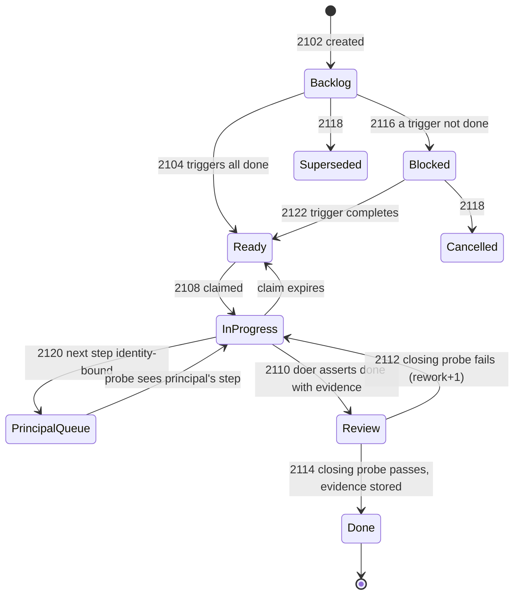

<!-- SPDX-License-Identifier: LicenseRef-Ultrastable-USL-1.0 -->
<!-- Copyright (c) 2026 Rowan Brad Quni-Gudzinas -->

# US-SPEC-08: Work items, work claims and reconciliation

| Field | Value |
|---|---|
| ID | US-SPEC-08 |
| Title | Work items, work claims and reconciliation |
| Version | 0.1.0 (draft) |
| Date | 2026-11-11 |
| Status | Draft |

## 1. Purpose

Many agents (and people) act on the same organization at once. Work claims keep two of them from doing the same work or overwriting each other. Reconciliation ensures no work item leaves the active set without a recorded reason. The principal queue holds the few steps only a person can take.

## 2. Terms

| Term | Definition |
|---|---|
| Work item | A record with identifier, title, owner role, trigger, done check, closing probe, priority, status, disposition. |
| Trigger | Identifiers of other items (or a named gate) that must be done first. |
| Work claim | An exclusive, time-limited hold on an item or a path. |
| Token | An opaque value proving the holder. |
| Fence | A monotonic integer per path, increased on each grant; a write presents the current fence. |
| Reaper | The process releasing expired claims. |
| Principal queue | The set of open gate cards. |
| WBS code | Optional dotted identifier `<portfolio>.<program>.<project>.<phase>[.<task>]`. |

## 3. Item state machine



An item leaves the active set only as `done`, `superseded` or `cancelled`, each with a disposition. A rework count at or above a threshold (default 3) escalates as a root-cause item. On Done, items naming this identifier as a trigger are re-evaluated. A reviewer is a different executor from the doer and, where two families exist, a different model family.

## 4. Work claims

```mermaid
sequenceDiagram
  participant A as Agent
  participant L as Claim service
  participant R as Resource
  A->>L: 1002 request claim(path, intent, holder)
  alt live claim held by another
    L-->>A: 1006 refuse (review theirs or take next item)
  else free
    L-->>A: 1008 token, expiry (default 2h), fence = previous+1
  end
  A->>R: 1010 write(token, fence); heartbeat renews
  R->>R: 1012 accept only live token and current fence
  A->>L: 1016 release(outcome)
  L->>L: reaper releases expired; metric counts orphans (target 0)
```

A holder paused past its expiry cannot overwrite the next holder's work, because its fence is stale (step 1014). Secret operations take a separate lease. A global kill switch makes the claim service refuse new claims, renewals, deploy leases and secret leases (US-SPEC-09).

**Seed form.** Claims are per item: `claims(item_id PK, agent, claimed_at, heartbeat_at)`. The tick's reaper deletes claims whose heartbeat is older than the time-to-live (default 120 minutes) and returns the item to `ready`.

## 5. Reconciliation

Each tick compares the active set with the previous tick and with the records of each consuming loop. An item that left the active set without a disposition (done with evidence, remediated, or backlogged with a trigger and closing probe) is recorded as a silent-drop incident and reopened. For each loop run the accounting invariant holds: `scanned = executed + failed + needs_human + no_action`; a gap above zero opens an incident, reopens the unaccounted items and blocks closure of their parents. Where several stores hold issues, a visibility ratio (open items in all stores divided by open items visible to operations tools) fires above a threshold (default 2).

## 6. Principal queue

A step routed to the principal is checked for an identity-bound line. A card without one is rerouted to the staff; the step is executed by them. A card with one is held with its default and closing probe, and closes automatically when the probe observes the step done. The number of open cards without an identity-bound line is a metric with target zero.

## 7. Normative requirements

- **US-08-R01 [L1]** At most one live claim MUST exist per item.
- **US-08-R02 [L1]** A claim MUST expire without a heartbeat within a configured time-to-live, and the reaper MUST return the item to `ready`.
- **US-08-R03 [L1]** An item whose trigger is not done MUST NOT be dispatched.
- **US-08-R04 [L1]** An item MUST NOT leave the active set without a disposition. Reconcile MUST reopen it and record a `silent_drop` outcome.
- **US-08-R05 [L1]** A gate card MUST close itself when its closing probe passes.
- **US-08-R06 [L1]** A holder MUST renew its claim by heartbeat while working.
- **US-08-R07 [L2]** A path-level claim MUST carry a token, an expiry and a fence equal to the previous fence for the path plus one.
- **US-08-R08 [L2]** A protected resource MUST accept a write only for the live token and current fence.
- **US-08-R09 [L2]** An agent facing a live claim by another holder MUST NOT duplicate the work; it MAY review the claimed change or take the next item.
- **US-08-R10 [L2]** Every queue pull SHOULD be recorded with puller, item and route.
- **US-08-R11 [L2]** Each consuming loop MUST report scanned and per-bucket counts per run; reconcile MUST test the accounting invariant and open an incident on a gap.
- **US-08-R12 [L2]** An item with rework count at or above a threshold MUST escalate as a root-cause item.
- **US-08-R13 [L2]** The number of orphaned claims MUST be a metric with target zero.
- **US-08-R14 [L2]** An interrupt-eligible step MUST leave the doer path and become one gate card.
- **US-08-R15 [L3]** Side effects crossing the claim boundary SHOULD carry idempotency keys.

## 8. Failure modes

| Failure | Effect | Mitigation |
|---|---|---|
| Executor reports "scanned 25, executed 0, failed 0, ..." | 25 items unaccounted (observed in QNFO) | Accounting invariant |
| Detect, dispatch once, never verify, re-detect | Endless loop with no repair | Closing probe; reconcile |
| Holder pauses past expiry | Overwrites next holder | Fence (R08) |
| Seed claims lack fence and token | A stalled holder that wakes could still write | PLANNED path-level claims |
| Orphaned claim | Item stuck | Reaper (R02) and metric (R13) |

## 9. Conformance tests

- **US-08-T01** Insert two claims for one item. Pass: second rejected.
- **US-08-T02** Make a claim 3 hours old with TTL 120 minutes, run a tick. Pass: claim deleted, item `ready`.
- **US-08-T03** Mark an item `done` with no disposition. Pass: reopened, one `silent_drop` outcome.
- **US-08-T04** Seed A (ready) and C (trigger A, open). Pass: C not dispatched until A is done with a disposition.
- **US-08-T05 [L2]** Holder 1 takes fence 7, expires; holder 2 takes fence 8; holder 1 writes with fence 7. Pass: rejected.
- **US-08-T06 [L2]** Run a loop that scans 25 and books 0. Pass: incident opened, 25 items reopened.

## 10. Reference implementation status

- Item-level claims, reaper, triggers, silent-drop reconciliation, gate-card probes: BUILT in `core/src/tick.js` (`reconcile`, `reap_claims`, `probe_gates`, `dispatch`) and `core/migrations/0001_init.sql`; tests in `core/test/tick.test.js`: "items that left the active set without a disposition are reopened and counted as silent drops", "stale claims are released", "gate cards close when their probe shows the owner step is done".
- Disagreements with the QNFO design: the seed tick's own `claims` table is per item and has no token, expiry column or fence (expiry is derived from `heartbeat_at`), and nothing in the tick renews the heartbeat; tokens, expiry, fences and heartbeat renewal are in the claims module below, which mirrors item claims into the seed table. The tick sets the status `blocked` only to park an item whose closing probe is not yet readable or that was released unworked; the Review and PrincipalQueue states are not implemented as states.
- Path-level claims with token, expiry and fence (R07, R08), heartbeat renewal (R06), shepherd refusal (R09), queue pull record (R10), rework escalation (R12), orphan metric (R13), one gate card per interrupt-eligible step (R14): BUILT in `core/claims/index.js` with `core/claims/migrations/0001_claims.sql`; tests `core/claims/claims.test.js` (T01 to T06 by id). Advisory except where the protected resource calls `check`; contention is proven on one SQLite handle, not on a scale-out store. The same mechanisms are RUNNING in QNFO, coordinating its own code loop and a hosted coding agent.
- Accounting invariant as an automatic gate (R11): BUILT in `core/claims/gate.js` with `core/claims/migrations/0002_gate.sql`; tests `core/claims/gate.test.js`. A gap opens an incident, reopens the unaccounted items, blocks closure of every ancestor of an unaccounted item, reopens a parent closed around the gate, and holds the loop's gate shut until a later run balances. Parent links are declared to the module; the seed item schema has no parent column. The item-set form `entered = open + closed + superseded` is BUILT in `core/remediation/index.js` (`reconcileItems`, test `core/remediation/remediation.test.js`). Observed in QNFO as a failure case.
- Visibility ratio across issue stores (section 5): BUILT in `core/claims/gate.js` (`visibilityRatio`, threshold 2, test `core/claims/gate.test.js`) against a stores port; adapters that read a real second tracker are PLANNED.
- Principal queue with reroute rule (section 6): BUILT in `core/claims/gate.js` (`routeToPrincipal`, `cardsWithoutIdentityLine` as the target-zero metric, `rerouteCards`; test `core/claims/gate.test.js`), beside the seed's gate cards with probes. Rerouting of cards filed by other modules is opt-in (`reroute_cards`) because such cards carry their identity-bound line only as text. RUNNING in QNFO.
- Not wired: the gate, the visibility ratio and the reroute are a module with a `step` surface; the composition root runs the `step` surface (`core/org/buildout.js` step `claims_gate`, test `core/org/org.test.js`); the reroute is opt-in by `reroute_cards`, and stores for the visibility ratio are not supplied by the host yet. BUILT for the step, PLANNED for the stores.
