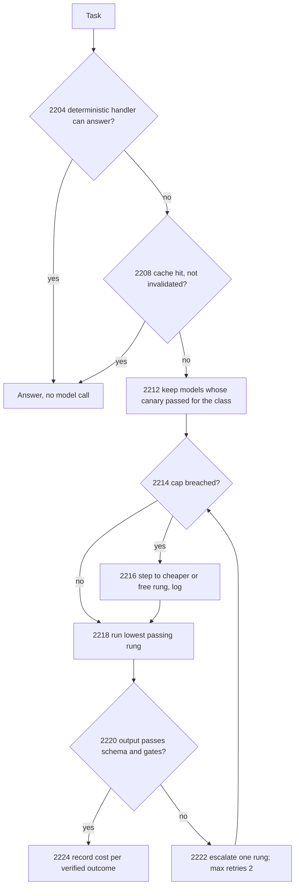

<!-- SPDX-License-Identifier: LicenseRef-Ultrastable-USL-1.0 -->
<!-- Copyright (c) 2026 Rowan Brad Quni-Gudzinas -->

# US-SPEC-09: Caps, kill switches and the cost-aware model ladder

| Field | Value |
|---|---|
| ID | US-SPEC-09 |
| Title | Caps, kill switches, cost-aware model ladder |
| Version | 0.1.0 (draft) |
| Date | 2026-11-11 |
| Status | Draft |

## 1. Purpose

An autonomous system needs bounds that hold when its other parts fail: switches that stop loops, caps on steps, tokens, time and spend, and a model-routing policy that lowers cost per verified outcome without stopping work when a budget is reached. This specification defines kill switches and drills, caps, the model ladder, the model floor and standards gate, and model admission.

## 2. Terms

| Term | Definition |
|---|---|
| Kill switch | A configuration row that stops a loop's actions but not its measurement. |
| Global kill switch | A row that makes the claim service refuse new claims, renewals, deploy leases and secret leases. |
| Task class | A named category of work with one capability test and one validation rule. |
| Rung (model) | An entry in an ordered list of ways to produce an answer, from no model call to a frontier model. |
| Capability canary | A short deterministic test of a model for a task class. |
| Cost per verified outcome | Spend attributed to tasks of a class divided by the number that passed validation. |
| Resolved upstream | The model that actually served a request after alias or gateway indirection. |
| Agreement | The share of labelled questions on which a decision model's answer equals the organization's label. |

## 3. Kill switches, caps and breakers

Each loop reads an on/off row and, when off, stops its actions while measurement continues. A drill periodically turns the global switch on for a bounded time (under 10 minutes), verifies the refusals and the observation event, turns it off in every case (including on error), verifies resumption and records the test; a metric reads the age of the last passing drill. A loop breaker files an item when a signature repeats 3 times in 24 hours. Per-iteration caps bound steps, tokens, wall-clock time and spend. Side effects carry idempotency keys. While any spend cap is breached: add no worker, schedule or paid model call, and treat reducing the overage as the top task. A breached cap steers to cheaper models; it never stops work.

## 4. Model ladder



| Layer | Name | Rule |
|---|---|---|
| L0 | Deterministic handler | Compute it (query, regex, probe, lookup, template) with no model call |
| L1 | Cache | Exact, TTL and invalidation on source change; semantic cache by cosine threshold; stable prompt prefixes billed as cached input |
| L2 | Capability gate | Keep only models whose canary passed for the class; price is a tiebreaker, never the gate |
| L3 | Cascade | Free tier, then cheap paid, then frontier; move up only on a measured failure |
| L4 | Ensemble | Sample N answers only when components are free or cached |
| L5 | Distilled specialist | Small model or exemplar bank trained offline for a recurring class |
| L6 | Draft then verify | Cheap model drafts; frontier model repairs only when deterministic checks fail |
| L7 | Budget scheduler | Daily per-class caps, an organization ceiling, a degradation order, a free fallback |

**Escalation signals** (recorded in the attempt row): schema or validator failure, tool-call parse failure, empty content, truncation, confidence below threshold. **Degradation order on cap:** serve from cache; step to a free tier; step to a cheaper paid rung; queue the task for the next window.

**Capability before price.** Observed: four candidate models did not emit valid tool calls for an agent loop while one cheap model did, so routing by price alone silently broke the loop.

```sql
CREATE TABLE model_task_matrix (
  task_class TEXT NOT NULL, rung INTEGER NOT NULL, model TEXT NOT NULL,
  unit_cost REAL NOT NULL, canary_tool_calls INTEGER, canary_schema INTEGER,
  ctx_tokens INTEGER, max_out INTEGER, agreement REAL,
  admitted_at TEXT, probed_at TEXT,
  PRIMARY KEY (task_class, rung, model));
```

**Worked example (illustrative).** 100 tasks. Cheap model 0.002 per task, passes 60. Frontier 0.02 per task, passes 98. Cascade: 100 cheap attempts cost 0.2; 40 failures go to frontier at 0.8, 39 pass: total 1.0 for 99 verified, 0.0101 per verified outcome, against frontier-only 2.0 / 98 = 0.0204. Escalation rate 0.40.

**Guard against inverted guards.** A cost guard is installed only after the resolved upstream of the path it guards is probed, because a guard whose target is dearer than the status quo raises cost. No routing or cost change ships without a same-turn probe of the logged resolved upstream rather than the model constant in code.

**Context economics.** Repeated contexts dominate input cost. Levers in order: stable-prefix caching; compaction of old turns; structured conversation state with a summary in place of raw history; retrieval of slices; a bound on every tool result.

## 5. Model floor, standards gate and admission

**Floor.** A model that writes or executes code, or produces reader-facing output, must be of frontier class; banned classes (small, legacy, distilled sub-frontier, quantized fast variants) are excluded for any purpose including diagnostics. Observed: a quantized fast model used to audit published research invented named living researchers as authors of work absent from its source.

**Floor guard.** Enumerate every worker's repository source and deployed bundle; strip comment-only lines and the banned list's own declarations; skip lines with a marker; match remaining lines against the banned patterns; exit 0 if none, else 1 and file an item per worker. A purge that is reverted by a concurrent redeploy is the case this guard prevents.

**Standards gate.** Every model advertised or configured carries maximum output at or above 32,768 tokens and context at or above 128,000, unless registered in an exemption registry with per-model evidence. All layers (server constants, client configuration, catalog) are verified after every model change.

**Admission pipeline** (per candidate model and task class; the only path by which a matrix row is created): 2302 propose; 2304 floor check (reject at 2306 with reason); 2308 capability canary; 2310 label agreement on a stratified sample (N between 100 and 500; fewer than 30 is inconclusive) with a lower confidence bound (for example Wilson 95%); 2312 compare to the class gate (default 0.7; range 0.6 to 0.85); 2314 reject for that class on failure; 2316 write the rung row on success; 2318 monitor (scheduled canaries, shadow sample of about 5% of decisions, cost per verified outcome); 2320 demote or remove (2322) if rolling agreement falls below gate minus margin (0.05), the canary fails twice, or the floor list changes. Observed: a candidate decision model agreed with the organization's labels in 0.17 of cases against a gate of 0.7 and was not adopted; random answering among six options agrees about 0.17 of the time.

```sql
CREATE TABLE model_admission (
  id INTEGER PRIMARY KEY, model TEXT, task_class TEXT,
  stage TEXT, -- floor|canary|agreement|admitted|demoted|rejected
  n INTEGER, agree REAL, lower_bound REAL, gate REAL,
  decided_at TEXT, reason TEXT, evidence TEXT);
```

**Infrastructure calibration.** A calibrator runs scheduled self-generated probe traffic (daily, weekly stress, monthly with retention cleanup), keeps exponential-moving-average baselines with variance-adaptive thresholds (EMA mean 120 ms, deviation 15 ms gives threshold 165 ms; a 240 ms run is an anomaly) and applies only reversible, binding-only adjustments from an allowlist, each verified on the next run and reverted if the metric regressed. Probe traffic is never counted as external usage.

## 6. Normative requirements

- **US-09-R01 [L2]** Each loop MUST have an on/off configuration row; when off it MUST stop actions and continue measurement.
- **US-09-R02 [L2]** A global kill switch MUST cause the claim service to refuse new claims, renewals, and deploy and secret leases while on.
- **US-09-R03 [L2]** A drill of the global switch MUST be bounded (default under 10 minutes), MUST turn the switch off in every case, and MUST record the test.
- **US-09-R04 [L2]** Each iteration MUST be bounded in steps, tokens, wall-clock time and spend.
- **US-09-R05 [L2]** While a spend cap is breached, the system MUST NOT add a worker, schedule or paid model call. Amended 2026-11-26: an implementation with graduated caps (R18, R19) MAY instead bound model calls past the allowance to a stated trickle (the running kit: one call an hour for the whole organization); it MUST NOT leave them unbounded.
- **US-09-R06 [L2]** An implementation MUST NOT raise a cap, delete a failing verification row or delete data that has no backup in order to clear a breach.
- **US-09-R07 [L2]** A cap hit MUST step the task down the ladder and MUST NOT end a task while a free path exists.
- **US-09-R08 [L2]** Routing MUST be capability first: a model without a passing canary for a class MUST NOT be routed to it.
- **US-09-R09 [L2]** Escalation MUST be triggered only by a measured signal recorded in the attempt row, one rung per failure, with a bounded retry count; a failed task MUST be filed as a work item and not retried indefinitely.
- **US-09-R10 [L2]** Cost per verified outcome, escalation rate, cache hit rate and tool-call validity rate SHOULD be measured per task class.
- **US-09-R11 [L2]** A model for code or reader-facing output MUST meet the floor. The floor guard MUST scan both source and deployed bundles.
- **US-09-R12 [L2]** A decision model MAY gate decisions only after agreement with organization labels meets the class gate by lower bound.
- **US-09-R13 [L2]** Review and proposal MUST use models of different families.
- **US-09-R14 [L1]** The model tier MUST be selected from the stated budget; a budget of 0 MUST select the smallest tier.
- **US-09-R15 [L3]** A loop breaker MUST file a root-cause item when a signature repeats 3 times in 24 hours.
- **US-09-R16 [L2]** One halt MUST stop every recurring and self-triggering path (crons, webhooks, the watch route, model calls) while read-only pages keep serving. It MUST be settable without a deploy, and a setting made without a deploy MUST win over the committed one in both directions (stop and resume). A halted clock MUST still leave a record of each slot it was halted in.
- **US-09-R17 [L2]** A per-loop switch row MAY carry an expiry after which it no longer counts, and a switch that is turned off MUST state its reason. A drill MUST NOT turn on, alter or clear a global switch that something other than the drill set, and the drill's own switch MUST carry an expiry inside the drill's bound, so that a drill that dies half way ends by itself.
- **US-09-R18 [L2]** Spend MUST be governed from one stated number (the owner's monthly budget). Every model call MUST be metered into a ledger before the next call is allowed, with the estimate taken from the usage the model reports, or from the reply length when it reports none.
- **US-09-R19 [L2]** Caps SHOULD be graduated: as the estimated bill of the day approaches its target, levels turn knobs (loop cadence, model choice, how much is bought beyond a free allocation, how often non-essential steps run), and every knob returns by itself when the estimate falls. No level MAY stop the clock, the work queue, the merge lane or the deploys.
- **US-09-R20 [L2]** Each invocation MUST meter its outbound calls against the platform's per-invocation limit. A loop that no longer fits MUST be deferred and run first at the next invocation; it MUST NOT be recorded as failed, and MUST NOT be dropped.
- **US-09-R21 [L2]** A model the provider reports as gone MUST be taken out of routing after that refusal and charged nothing, the next model MUST answer the call, and the retired model MUST be probed again after a stated interval. Where a catalog records a successor, the same rung MUST continue on the successor and the retirement MUST be recorded.
- **US-09-R22 [L2]** Items the system files on its own initiative MUST be capped per day; a refusal by the cap MUST be counted.

## 7. Failure modes

| Failure | Effect | Mitigation |
|---|---|---|
| Cheap model lacks tool calls | Retries cost more than the dear model | Capability gate |
| Cost guard targets a dearer path | Cost rises | Probe resolved upstream first |
| Truncation at server or client | Wrong output | Verify all layers |
| Kill drill leaves switch on | Outage | R03: off in every case |
| Small-model audit invents authors | Fabricated attribution | Floor |

## 8. Conformance tests

- **US-09-T01** Set a loop's switch off. Pass: no action rows written; measurement rows continue.
- **US-09-T02** Turn the global switch on, request a claim. Pass: refused with the observation event; off, then granted.
- **US-09-T03** Breach a class cap. Pass: next call served by a cheaper or free rung; task not ended.
- **US-09-T04** Route a class to a model with `canary_tool_calls = 0`. Pass: refused.
- **US-09-T05** Select tier with budgets 0, 49.99, 50, 500 and tiers at 0, 50, 500. Pass: small/small/small; small/small/small; medium doer and manager with small reviewer; large doer and manager with medium reviewer.
- **US-09-T06** Admit a model with agreement lower bound 0.17 against a gate of 0.7. Pass: rejected for that class, agreement stored.
- **US-09-T07** Run the drill. Pass: a loop is refused while the switch is on, the switch is off afterwards, the loop runs again, and one test row is recorded. Make a step of the drill throw. Pass: the switch is still off afterwards and the failed drill is recorded.
- **US-09-T08** Set the halt without a deploy and fire the cron and the watch route. Pass: no loop body and no model call runs, one record of the halted slot is written, the health page answers.
- **US-09-T09** Use up the day's allowance, then call a model twice in one hour. Pass: at most one call is served and the other is refused and counted.

## 9. Reference implementation status

Paths in 9.1 are relative to `workers/` in the platform repository (the kit's composable modules); paths in 9.2 are relative to the platform repository root. A line names a file that exists and a test that passes; code named here has not run in production unless the line says so, and every model port is a fake in the tests. Re-verified against the code on 2026-11-26.

### 9.1 Composable modules (`workers/`)

- Tier selection from budget (R14, T05): BUILT in `bootstrap/bootstrap.py` (tests in `tests/test_seed.py`) and in `core/router/router.js` (`selectTier`, test in `core/router/router.test.js`); tiers in `ultrastable.json` (0, 50, 500 USD per month minimum).
- Per-iteration cap on work in progress (`max_wip_per_role`): BUILT in `core/src/tick.js` (step `dispatch`), exercised by `core/test/tick.test.js`; no test asserts the cap by itself.
- Spend caps that steer down and refuse paid calls at the hard cap, provider and global switches for model calls, reviewer of a different family, call records (R05 to R08, R13): BUILT in `core/router/router.js`, tests in `core/router/router.test.js`. Provider probes that switch a failing route off and back on: BUILT in `core/router/calibration.js` (`core/router/calibration.test.js`).
- Kill switches with drills, caps, ladder with canaries, floor guard, standards gate, calibrator, admission checks observed once: RUNNING in QNFO (floor guard and standards gate operating; agreement check observed once).
- Persisted capability matrix and admission pipeline (floor, canary, agreement by Wilson lower bound against the class gate; R08, R12, T04, T06): BUILT in `core/ladder/index.js` (`admit`, `candidates`, `canRoute`, `setFloor`) with schema `core/ladder/migrations/0001_ladder.sql`, tests in `core/ladder/ladder.test.js`. Admission is the only code that writes a matrix row.
- Shadow sampling and demotion step: BUILT in `core/ladder/index.js` (`shouldShadow`, `recordShadow`, `rollingAgreement`, `monitor`), tests "shadow sampling" and "demotion step" in `core/ladder/ladder.test.js`. A row is removed when rolling agreement falls below gate minus margin, the canary fails twice, or the floor list changes; each removal is recorded and files an item.
- Cascade with measured escalation (R07, R09, T03) and draft-then-verify (L6): BUILT in `core/ladder/index.js` (`cascade`, `draftThenVerify`), tests "US-09-R09", "US-09-T03, US-09-R07" and "draft-then-verify (L6)" in `core/ladder/ladder.test.js`.
- Cost-per-task view (R10: cost per verified outcome and escalation rate per class): BUILT in `core/ladder/migrations/0001_ladder.sql` (view `ladder_v_cost_per_task`) and `core/ladder/index.js` (`costPerTask`), test "cost-per-task view, worked example of section 4" in `core/ladder/ladder.test.js`. Cache hit rate and tool-call validity rate are not measured.
- Binned prediction calibration: BUILT in `core/predict/index.js` (`binnedCalibration`, `gateConfidence`), test "US-05-R13" in `core/predict/predict.test.js` (see US-SPEC-05).
- Distilled specialist (L5): PLANNED. It needs a small model or exemplar bank trained offline on an organization's own task history, which no installation has yet; the attempt rows of `core/ladder` are the record such training would read.
- PLANNED: `core/router` reading the matrix of `core/ladder` when it routes (today it reads capabilities from configuration); running `core/ladder` in an organization (its `step` runs in the composition root, `core/org/buildout.js`); scheduled canaries and labelled answers from a live provider (need provider credentials); the floor guard that scans source and deployed bundles (R11) and the standards gate; L0 handlers and the L4 ensemble. The kill-switch drill, the per-loop switch rows, the L1 cache and a budget scheduler are built in the running kit (9.2).

### 9.2 Running kit and platform (`seed/`, `foundation/`)

- Per-loop switch rows (R01, R17, T01): BUILT in `seed/worker/src/switches.js` (`readSwitches`, `offReason`, `setSwitch`, `gated`; table `loop_switches`, the row `*` covers every loop, the worker variable `LOOPS_OFF` switches loops off without a deploy), honoured by the cron loops in `seed/worker/src/index.js` (a switched-off loop still leaves its beat) and by the tick in `seed/worker/src/tick.js` (only the acting steps `dispatch` and `execute` can be switched off; every measuring step still runs). Tests "US-09-R01, US-09-T01: a switched-off acting step writes no action row; every measuring step still runs" and "US-09-R01: a switched-off loop leaves its beat (measurement) and its body does not run" in `seed/worker/test/switches.test.js`. A row is written by code (`setSwitch`) or set through the worker variable; no console command writes one yet.
- Drill of the global switch (R03, R17, T07): BUILT in `seed/worker/src/switches.js` (`drill`, `lastDrill`; table `switch_drills`), run once a day by the cron as loop `kill-drill` in `seed/worker/src/index.js`. Tests "US-09-R03: the drill proves refusal, turns the switch off, proves resumption and records the test", "US-09-R03: the switch is turned off in every case, including an error inside the drill, and the failed drill is recorded", "US-09-R03: if the row cannot be deleted it still ends by itself inside the bound" and "a drill never touches a global switch the owner set" in `seed/worker/test/switches.test.js`. The age of the last passing drill is read by `lastDrill`; it is not yet a seeded metric with a breach item. R02 in the kit: the global row stops the tick's `dispatch` step, so no new claim is made; the kit has no deploy or secret leases to refuse.
- One halt for every recurring path (R16, T08): BUILT in `seed/worker/src/budget.js` (`halted`: the worker variable `HALT` wins over the committed `ops/halt.json`) and `seed/worker/src/index.js` (cron, webhooks and `/pulse/watch` answer halted; `/health` keeps serving; the halted slot is one beat). Test "HALT-1: the worker variable wins over the committed file, and a halted tick runs nothing but its beat" in `seed/worker/test/budget.test.js`; every workflow job and every worker cron honouring it is checked by "HALT-1: every workflow job honours the repository variable HALT, and every worker cron honours the worker variable" in `test/plan-limits.test.mjs`.
- Spend governor from one number, metered ledger, lean and crawl modes (R04 for model calls, R05 as amended, R07, R18, T09): BUILT in `seed/worker/src/budget.js` (`budgetConfig`, `allowance`, `decide`, `governedAI`, table `budget_ledger`), tests "a budget of 0 stays inside the free AI allocation, with a safety margin", "every call is metered in the ledger; past the day cap calls are refused within the tick and then trickle one an hour (SPEND-SOFT-1)", "lean mode allows one model call per tick" and "the tick worker never hands a loop the raw AI binding" in `seed/worker/test/budget.test.js`.
- Graduated throttle from the day's estimated bill (R19): BUILT in `seed/worker/src/spend.js` (`estimateDay`, `level`, `recordSpend`, `readSpend`), tests "graduated bands: full, ease, throttle, crawl; never a stop" and "a fast morning pace throttles before the target is reached" in `seed/worker/test/spend.test.js`; the free-plan daily allowances are governed the same way in `seed/worker/src/freetier.js` (tests in `seed/worker/test/freetier.test.js`), and the tick keeps the queue moving at every level (test "SPEND-SOFT-1: no step is skipped for good; lean defers to every 3 h, spend crawl keeps the queue moving" in `seed/worker/test/tick.test.js`).
- Per-invocation meter of outbound calls with deferral (R04, R20): BUILT in `seed/worker/src/subreq.js`, tests "meter refuses a call past the cap minus the reserve, before touching the network" and "guarded: a loop that no longer fits, or hits the cap with nothing done, is deferred and carried, never failed" in `seed/worker/test/subreq.test.js`. One budget of code-host calls per tick is in `seed/worker/src/lane.js` (`githubBudget`; see US-SPEC-24).
- Model router: L1 cache and in-flight dedupe, L3 cascade (free models first, a paid model only after every free one failed the gate and only inside a hard monthly cap, never at cap 0), deterministic quality gate, learned ordering (R07, R09, R10 in part, T03): BUILT in `workers/core/airouter/index.js` (`createRouter`), vendored unchanged as `seed/worker/src/airouter.js` and called through `seed/worker/src/airoute.js` (`routeChat`). Tests "caches and dedupes: the second identical call and a concurrent one cost no model call", "a free reply that fails the gate escalates to the next free model, not to paid", "paid never runs at cap 0; runs once free fails and a cap allows it; refuses past the cap" and "learns: a free model that keeps failing a kind is dropped from that kind" in `workers/core/airouter/airouter.test.js`. It routes by learned pass rate, not by the admission matrix of `core/ladder` (R08, R12 stay with 9.1).
- Retired models (R21): BUILT in the router ("a deprecated model is retired after one refusal and charged nothing; the next model answers" in `seed/worker/test/airoute.test.js`) and, for the platform's executor, in `foundation/agents.py` (`heal`: the same rung continues on the catalog's successor) with `foundation/modelwatch.py` and `doctrine/models.json`, tests `test_model_heal_exercised` in `tests/foundation/test_yearsim.py` and `test_a_retired_id_fails_and_is_rewritten_to_its_successor` in `tests/foundation/test_unattended.py`.
- Tier selection from budget (R14, T05) in the kit: BUILT in `seed/bootstrap/bootstrap.py`, test `test_budget_selects_model_tier` in `seed/tests/test_seed.py`.
- Loop breaker (R15, kit form): BUILT in `seed/worker/src/selfaudit.js` (`loopBreak`: an item dispatched the stated number of times with no outcome is blocked and a `LOOPBREAK-` item demands a different approach), test "loop-breaker blocks an item dispatched 3 times with no outcome and files a LOOPBREAK item" in `seed/worker/test/selfaudit.test.js`. It counts dispatches of one item, not an error signature in a 24 hour window; the signature form is `core/kernel/failure.js` (US-SPEC-17).
- Cap on self-originated items (R22): BUILT in `seed/worker/src/tick.js` (`ensureItem`, `ORIGINATE_MAX_PER_DAY`), test "ORIGINATE-CAP-1: the system files at most ORIGINATE_MAX_PER_DAY items of its own a day" in `seed/worker/test/budget.test.js`.
- PLANNED in the running kit: the model floor guard over source and deployed bundles (R11) and the standards gate (item `Q-SPEC-09-model-floor-guard`); routing from the admission matrix (R08, R12); reviewer and proposer of different model families in the kit's executor (R13 is built in `core/router`); a seeded metric and breach item on the age of the last passing drill; a console command that sets a switch row (both: item `Q-SPEC-09-drill-metric`).
