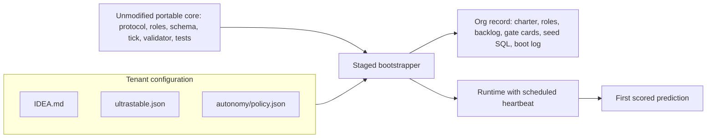

<!-- SPDX-License-Identifier: LicenseRef-Ultrastable-USL-1.0 -->
<!-- Copyright (c) 2026 Rowan Brad Quni-Gudzinas -->

# US-SPEC-10: Organization kit and seed bootstrapping from an idea

| Field | Value |
|---|---|
| ID | US-SPEC-10 |
| Title | Organization kit and seed bootstrapping from an idea |
| Version | 0.1.0 (draft) |
| Date | 2026-11-11 |
| Status | Draft |

## 1. Purpose

The loops are organization-independent. An organization-independent core plus a small tenant configuration produces a running organization. The seed is a repository that, given one human-written idea file, plans the organization, writes its charter and policy, provisions a runtime and starts the heartbeat. After the first boot nothing runs on a person's machine.

Elicitation front door: the idea file is deliberately small. What the idea file does not say is found out by the prompted-recall procedure of US-SPEC-16 (needs register, ask cards, stated reversible defaults, readiness score), not by asking the person for technical choices. The management records produced after bootstrap (charter, scope statement, work breakdown, registers, closeout) are specified in US-SPEC-15. Scope boundaries (`SCOPE.md`) apply: bootstrapping sets up delivery of what the person wants; it does not write business plans or funding material.

## 2. Terms

| Term | Definition |
|---|---|
| Core | Files identical for every tenant and not edited during installation: agent protocol, role files, schema, tick, validator, tests. |
| Tenant configuration | The idea file, the organization configuration file and the autonomy policy file. |
| Idea file | The only file a founder writes. |
| Connector | A named credential binding for an outside system, referred to by environment variable name. |
| Org record | The files a bootstrap writes about one organization. |
| Kit backlog | Items `KIT-0` to `KIT-6` that stand the organization up. |
| Boundary manifest | A file classifying every component as `core`, `app` or `private`. |

## 3. The kit

Example kinds of organization: a software company (programs: operations, infrastructure, growth, research; products: services; probes: health checks); a content site (programs: channels; products: a site; guard: error-page rate); finance and operations (programs: close, collections; probes: reconciliations; payments are interrupt-eligible); a nonprofit's services; an individual's affairs as a separated plane.

## 4. Idea file grammar

Optional front matter between `---` lines of `key: value` (text after `#` is a comment), then sections introduced by `# <Title>` (lowercased by the parser). Each section yields its bullet lines (`- `) as a list and other non-empty lines as prose, skipping lines beginning `Example:` or `Each line`. Recognised keys: `org_name`, `slug`, `owner`, `owner_contact` (a pointer to a secret store, not an address). Recognised sections: `idea`, `who it is for`, `first outcomes`, `constraints`. Monthly budget: the first match of case-insensitive `budget[^0-9]*([0-9]+(?:\.[0-9]+)?)` in the constraint bullets, else 0.

## 5. Bootstrapper stages

Seven stages in fixed order, each inside a guard that records start time, calls the stage, converts any exception to status `blocked` with type and message, logs stage, status (`ok`, `degraded`, `blocked`), detail and times, and for `blocked` adds a backlog item `BOOT-<STAGE>` (owner `operations`, priority 0, closing probe "boot log stage status ok"). It stops early only if `read` is blocked before an idea has been parsed. Exit code 0 if no stage is blocked, 2 otherwise.

| Stage | Behavior |
|---|---|
| read | Load the three files; derive name, slug (lowercase, non-alphanumeric runs to `-`, max 40 chars, default `org`), outcomes, budget; run the policy validator. Missing idea file: `degraded`, empty charter, gate card `GATE-IDEA`. Invalid policy: `blocked`. |
| detect | Test only whether each connector's environment variable is set (never its value) and whether tools exist. Each missing non-optional connector adds a gate card (default "those capabilities stay in dry-run", probe `env:<NAME>`); result `degraded`. |
| select | Take the last tier whose minimum budget does not exceed the budget. Budget above 0 adds gate card `GATE-BUDGET` (spending is identity-bound; default "free tiers only"; probe `manual`). |
| plan | `per_outcome` roles yield one instance per outcome; `pool` yields 1 below budget 50, else 2. For k outcomes: 2k + 6 instances at budget at least 50, 2k + 4 below. Kit backlog (priority 10 + n): KIT-0 charter (no trigger); KIT-1 repositories and protection and KIT-2 runtime provisioned (trigger KIT-0); KIT-3 heartbeat (done check `tick_runs_completed_1h >= 6`, trigger KIT-2); KIT-4 reports reach the owner and KIT-5 first plus accepted (trigger KIT-3). A constraint containing "nothing public" adds KIT-6 at priority 5. Each outcome becomes `OUT-<i>` (priority 30 + i, product manager, trigger KIT-0). One prediction `P-KIT-3`: `tick_runs_completed_1h >= 6`, due 2 hours after seeding. |
| write | Charter, roles, backlog, gate cards as JSON; seed SQL of `INSERT OR IGNORE` only (including one trust ledger row per (surface, action class) at the surface's start rung with reliability 0.5 and zero outcomes, and a lineage row); deployment file with placeholders replaced; worker configuration module. The stored seed contains no tenant value. |
| provision | Dry run records four commands (create database, apply migrations, execute seed, deploy) and returns `degraded`. Apply mode returns `blocked` unless the cloud token and account identifier are present; otherwise it reuses a same-named database or creates one, then runs the rest, raising an exception with the last 400 characters of error output on any non-zero exit. |
| start | Record that the schedule is armed; KIT-3 closes only when six complete ticks are seen in an hour. A four-line report and the boot log are written last. |

**Worked example (offline simulation).** Idea "Tool Share", budget 50, two outcomes. Dry run: 4 of 7 stages `ok` (read, select, plan, write); detect, provision, start `degraded`; 10 role instances (2*2 + 6); 9 backlog items (KIT-0 to KIT-6, OUT-1, OUT-2); 5 gate cards (four secrets and the budget); exit 0. Ticks run with simulated time at 10-minute steps; `P-KIT-3` is scored at the 13th tick: observed 6, verdict `hit`. The target equals the number of 10-minute intervals in an hour, so one missed tick yields 5 and a miss: the intended sensitivity of a heartbeat probe.

## 6. Lessons as design rules

| Rule | Mechanism |
|---|---|
| The boot never exits | Stage and step guards turn faults into items |
| Test the whole chain early | Credential-free dry run in CI on every push |
| Never swallow an error | Exit codes checked; last 400 characters kept |
| Verify before depending | `detect` checks tools and inputs |
| Capability from the environment | Tier from budget; start rungs from policy |
| Safety is a classification | `reversible` and `identity_bound` flags, validator, mirrored deny list |
| Local first, then widen | Low start rungs; widening only by reviewed change |
| Unfinished work is a lesson | Nothing is done without a closing probe |
| Instructions are part of the artifact | Protocol, pointers and role files from the first commit |

## 7. Boundary manifest and tenant isolation

**Boundary check (L2).** A manifest classifies each deployed worker as `core`, `app` or `private` (a private plane that never ships), and lists core scripts, workflows and tables. The check enumerates live workers, reports each live worker absent from the manifest, each manifest worker not live, any unknown class or missing role text and any listed path that does not exist, and exits 1 on any violation. CI runs it on every change, so a new component cannot merge without a decision on which side of the product it lies.

**Tenant isolation (PLANNED).** Levels: 1, a separate account per tenant; 2 (default; the seed creates one database and worker per slug), a separate database and worker in a shared account; 3, a shared database with a tenant id enforced by policy. A control plane has no read path to tenant items; each tenant pushes an hourly aggregate. A daily isolation probe writes a canary row in tenant A, attempts to read it with tenant B's credentials, expects denial (or zero rows at level 3), deletes the canary and records the result; any mismatch is a severe outcome and opens a priority-0 item.

**One-command install (PLANNED).** Takes a slug, runtime and idea file; verifies preconditions; fetches a signed bundle and stops on any SHA-256 digest mismatch (exit 3); runs the bootstrapper; provisions through the adapter; binds connectors (missing values become gate cards); deploys with probes (health returns 503 until the first tick completes); waits for the first tick; registers the tenant. Re-running performs only steps whose probes fail, so the same command upgrades a tenant.

## 8. Normative requirements

- **US-10-R01 [L1]** The idea file MUST be the only file a founder is required to write; defaults MUST work as-is.
- **US-10-R02 [L1]** A bootstrapper MUST run its stages in order, each guarded, and a failed stage MUST become a backlog item with an owner, blocker and closing probe, with later stages running degraded.
- **US-10-R03 [L1]** The bootstrapper MUST record only the presence of each connector credential. A planted secret value MUST NOT appear in any output file.
- **US-10-R04 [L1]** Seed statements MUST be idempotent.
- **US-10-R05 [L1]** A dry run with no credentials MUST complete, write all org record files and exit 0; apply mode without credentials MUST exit 2 with `BOOT-PROVISION` in the backlog.
- **US-10-R06 [L1]** Every gate card the bootstrapper writes MUST have a default in effect and a closing probe.
- **US-10-R07 [L1]** A missing idea file MUST degrade, not fail: an empty charter and a gate card.
- **US-10-R08 [L1]** Boot success MUST be stored as a prediction scored by the system itself (default: six complete ticks within one hour).
- **US-10-R09 [L1]** The stored seed MUST contain no tenant value; the bootstrapper renders the deployment file and configuration module.
- **US-10-R10 [L1]** A reviewer model MUST be designated from a different family from the authoring model where two exist.
- **US-10-R11 [L2]** A boundary check MUST fail the build when a component is unclassified or a classified component is not live.
- **US-10-R12 [L2]** Assertions published about the product SHOULD be backed by read-only probes run when viewed, and an assertion that stops being true SHOULD file an item like any failure mode.
- **US-10-R13 [L3]** A tenant isolation probe SHOULD run daily per tenant pair; a failure MUST be a severe outcome.
- **US-10-R15 [L1]** The bootstrapper MUST treat the person as a non-expert: missing information MUST become a question or a stated, reversible default per US-SPEC-16, never a requirement to supply technical detail.
- **US-10-R14 [L3]** An installer SHOULD verify a bundle digest before applying and MUST stop on mismatch.

## 9. Failure modes

| Failure | Effect | Mitigation |
|---|---|---|
| No credential | Boot halts | Gate card with `env:` probe; dry-run |
| Provision error | Half-built runtime | `BOOT-PROVISION` item with last 400 chars |
| Policy invalid | Unsafe boot | Validator blocks |
| Reviewer and doer share a family at the lowest tier | Weak review | Known limit; configure a second provider |
| Assertion probe contains a semicolon inside a literal | Runner refuses the probe; page reports false failures (observed in QNFO 2026-11-10) | Change probe and contract together; build check |

## 10. Conformance tests

- **US-10-T01** Run the dry-run bootstrap twice. Pass: second run changes nothing; exit 0.
- **US-10-T02** Run apply with no token. Pass: exit 2, `BOOT-PROVISION` in backlog, seed SQL still written.
- **US-10-T03** Plant a secret value in the environment; run; search every output. Pass: no hit.
- **US-10-T04** Remove the idea file. Pass: `degraded`, `GATE-IDEA` card.
- **US-10-T05** Budgets select tiers as in US-09-T05. Outcome count k gives 2k + 6 or 2k + 4 role instances.
- **US-10-T06** Add a constraint "Nothing public until the owner says so". Pass: KIT-6 exists at priority 5.

## 11. Reference implementation status

- Bootstrapper (dry-run, plan, write, guards, tiers, gate cards, idempotent seed SQL): BUILT in `bootstrap/bootstrap.py`; 12 Python tests in `tests/test_seed.py` passed on 2026-11-11 (`python -m unittest discover tests`). Dry-run bootstrap completes without credentials.
- Apply mode (real provisioning on a cloud account): PLANNED as a verified capability. The code is in `bootstrap/bootstrap.py` and its command order is tested with a fake command runner in `tests/test_seed.py` and `tests/test_bootstrap_temporary.py`; it has not been run against a real account as of 2026-11-15, because that needs the owner's cloud credential.
- Disagreement: the Worker entry point imports a rendered `config.js` that exists only after a bootstrap write.
- Model-calling executor: BUILT in `core/runner/index.js` (tests `core/runner/runner.test.js`): a doer and a reviewer on different models take a ready item to a draft pull request through the model router; verification is the repository's CI and the runner never merges. It is opt-in (`config.runner.enabled`) and has not run on a live account.
- Repository creation: PLANNED (KIT-1 awaits a code-host credential that can create repositories; no code creates one).
- Unified command-line tool: BUILT in `tools/us.mjs` (tests `tools/us.test.mjs`): one entry point that runs bootstrap, install, verify, release, boundary, the test suites and the checks, and returns each script's exit status unchanged.
- Tenant isolation (section 7): BUILT in `core/tenancy/index.js` (tests `core/tenancy/tenancy.test.js`): levels 1 to 3 with level 2 the default, a tenant-scoped store for level 3, counts-only hourly aggregates with no control-plane read path to tenant items, and the daily isolation canary probe per tenant pair (US-10-R13) whose failure is a severe outcome and a priority-0 item. Tested with in-memory databases and a fake HTTP path; not wired into `core/org` and not run between two live tenants.
- One-command install (section 7): BUILT in `core/install/index.js` and `tools/install.mjs` (tests `core/install/install.test.js`, `tools/install.test.mjs`): preconditions, SHA-256 digest check of bundle and migrations against the manifest with exit 3 on mismatch (US-10-R14), Ed25519 signature of the manifest (`tools/release_bundle.mjs` signs with a key named by environment variable), bootstrap, provision through `adapters/cloudflare/install-adapter.js`, connectors by presence with gate cards, deploy with the health probe, first tick, tenant registration; a re-run performs only the steps whose probes fail. PLANNED: a run of the apply path against a real account, and a signed release (the signing key is the owner's to create).
- Boundary check (US-10-R11): BUILT in `tools/boundary_check.mjs` with the manifest `tools/boundary.json` (tests `tools/us.test.mjs`, including this repository's own tree): an unclassified component, a classified component that is not live, an unknown class, a missing role, a missing listed path or table each exit 1.
- Assertion probes (US-10-R12): BUILT in `core/describe/index.js` (tests `core/describe/describe.test.js`): each published statement is a claim with a read-only probe that the probe runner re-checks each period; a failing or stale claim is withdrawn from the served page and files an item.
- Boundary check and assertion probes: RUNNING in QNFO (one installation, 40 workers classified at 2026-11-10 by its own manifest, owner-reported).
