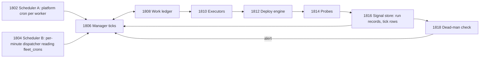

<!-- SPDX-License-Identifier: LicenseRef-Ultrastable-USL-1.0 -->
<!-- Copyright (c) 2026 Rowan Brad Quni-Gudzinas -->

# US-SPEC-11: Fleet runtime

| Field | Value |
|---|---|
| ID | US-SPEC-11 |
| Title | Fleet runtime: schedulers, executors, dispatcher, run ledger |
| Version | 0.1.0 (draft) |
| Date | 2026-11-11 |
| Status | Draft |

## 1. Purpose

This specification describes how the agent processes of the other specifications are kept running without a person or a person's session: independent schedulers start work, executors carry it out and record it, probes verify it, and a dead-man check notices when a scheduled slot has no record.

## 2. Terms

| Term | Definition |
|---|---|
| Fleet | The set of independently deployable worker processes (serverless worker, container or job) that implement the agents, loops and surfaces. |
| Worker contract | The checklist every fleet member satisfies so the fleet can be enumerated and managed. |
| Scheduler | A process that decides from time alone that a procedure is due and starts it. |
| Executor | A process that carries out one task definition and writes a run record. |
| Run ledger | The table of run records. |
| Slot | One expected time-aligned firing of a scheduled procedure. |
| Dead-man check | A check that raises an alert when a slot has no record. |

## 3. Topology



Separating starting (schedulers) from doing (executors) and recording (signal store) means a stalled scheduler, executor or recorder leaves a different, detectable gap instead of a silent stop. The dispatcher reduces a schedule change from a deployment to a row write.

## 4. Worker contract

Every fleet member provides: (1) a `VERSION` constant in semantic-version form incremented per deployment; (2) `GET /health` returning `{status, worker, version, enabled, bindings_ok}`; (3) a self-describing header (purpose, capabilities, deploy method, canonical source); (4) a canonical directory holding a copy of the deployed source so repository and deployment can be compared byte for byte; (5) a registry row (name, purpose, kind, status, crons, dependencies, health URL, autonomy level, owner); (6) a list of secret names, never values; (7) kill-switch and autonomy flags readable from a key-value store or database. The registry is the only census authority; deployed reality is reconciled against it hourly; each worker is in one state: `live`, `drifted`, `degraded`, `paused` or `retired`. A worker with no version is invisible to the drift comparison.

## 5. Dynamic dispatcher

On each per-minute invocation: (1) read every `fleet_crons` row with `enabled = 1` and `next_fire` null or not later than now; (2) for each, compute the next fire time from the five-field cron expression and insert a `fleet_runs` row with status `queued`; (3) post `{task_id, cron_name}` to the executor; (4) record `last_fired` and `next_fire` whether or not the post succeeded, so a failing executor is not re-fired every minute. A dispatch error is returned in the result and visible as a run row that never leaves `queued`.

```
function next_fire(expr, from):
  f = split(expr)               # minute hour dom month dow
  if len(f) != 5: return null
  t = floor_to_minute(from) + 1 minute
  repeat up to 527040 times:    # 366 days of minutes
    if match(f[0], t.minute) and match(f[1], t.hour) and match(f[2], t.dom)
       and match(f[3], t.month) and match(f[4], t.dow): return t
    t = t + 1 minute
  return null
```

A field matcher accepts a comma list of terms: `*`, `*/n` (true when the value is a multiple of n), a range `a-b`, or a literal. For example `*/10 * * * *` called at 12:03 returns 12:10.

## 6. Executor and run ledger

The executor reads a task row from `fleet_tasks` (`id`, `type`, `definition` JSON, `enabled`) and runs it by type: `sql` (one statement on a named binding, returning row count and first three rows); `http` (one request, status and first 500 characters); `ai` (a model call through a gateway, model chosen from an allowed list defaulting to the cheapest, bounded tokens, default 1,024); `workflow` (an ordered list of such steps). Any other type is rejected. Run outcome updates the dispatcher's row: `running`, then `ok` with a result truncated to 4,000 characters, or `failed` with an error truncated to 1,000. After completion the executor builds an event envelope (schema version, kind, identifier, timestamp, provenance with emitter, session and SHA-256 of the payload), validates it before writing, and stores it `accepted` or `rejected` with the error.

A fuller run ledger: `run_id, worker, trigger (cron|http|event|manual), ts_start, ts_end, status, error_class, summary, evidence_refs, parent_run, cost`.

**Accounting invariant.** For every batch an executor scans: `executed + failed + needs_human + no_action = scanned`. A batch violating it is itself a failure.

## 7. Redundancy and the dead-man check

Two scheduling paths are independent when they share no process and no table of next-fire state. A slot has a record when a tick row or a run row with a start time inside the slot exists.

1. For each declared recurring procedure compute expected slots in the window from its cron expression.
2. Count records per slot.
3. A slot with zero records opens an alert item naming the procedure, the slot and which scheduler(s) declared it.
4. If both schedulers declare the procedure and exactly one produced a record, label it a single-path failure (lower priority, degraded redundancy). If neither produced a record, label it a stop (higher priority).

With two active schedulers a slot may have duplicate records; the tick takes a work claim so the second firing ends without acting.

**Worked example.** `*/10 * * * *` has 6 slots per hour. Scheduler A has records in all 6; B in slots 1, 2, 4, 5, 6. Slot 3 has one record, so no alert; B's reliability is 5 of 6 = 83%. If both are missing in slot 4, a stop alert opens.

## 8. Normative requirements

- **US-11-R01 [L3]** Every fleet member MUST satisfy the worker contract of section 4.
- **US-11-R02 [L3]** The registry MUST be the census authority, and deployed state MUST be reconciled against it on a schedule.
- **US-11-R03 [L3]** The dispatcher MUST update `next_fire` and `last_fired` whether or not dispatch succeeded.
- **US-11-R04 [L3]** A schedule change MUST be possible by writing a row, with no redeploy.
- **US-11-R05 [L3]** The executor MUST reject unknown task types and MUST write a run record for every execution.
- **US-11-R06 [L3]** The executor MUST validate event envelopes before writing and store rejects with their error.
- **US-11-R07 [L3]** The executor MUST satisfy the accounting invariant per batch.
- **US-11-R08 [L3]** The dead-man check MUST compute expected slots from declared cron expressions and open an alert for each slot with no record.
- **US-11-R09 [L3]** Alerts MUST distinguish a single-path failure from a stop.
- **US-11-R10 [L3]** The manager tick MUST take a work claim so duplicate firings do not both act.
- **US-11-R11 [L3]** A dispatcher SHOULD guard against overlapping runs of one task, for example by a claim before dispatch and a reaper for stale `queued` rows.
- **US-11-R12 [L3]** Schedules SHOULD be staggered; collisions per minute SHOULD be measured.
- **US-11-R13 [L3]** A monitor SHOULD be hosted in a different worker than the one that writes the probe table it monitors.

## 9. Failure modes

| Failure | Effect | Mitigation |
|---|---|---|
| Executor fails to dispatch | Row stuck at `queued` | Reaper; alert |
| Overlapping runs of one task | Contend for one ledger row | Claim before dispatch |
| Worker without version | Invisible to drift check | R01 |
| Monitoring roster frozen | 73 of 83 probe names frozen at one timestamp, 3,342 of 21,076 probe rows HTTP 404 for retired workers (observed in QNFO) | Census; roster reconciliation |
| Both schedulers silent | Stop | R08, R09 |

## 10. Conformance tests

- **US-11-T01** `next_fire('*/10 * * * *', 12:03)`. Pass: 12:10.
- **US-11-T02** Disable the executor and let a job fire. Pass: row stays `queued`, `next_fire` advanced, no re-fire next minute.
- **US-11-T03** Post an unknown task type. Pass: rejected.
- **US-11-T04** Remove all records for one slot of a declared procedure. Pass: alert naming procedure and slot.
- **US-11-T05** Fire the tick from both schedulers in one slot. Pass: one acts, the other ends without acting.

## 11. Reference implementation status

- The seed has one cron-driven tick (`adapters/cloudflare/src/index.js` `scheduled`, running `core/src/tick.js`). The fleet runtime below is a module beside it; the composition root does not call it yet, and nothing below is in production use.
- Per-minute dispatcher reading `fleet_crons` (R03, R04, R11), cron matcher (T01), typed executor for `sql`, `http`, `ai` and `workflow` tasks with a run record for every execution (R05), event envelopes validated before writing with rejects stored (R06): BUILT in `core/fleet/index.js` with `core/fleet/migrations/0001_fleet.sql`; tests `core/fleet/fleet.test.js` (T01 to T05 by id). The `ai` task calls a gateway port; no model provider is bundled. Worker contract, dispatcher, executor and a subset run ledger (`fleet_runs`) are RUNNING in QNFO. Native per-worker cron and the dispatcher coexisted there; no measured failover between them is recorded. The dynamic dispatcher and executor were later listed as retired in a QNFO consolidation audit, so redundancy was demonstrated before that date and is not asserted afterward.
- Worker contract check (R01) and registry-versus-deployment reconciliation into the five states with the ghost, unregistered and unversioned counts (R02): BUILT in `core/fleet/index.js` (`contractGaps`, `register`, `reconcile`; test `core/fleet/fleet.test.js`) against a `deployed.list()` port. The adapter that reads a live platform's deployments is PLANNED: it needs an account. RUNNING in QNFO, where versions were incomplete (in one scan 27 of 79 deployed workers lacked a version) and the contract was enforced only in part.
- Full eleven-column run ledger (`fleet_runs`), accounting invariant as an automatic gate (R07: `recordBatch`, `drain`, `batchGate`), slot-counting dead-man check with single-path and stop alerts and per-scheduler reliability (R08, R09: `deadman`), one acting firing per slot under a work claim (R10: `fireOnce`), collisions per minute (R12: `collisions`) and event-triggered scheduling (`setTrigger`, `emit`): BUILT in `core/fleet/index.js`; tests `core/fleet/fleet.test.js`.
- R13 (a monitor hosted outside the worker that writes its probe table): BUILT as a detector that refuses to run in the writer, `core/remediation/index.js` (`externalLiveness`, test `core/remediation/remediation.test.js`). Deploying it as a separate worker is PLANNED: it needs a live account.
- Hot standby: PLANNED. It needs two schedulers deployed on a live account and a measured failover; `fireOnce` and the dead-man check are the parts built toward it. Automatic staggering of schedules (R12) is PLANNED; only the measurement is built.
