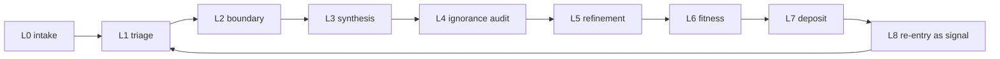

<!-- SPDX-License-Identifier: LicenseRef-Ultrastable-USL-1.0 -->
<!-- Copyright (c) 2026 Rowan Brad Quni-Gudzinas -->

# US-SPEC-12: Signal-organism architecture, wiring graph and orphan detection

| Field | Value |
|---|---|
| ID | US-SPEC-12 |
| Title | Signal-organism architecture, wiring graph, orphan detection |
| Version | 0.1.0 (draft) |
| Date | 2026-11-11 |
| Status | Draft |

## 1. Purpose

Part A defines a payload architecture in which the system's own outputs re-enter as inputs: every artifact is a signal with an evidential weight, a boundary table confines which worker may read which data class (default deny), and a strict rule accepts a revision only if it shrinks the set of open questions. Part B defines the wiring graph: a machine-read graph of what the fleet's members and resources are bound to, used to find islands, unresolved targets and tables that are written but never read. Biological words ("organism", "sensing", "metabolism") name data flows and imply no biological process.

Scope note: the signal pipeline is a general pattern for any signal source. QNFO uses it for its own research application, which is an application of QNFO and not part of Ultrastable's default product; publication and dissemination workers named below are examples from that application and belong in an opt-in Capability Pack (`SCOPE.md`). The wiring graph (Part B) is core.

## 2. Terms

| Term | Definition |
|---|---|
| Signal | A record `s = (time, source, content, weight)`. The weight states what the signal licenses the system to believe; a record without a weight is noise. |
| Artifact | An output object with a type, an attribution and a deposit identity (for example a published document with a persistent identifier). |
| Open-question set U(a) | The questions from a fixed audit list (default 15) that artifact a does not answer. |
| Boundary | The set of permitted (worker, source, domain) triples. |
| Re-entry | Converting a deposited artifact into a signal. |
| Wiring graph | A directed graph of fleet members and resources whose edges are declared bindings read from deployment metadata, not documentation. |
| Orphan | A node or table with no declared consumer or no declared producer. |
| Island | A worker with no service edge in either direction. Sink: called by others, calls none. Source: calls others, called by none. |
| Producer-consumer map | For each table or queue, the processes that write it and those that read it. |

## 3. Part A: signals, boundary, triage, re-entry

Layers as data flows, each reading the previous layer's output table: L0 intake into a proposals table; L1 triage (weight and decision ACCEPT, LOG or IGNORE from a two-model scorecard); L2 boundary confinement; L3 synthesis of a candidate artifact; L4 ignorance audit; L5 refinement; L6 fitness; L7 deposit with attribution; L8 feedback (the deposited artifact re-enters as a signal).



```sql
CREATE TABLE signals (
  id TEXT PRIMARY KEY, ts TEXT, source TEXT, source_ref TEXT, content TEXT,
  open_questions TEXT, evidential_weight REAL, domain TEXT,
  status TEXT, decision TEXT, score REAL, created_at TEXT);
CREATE TABLE signal_worker_boundary (
  worker TEXT, source TEXT, permitted INTEGER DEFAULT 1, domain TEXT, note TEXT,
  PRIMARY KEY (worker, source));
```

**Boundary enforcement.** (1) The worker presents the signal it intends to consume. (2) Look up (worker, source, domain). (3) No row: deny (default deny). (4) Row with `permitted = 0`: deny. (5) Otherwise permit. (6) A denial is written as an incident and does not stop the worker's other work. A cross-domain guard rejects a triple whose domain is not listed. Example seed: research workers consume research sources and re-entry; dissemination workers only deposited artifacts and engagement; a separated-plane surface only its own source; operations only fleet telemetry.

**Re-entry rule.** (1) Select artifacts with a deposit identity, distributed or published, whose identifier is not already a `source_ref` of a re-entry signal (the identifier is the idempotency key). (2) Build content as title, abstract, identifier and U(a). (3) If U(a) is empty or unrecorded, write the signal with weight 0 and status `logged` and stop; recording U(a) at review time is a prerequisite. (4) Set the weight to a stored value (high for verified, review-clean artifacts; 0 for artifacts that failed review); it is stored, not inferred. (5) Write the signal with source `artifact_reentry`. (6) A response is accepted only if it strictly shrinks U, and a shrinkage obtained by narrowing a statement is logged as a violation.

**Worked example (illustrative).** U(a) has 15 questions; re-entry weight 0.8. A revision leaves 12: accepted. A second leaves 12: not accepted. A third leaves 9 but a diff check finds two result-asserting paragraphs removed: logged as narrowing and rejected.

**Fitness threshold.** A signal is worth responding to when expected reduction in open questions per unit of effort exceeds a threshold. The threshold is initialised null; while null, triage falls back to the L1 scorecard. A numeric value is written only after an experiment shows fitness-scored triage beats recency-scored triage.

## 4. Part B: wiring graph and orphans

**Sweep.** For each worker record cron expressions, routes, queue consumers and bindings by type: relational database, key-value namespace, object bucket, vector index, queue, durable object, workflow, service binding (a worker-to-worker call), AI binding, secret (name only), text variable. Write to a graph store (generated, account, worker_count, errors, workers[]). A worker whose interface call errored is listed under `errors` and excluded from counts.

**Analyzer.** (1) Build the edge set of (caller, callee) from service bindings. (2) Compute in-degree and out-degree per node. (3) Label island (both zero), sink (only in-degree), source (only out-degree). (4) Label an edge target unresolved when absent from both graph and registry. (5) Directed density = edges / (n * (n - 1)). (6) Compare graph with registry and report drift counts: ghosts (registered, not deployed), unregistered (deployed, not registered), unversioned. (7) Write an integration score with the counts.

**Worked example.** 80 registered workers and 49 declared edges: density 49 / (80 * 79) = 49 / 6,320 = 0.00775 (recorded 0.0078); 42 islands and 16 sinks in the same reading: a sparse near-star in which most workers are un-integrated leaves.

**Orphan tables.** Join each table's writer set and reader set; a table with writers and no readers is a producer without a consumer. Four such faults in one QNFO audit day: 75 improvement rows with no drain; 34 queued dispatch rows with zero transitions; an issue drain that processed 21 items and closed 0; an executor that scanned 25 and executed 0.

**Census.** A table listing each member with measured activity, separating idle from unmeasured. Absence from the monitor's roster is not proof a worker is idle. Measure first by extending the roster; retire only members dead for a period (default 2 days) or that fire and fail.

## 5. Normative requirements

- **US-12-R01 [L3]** A signal MUST carry an evidential weight; a record without one MUST be treated as noise.
- **US-12-R02 [L3]** A worker MUST consult the boundary table before consuming a signal; absence of a row MUST deny.
- **US-12-R03 [L3]** A boundary denial MUST be recorded as an incident and MUST NOT stop the worker's other work.
- **US-12-R04 [L3]** Re-entry MUST be idempotent on the artifact identifier.
- **US-12-R05 [L3]** An artifact with no recorded U(a) MUST re-enter with weight 0 and status `logged`.
- **US-12-R06 [L3]** A re-entry weight MUST be stored, not inferred.
- **US-12-R07 [L3]** A revision MUST be accepted only if it strictly shrinks U, and a shrink by narrowing a statement MUST be logged as a violation and rejected.
- **US-12-R08 [L3]** While the fitness threshold is null, triage MUST use the scorecard fallback.
- **US-12-R09 [L3]** The wiring graph MUST be read from deployment metadata, not documentation.
- **US-12-R10 [L3]** A worker the metadata interface errored on MUST be listed under `errors` and excluded from counts.
- **US-12-R11 [L3]** The analyzer MUST label islands, sinks, sources, unresolved targets and the three drift counts.
- **US-12-R12 [L3]** The implementation SHOULD detect producer-without-consumer tables from the producer-consumer map.
- **US-12-R13 [L3]** Idle workers MUST NOT be retired before the monitor roster includes them.
- **US-12-R14 [L3]** Probe and calibration traffic MUST NOT be counted as external usage.

## 6. Failure modes

| Failure | Effect | Mitigation |
|---|---|---|
| Pipeline, not loop: 19 artifacts published, none re-entered (observed in QNFO) | No learning from outputs | L8 re-entry |
| Whole-word match fails on word stems | Missed anchor | Stem matching |
| Edge only via shared database | Worker shown as island | Data-flow edges (PLANNED) |
| Graph and registry disagree by capture date | Different counts | Date every reading |
| Injected instruction in one worker's input | Reaches every worker | Boundary limits which worker reads which class |

## 7. Conformance tests

- **US-12-T01** Present a (worker, source) with no boundary row. Pass: denied and incident written.
- **US-12-T02** Run re-entry twice on one artifact. Pass: one signal.
- **US-12-T03** Re-enter an artifact with U(a) empty. Pass: weight 0, status `logged`.
- **US-12-T04** Submit a revision with 12 open questions against 12. Pass: rejected.
- **US-12-T05** Analyze a graph of 80 nodes and 49 edges. Pass: density 0.00775.
- **US-12-T06** Create a table with a writer and no reader. Pass: reported as a producer without a consumer.

## 8. Reference implementation status

- The signal pipeline and the wiring graph below are modules; the composition root calls their `step` surfaces (`core/org/buildout.js`, steps `signals` and `graph_wiring`; the graph step needs a `metadata` port and records that it skipped without one). No deployed account runs them yet.
- Signal intake, triage, boundary, synthesis, ignorance audit, strict-shrink refinement, deposit and re-entry (R01 to R07): BUILT in `core/signals/index.js` with `core/signals/migrations/0001_signals.sql`; tests `core/signals/signals.test.js` (T01 to T04 by id). Triage, synthesis and the audit call scorer, synthesizer and auditor ports; no model is bundled. Narrowing is detected against an artifact's listed assertions only. RUNNING in QNFO for its research pipeline, where the boundary table, re-entry and the strict-shrink rule were built in part and operation is not evidenced.
- Fitness threshold (R08): BUILT as a mechanism in `core/signals/index.js` (`proposeFitnessThreshold`, `triage`; test `core/signals/signals.test.js`): the threshold starts null, triage uses the scorecard while it is null, and a number is written only by a recorded experiment in which fitness-scored triage beat recency-scored triage. The numeric value itself is PLANNED: no experiment has been run, so none is specified.
- Wiring sweep, graph computation and census (R09 to R11, R13, R14): BUILT in `core/graph/wiring.js` with `core/graph/migrations/0002_wiring.sql`; tests `core/graph/wiring.test.js` (T05 by id), against metadata, registry, roster and activity ports. The adapter that reads a live platform's bindings is PLANNED: it needs an account. RUNNING in QNFO (sweep of 2026-09-09 captured 75 of 76 workers; one failed with a closed connection). Those readings are owner-reported and dated; the sweep file held no cron or route data, so the trigger layer came from registry rows.
- Orphan-table join and data-flow edges (R12): BUILT in `core/graph/wiring.js` (`extractTableAccess`, `producerConsumer`, `analyze`; test `core/graph/wiring.test.js`). Table access is read from declared lists and from SQL in script text; SQL assembled at run time is not seen. Data-flow edges are written to the edge table that `core/graph/index.js` `blastRadius` reads.
- Stem matching for anchors (section 6): PLANNED.
