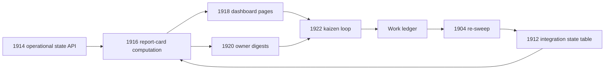

<!-- SPDX-License-Identifier: LicenseRef-Ultrastable-USL-1.0 -->
<!-- Copyright (c) 2026 Rowan Brad Quni-Gudzinas -->

# US-SPEC-13: Dashboard, service levels and report cards

| Field | Value |
|---|---|
| ID | US-SPEC-13 |
| Title | Dashboard, SLA, report card |
| Version | 0.1.0 (draft) |
| Date | 2026-11-11 |
| Status | Draft |

## 1. Purpose

A principal and the managers need one view of what the organization is doing and how well. This specification defines the dashboard and its data routes, the service-level policy that bounds how old an open item may be, and the report cards that score the system against rubrics with evidence pointers. Digests and dashboard are built from the same state, so they cannot disagree.

## 2. Terms

| Term | Definition |
|---|---|
| Dashboard | A worker that renders operational state and exposes it as JSON. |
| Report card | A dated record scoring named dimensions against a named rubric, each score with evidence and confidence. |
| Evidence sheet | A table in which each assertion carries evidence, confidence and status, so no score is accepted without an evidence pointer. |
| Severity (SEV) | A class setting time to resolution from the open date. |
| Hard cap | No open row has a due date beyond a bound. |
| Kaizen loop | The loop that dispositions the largest gap rows into the work ledger. |

## 3. Dashboard

Routes: `/` status page; `/api/state` raw JSON; `/api/refresh` recompute; `/api/integration` registered, live, edges, islands, sinks, density, drift; `/api/loop` last execute time and scanned/executed/failed/needs_human/no_action; `/health` version and liveness. Panels: 24-hour requests and errors from platform analytics; per-scheduled-worker errors and next runs; audit panels; open gate cards; open agent issues; drift divergence. Recorded gaps to design against: no per-worker run-success ledger; registered probes pointing at hostnames returning 404 so unrouted-but-live workers were reported down.



## 4. Service-level policy

| Severity | Meaning | Time to resolution |
|---|---|---|
| SEV1 | System down, security, data loss | 24 hours |
| SEV2 | User-visible regression or wrong output | 72 hours |
| SEV3 | Enhancement or backlog (default for next-action rows) | 7 days |
| SEV4 | Optional or research | 14 days |

**Hard cap.** No open row has a due date more than 14 days out, except calendar-bound items on a natural schedule, items gated on an external event, and rate-limited drains rescoped to a running checkpoint (for example 329 records at about 18 per day). An acceleration rule pulls every other open agent-owned row beyond the SEV3 limit to that limit. A weekly audit checks that each open row has a dated trigger or a durable executor, and a view of items waiting on a person stays at zero.

```
for row in open_rows:
    row.due = min(row.due, row.open_date + sla(row.severity))
    if not exempt(row) and row.due > now + 14d: row.due = now + SEV3_cap
    if row.due < now: raise_priority(row); notify(manager)
```

**Per-step budgets.** Each stage of each process has a time budget. At the tick, for each step whose elapsed time exceeds budget B: if elapsed <= 2B file one item keyed by (process, step); if elapsed > 2B and no blocking question is open for it, write one question card with the step, elapsed time and closing probe. With B = 4 h, a review step at 5 h files an item and at 9 h writes one blocking question. Each process defines its definition of done once and maps at least two independent paths to it (primary, remediation, workaround); a step with exactly one path is a gap.

## 5. Report cards

**Systems report card.** Scores dimensions against published rubrics (levels of automation, organizational viability, decision-cycle closure, self-adaptive loops, control-loop automation, time horizon). Each score has a statement, evidence, confidence and status; for example "about 5 of 8 loops closed" is medium confidence because it is inferred from receipt counts.

**Objective function.** The operational triad: human-gated operations toward 0, drift divergence toward 0, self-healing active. A cycle is good if it moves the triad toward (0, 0, active). A six-term scalar `F = w1*loop_closure_rate - w2*drift_count - w3*human_interventions - w4*cost_overrun - w5*integration_gap + w6*throughput` was drafted; its weights were uncalibrated and F was not a stored scalar.

**Autonomy report card.** Ten dimensions scored 0 to 5 with an evidence pointer and a stated gap to the next point; the overall score is their mean. Used as set-points of a homeostasis loop: re-scored monthly by a dated register row; a dimension that falls 0.5 or more without a documented cause becomes a kaizen candidate; the three largest gap rows are dispositioned per cycle. The card records its own limits: self-measurement bias (the system grades itself), rubric mismatch (rubrics designed for vehicles, people or organizations applied by analogy), and point-in-time evidence; a top score is reported as a gap row, not accepted. The card codifies a residual consent boundary: irreversible external actions where the principal is the identity actor; destruction of the principal's personal data without a rollback; and changes to the objective function, which the system may propose but not adopt.

## 6. Normative requirements

- **US-13-R01 [L3]** The dashboard MUST expose raw state as JSON and a health route.
- **US-13-R02 [L3]** Digests and dashboard MUST be computed from the same state.
- **US-13-R03 [L3]** A report card score MUST carry an evidence pointer, a confidence and a status; a score without evidence MUST NOT be accepted.
- **US-13-R04 [L3]** A report card MUST state its limits, including self-measurement bias.
- **US-13-R05 [L3]** A dimension that falls by 0.5 or more without a documented cause MUST become a work item.
- **US-13-R06 [L3]** The system MUST NOT adopt a change to its own objective function; it MAY propose one.
- **US-13-R07 [L2]** Each open row MUST have a severity and a due date no later than open date plus the severity's time, subject to the hard cap.
- **US-13-R08 [L2]** No open row MAY carry a due date more than 14 days out except the three exemptions of section 4.
- **US-13-R09 [L2]** A row past due MUST be raised one priority level and the manager notified.
- **US-13-R10 [L2]** The count of items waiting on a person MUST be a metric with target zero.
- **US-13-R11 [L3]** Per-step budgets SHOULD exist for every stage; a breach MUST file an item, and a breach of twice the budget MUST produce exactly one blocking question per (process, step).
- **US-13-R12 [L3]** Each process SHOULD define its done check once and map at least two independent paths to it.
- **US-13-R13 [L3]** Probe targets SHOULD be validated against routing, so unrouted-but-live workers are not reported down.

## 7. Failure modes

| Failure | Effect | Mitigation |
|---|---|---|
| System grades itself | Inflated scores | R04, outside audit (PLANNED) |
| Rubric applied by analogy | Misleading level | State mismatch |
| Unweighted scalar F | Scales dominate | Keep triad; calibrate weights first |
| Probes on 404 hostnames | False outages | R13 |
| Top score accepted | Sycophancy | Report top row as a gap |

## 8. Conformance tests

- **US-13-T01** GET `/health` and `/api/state`. Pass: JSON with version and counts.
- **US-13-T02** Add a score without an evidence pointer. Pass: rejected.
- **US-13-T03** Add an open SEV3 row due in 30 days. Pass: due set to now plus the SEV3 cap.
- **US-13-T04** A step with B = 4 h elapsed 9 h and no open question. Pass: exactly one question card.
- **US-13-T05** Drop a dimension by 0.6 with no cause. Pass: a work item.

## 9. Reference implementation status


- Health route and the four-line tick report: BUILT (`adapters/cloudflare/src/index.js`, `core/src/tick.js`).
- Product dashboard: BUILT as a module in `core/console-l3/dashboard.js` (tests: `core/console-l3/dashboard.test.js`): the status page, `/api/state`, `/api/refresh`, `/api/integration`, `/api/loop` and `/health`, all rendered from the one state function of `core/console-l3/index.js` that also feeds the digest (US-13-R01, US-13-R02); probe targets are checked against routing so an unrouted target is reported unrouted, not down (US-13-R13). The composition root serves the earlier JSON routes under the console; mounting the status page and the three new routes there is not done yet.
- Dashboard panels fed by platform analytics (24-hour requests and errors, per-scheduled-worker errors and next runs): PLANNED. They need a live account's analytics; the seed has no such reading.
- Report cards with evidence, confidence, status and limits; a fall of 0.5 files a work item; the objective function may be proposed and never adopted (US-13-R03 to R06): BUILT in `core/console-l3/index.js` (tests: `core/console-l3/console-l3.test.js`).
- Fleet dashboard (72 workers, 24-hour request and error totals, flow chains, integration route): RUNNING in QNFO. Autonomy report card scored 3.6 of 5 on 2026-09-10; that figure is the system's own, dated, and not independently verified.
- Service-level policy and weekly audit: RUNNING as policy in QNFO.
- Automatic due-date recomputation, the 14-day hard cap with its three exemptions, the acceleration rule, the past-due raise with a notice to the manager, the weekly audit, and the count of items that wait on a person as a metric with target zero (US-13-R07 to R10, US-13-T03): BUILT in `core/sla/index.js` (tests: `core/sla/sla.test.js`). It runs as one `step` per tick once the composition root calls it; that call is not wired yet.
- Per-step budgets and automatic breach procedure (US-13-R11, US-13-R12, US-13-T04): BUILT. `core/sla/index.js` stores process definitions and step runs and reports steps with fewer than two paths; `core/console-l3/index.js` files one item past the budget and exactly one blocking question past twice the budget.
- Six-term F: BUILT as a computed, stored scalar in `core/sla/index.js` (table `sla_objective`, with the weights in effect and the triad). Three terms are read from L1 tables (loop closure rate, human interventions, throughput); drift count, cost overrun and integration gap are read only when the caller passes a reading and are marked unmeasured otherwise.
- Calibrated weights for F: PLANNED. The weights are configuration defaults marked uncalibrated; calibrating them needs a history of real cycles.
- Monthly automated recomputation of the autonomy card from tables: BUILT in `core/sla/index.js` (`recomputeAutonomyCard`, driven by a dated register row; tests in `core/sla/sla.test.js`, including US-13-T05). The ten dimensions are ratios this module reads from L1 tables, not the ten dimensions of the QNFO card; a top score is recorded as a gap and the three largest gaps are filed each cycle.
- Outside audit of the report cards: PLANNED. The cards are self-measured and say so in their limits.
