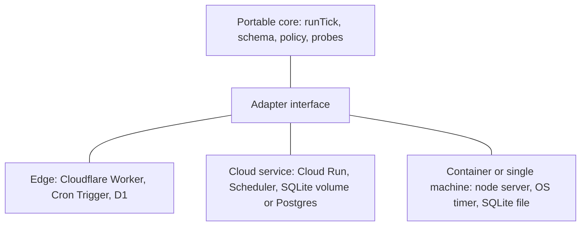

<!-- SPDX-License-Identifier: LicenseRef-Ultrastable-USL-1.0 -->
<!-- Copyright (c) 2026 Rowan Brad Quni-Gudzinas -->

# US-SPEC-14: Portability seams and adapters

| Field | Value |
|---|---|
| ID | US-SPEC-14 |
| Title | Portability seams: Store, Scheduler, Secrets, Models, Role runtime (Cloudflare reference and other adapters) |
| Version | 0.1.0 (draft) |
| Date | 2026-11-11 |
| Status | Draft |

## 1. Purpose

The loops are the product; the cloud is a detail. The portable core calls no platform API. It sees a store handle and a scheduler that calls `runTick`. An adapter implements a small set of ports once per platform. Moving between platforms changes the adapters and no tick step, policy, ledger or protocol. The core's tests are the conformance suite.

## 2. Terms

| Term | Definition |
|---|---|
| Portable core | Schema, tick steps, ledgers, policy data, protocol and probes; calls no platform API. |
| Port | One interface an adapter implements. |
| Adapter | The module set implementing the ports for one platform. |
| Store handle | `prepare(sql).bind(...).all() / .first() / .run()`, with `meta.changes` and `meta.last_row_id` on `run()`. |
| Presence map | A map of secret names to booleans; the core sees whether a secret exists, never its value. |

## 3. Ports

| Port | Contract | Cloudflare reference | Other adapters |
|---|---|---|---|
| Scheduler | Call `runTick(db, {config, env, now})` on a cadence; one tick at a time | Cron Trigger calls the scheduled handler | Cloud scheduler job posting to an authenticated HTTPS route; orchestrator CronJob; operating-system timer |
| Store | Store handle over the schema | D1 | SQLite file (single instance); managed Postgres through a dialect shim; document database (steps rewritten) |
| Secrets | Presence map; values only to the process that needs them | Worker secret bindings | Secret manager mounted as environment variables; orchestrator secrets |
| Models | An alias (small, medium, large) resolved to an endpoint returning a completion and token counts | Edge inference binding or hosted-model connector | Managed model endpoint by project and region; any inference endpoint |
| Role runtime | One instance per manager or staff role | Durable Objects or Agents SDK | Container jobs or an agent engine |
| Deploy | Versioned release, traffic shift, revert | Versioned deploy, canary, revert (US-SPEC-07) | New revision with 10% traffic shift and probes on a tagged URL, then 100% or rollback |
| Health | The last tick report | A `/health` route | Route plus an uptime check each minute |

## 4. Adapter details

**Scheduler duplicates.** A scheduler can deliver twice. An adapter migration adds `slot INTEGER UNIQUE` to `tick_runs`; the handler inserts `now / 600000` as the slot and returns if the insert conflicts.

**Store dialect (Postgres-class).** A shim translates `?` to `$n`, `INSERT OR IGNORE` to `ON CONFLICT DO NOTHING`, `datetime('now')` to `now()` stored as text in `YYYY-MM-DD HH:MM:SS` (so string comparisons hold), `AUTOINCREMENT` to `BIGSERIAL` and `last_row_id` to `RETURNING id`. The aggregations and the `NOT IN` dispatch query map directly. **Document database:** each table is a collection keyed by primary key; claim uniqueness comes from a create-only write keyed by item id; dispatch is an indexed query on (status, owner_role, priority) followed by a transactional claim; reconcile, trust and dispatch steps are rewritten and the conformance tests re-run.

**Secrets.** The tick builds its presence map from variable names; a service account that can read only mounted payloads enforces the secret lock by identity permission as well as by code.

**Models.** A deploy-time check fails if reviewer and doer aliases resolve to one family when two are available.

**Single-writer limit.** SQLite on an object-store volume is single-writer; pin to one instance until a scale-out store is in place.

## 5. Normative requirements

- **US-14-R01 [L1]** The core MUST NOT call a platform API; all platform access MUST pass through a port.
- **US-14-R02 [L1]** The store handle MUST support `prepare().bind().all()/first()/run()` with `meta.changes` and `meta.last_row_id`.
- **US-14-R03 [L1]** The scheduler port MUST run at most one tick at a time for a slot.
- **US-14-R04 [L1]** A secrets port MUST expose a presence map to the core and MUST NOT pass values to the core.
- **US-14-R05 [L1]** The health port MUST report the latest tick and return failure if the tick did not complete all steps.
- **US-14-R06 [L1]** Time strings MUST compare lexicographically in the store (US-00-R05).
- **US-14-R07 [L1]** An adapter MUST pass the core's tests over its store handle: the tick test suite, and the bootstrap tests with its provision stage replaced.
- **US-14-R08 [L3]** A deploy port MUST support revert to the prior version; a deploy MUST keep "probe passed before and fails after reverts".
- **US-14-R09 [L3]** A scheduler adapter that may deliver twice MUST deduplicate by slot.
- **US-14-R10 [L3]** The model port MUST fail at deploy time if reviewer and doer resolve to one family when two are available.
- **US-14-R11 [L3]** An adapter on a scale-out store MUST demonstrate claim correctness under contention.

## 6. Failure modes

| Failure | Effect | Mitigation |
|---|---|---|
| SQL dialect differences | Core queries fail | Shim; conformance tests |
| Double delivery | Two ticks in one slot | Slot uniqueness |
| Single-writer store with many instances | Lost writes | Pin to one instance |
| Long-lived keys in workflows | Credential exposure | Workload identity federation |

## 7. Conformance tests

- **US-14-T01** Run the L1 tick test suite over the adapter's store handle. Pass: all tests pass.
- **US-14-T02** Run the bootstrap tests with provision replaced by the adapter's. Pass: all pass.
- **US-14-T03** Send the scheduler's request twice in one slot. Pass: one tick row for the slot.
- **US-14-T04** Set a secret and read the presence map. Pass: `true` for the name, no value in any log.
- **US-14-T05 [L3]** Deploy a version failing a prior-passing probe. Pass: reverted.

## 8. Reference implementation status

- Cloudflare reference (Worker with cron, D1 store, health route): BUILT as `adapters/cloudflare/src/index.js`, `core/src/tick.js`, `adapters/cloudflare/wrangler.template.jsonc`; RUNNING in QNFO in its own form. A real deployment of the seed to a cloud account has not been run as of 2026-11-11.
- Store port over SQLite: BUILT in `adapters/sqlite/d1-sqlite.js` (a file or in-memory database behind the store handle), with the test helpers `core/test/d1shim.js` and `core/_shared/testdb.js`; the same `runTick` runs on D1-shaped SQLite. `core/conformance/l1.test.js` runs the L1 tick over the adapter's handle and checks the handle's contract (US-14-R02, US-14-R06, US-14-R07, US-14-T01).
- Presence-only secrets: BUILT (`presence()` in `core/org/index.js`; US-14-T04 in `core/conformance/l1.test.js`).
- Cloud Run adapter (token-gated `/tick`, `/health`, the guided console of US-SPEC-18, SQLite volume): BUILT in `adapters/gcp/` (`server.js`, `Dockerfile`, `deploy.sh`), 3 tests passing on 2026-11-11 after a Windows path fix (`fileURLToPath`). Not deployed on a Google Cloud project.
- Postgres dialect shim: BUILT in `adapters/postgres/index.js` (tests: `adapters/postgres/postgres.test.js`): `?` to `$n`, `INSERT OR IGNORE` to `ON CONFLICT DO NOTHING`, `datetime('now')` to UTC text in `YYYY-MM-DD HH:MM:SS`, `AUTOINCREMENT` to `BIGSERIAL`, `last_row_id` from `RETURNING id`, and the store handle over any client with `query(text, params)`. The whole L1 migration and every statement of `core/src/tick.js` are translated in the tests; the handle is exercised against a recording client.
- The L1 tick suite and claim contention on a live Postgres (US-14-T01 and US-14-R11 for this adapter): PLANNED. No Postgres server or driver is available to the test run, so the shim is proven as text and not yet against a server.
- Document-database adapter: BUILT in `adapters/docdb/index.js` (tests: `adapters/docdb/docdb.test.js`): the document port, a reference in-memory store, claim uniqueness by a create-only write keyed by item id, dispatch as an indexed query followed by a transactional claim, and the reconcile, trust and dispatch steps rewritten and compared with the SQL steps on the same data; claim correctness under contention is shown on the reference store (US-14-R11).
- Document-database driver for a hosted service, and the other five L1 steps on a document store: PLANNED. A hosted driver needs a live account; the remaining steps are not rewritten.
- Model port and role runtime: BUILT in `core/modelport/index.js` (tests: `core/modelport/modelport.test.js`): aliases resolved to endpoints that return a completion and token counts, the deploy-time check that fails when reviewer and doer resolve to one family while two are available (US-14-R10), and an in-process role runtime with one leased instance per role row that works queued dispatch rows.
- Role runtime on Durable Objects, container jobs or an agent engine, and the container variant: PLANNED. Each needs a live account; they implement the same three calls as the in-process runtime.
- Slot uniqueness migration: BUILT as `adapters/shared/migrations/0001_sched_slots.sql` and `adapters/shared/slot.js` (tests: `adapters/shared/slot.test.js`, US-14-R03, US-14-R09, US-14-T03). The slot is kept in its own table `sched_slots` (slot number, tick run id) instead of a unique column on `tick_runs`, because a unique column cannot be added to another module's table idempotently. The Cloudflare and Cloud Run handlers do not call `runOncePerSlot` yet.
- Disagreement: the schema uses SQLite-dialect defaults (`datetime('now')`, `AUTOINCREMENT`), so a Postgres port requires the shim above; the shim translates them and has not run against a server.
