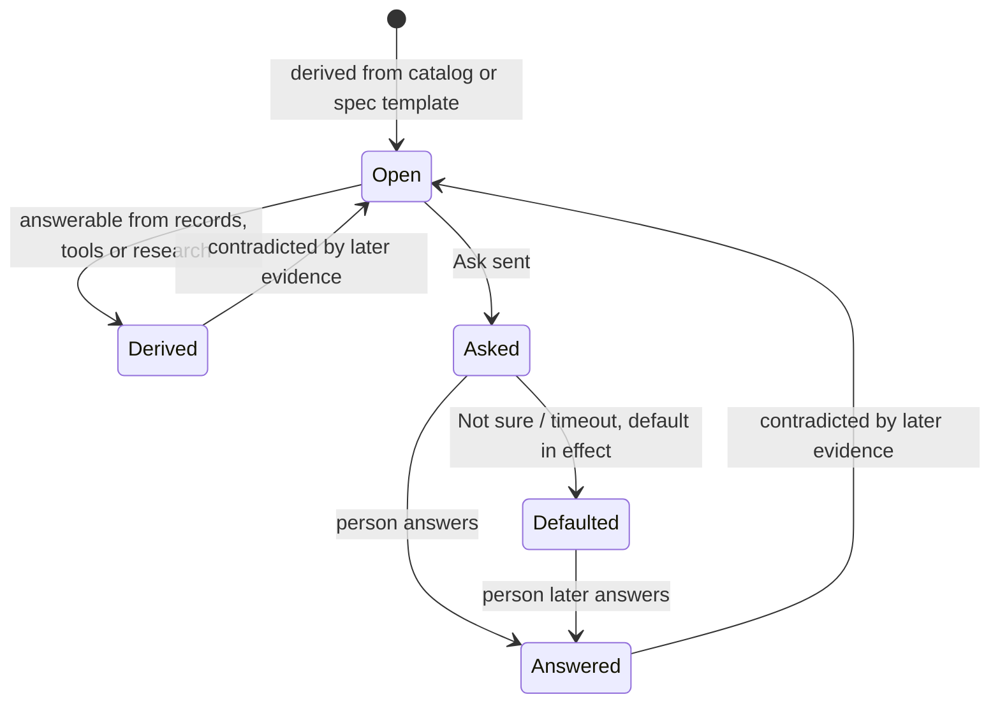

<!-- SPDX-License-Identifier: LicenseRef-Ultrastable-USL-1.0 -->
<!-- Copyright (c) 2026 Rowan Brad Quni-Gudzinas -->

# US-SPEC-16: Ignorance and prompted recall

| Field | Value |
|---|---|
| ID | US-SPEC-16 |
| Title | Ignorance and prompted recall |
| Version | 0.1.0 (draft) |
| Date | 2026-11-11 |
| Status | Draft |

## 1. Purpose

The expected user can say what they want and does not know what they do not know. They are not a coder or an engineer. They cannot be asked for an architecture, a schema or a stack. The system therefore has to **know what it needs**, **find out what it is missing**, **ask in the person's words**, and **proceed safely on stated defaults** when the person cannot answer. From the answers it writes its own architectural specification and charters (US-SPEC-15). This specification defines that elicitation.

It is the front door of bootstrapping (US-SPEC-10).

## 2. Terms

| Term | Definition |
|---|---|
| Need | A fact or decision the system requires to produce a REQUIRED artifact (US-SPEC-15 Section 5). |
| Needs register | The set of all Needs for a project, each with a state. Derived from the artifact catalog and the spec templates, not from the person. |
| Ask | A question card sent to the person about one Need. |
| Cue | Evidence or an example in the Ask that lets the person recognize an answer instead of recalling it. |
| Default | A value taken for the person when they cannot or will not answer, recorded with a revert path. |
| Ignorance audit | A procedure that finds Needs nobody has thought of yet (Section 6). |
| Readiness score | Fraction of MUST Needs that are Answered or Defaulted. |
| Read-back | The system's restatement of the spec in the person's own vocabulary, for correction. |

## 3. Four kinds of not-knowing

| Kind | Meaning | Response |
|---|---|---|
| Known unknown | The system knows it needs X; the person has not said | Ask |
| Person-unknown | The person does not know X exists or what it means | Explain in one plain sentence, give options, offer a default |
| System-unknown | The system lacks the knowledge to ask well | Research, cite sources, or escalate as a gate card; never guess silently |
| Unknown-unknown | Neither side has thought of it | Ignorance audit (Section 6); runtime surprises recorded as lessons (US-SPEC-15 A-CLO-3) |

## 4. Need states

## 5. Asking

### 5.1 Ask card

An Ask MUST contain:

| Field | Rule |
|---|---|
| `need_id` | The Need it answers |
| `question` | One question, plain words, at most 25 words, no unexplained term |
| `why` | One line: what this changes in what gets built |
| `cue` | Evidence or an example (for instance a sentence from the person's own idea file, or what a similar project chose) |
| `options` | Two to four options, plus `Not sure` and `Tell me more` |
| `default` | The value used if the person answers `Not sure` or does not answer in time |
| `default_consequence` | One line: what happens if the default is wrong, and how to change it |
| `reversibility` | `reversible` or `not reversible` |
| `priority` | By value of information (5.3) |

### 5.2 Rules

| ID | Rule |
|---|---|
| US-16-R01 | The system MUST NOT ask what it can derive from the idea file, existing records, a tool probe or cited research. |
| US-16-R02 | An Ask MUST be answerable by recognition: options with a cue, not an open recall question, unless the Need is inherently free text (a name, a goal). |
| US-16-R03 | An Ask MUST use the person's own vocabulary. The system keeps a glossary of the person's terms and the system's terms and maps between them. Jargon MUST NOT appear unless defined in the same card. |
| US-16-R04 | At most N Asks (default 3) are open at once. Excess Needs wait. |
| US-16-R05 | `Not sure` MUST resolve to the default, with an entry in the assumption log (A-INI-4) and a revisit trigger. |
| US-16-R06 | A Need that would, if defaulted, cause a not-reversible action, bind the person's identity, spend above the cap, or expose private data MUST NOT be defaulted. It becomes a gate card in the principal queue (US-SPEC-06) and work that depends on it waits while other work continues. |
| US-16-R07 | The person's answer MUST be stored verbatim with timestamp and channel, and MUST change the record through a deterministic mapping (answer to record write), not through an agent's interpretation. |
| US-16-R08 | Options MUST be neutral. The system MUST NOT pre-select the option that is easiest to build, and MUST mark the default as a default. |
| US-16-R09 | A person's `Tell me more` MUST return an explanation and the same card, not a new question. |
| US-16-R10 | An unanswered Ask expires to its default after its stated time (default 72 hours) and is flagged for revisit at the next demonstration or review. |

### 5.3 Priority: value of information

`priority = P(wrong default) x cost_of_rework_if_wrong x number_of_artifacts_depending_on_it`, estimated by the manager role and logged so that estimates can be scored later like any prediction (US-SPEC-05). Highest first. Low-priority Needs are defaulted without asking, if reversible (R06).

## 6. Ignorance audit

Run at the initiation gate (G1), at each later phase gate, and when a surprise occurs. It produces new Needs or risks. It MUST include all four sweeps:

| Sweep | What it does | Evidence it must leave |
|---|---|---|
| Catalog sweep | Check every REQUIRED artifact field against the needs register; list any field with no Need | List of missing Needs |
| Analogy sweep | For the kind of system being built, list what comparable projects usually need or get wrong (security, accessibility, data retention, failure and recovery, running cost, who operates it, legal notices where the person's idea touches them) | Cited sources or an explicit "no source" mark; each item either a Need, a risk or a recorded dismissal with reason |
| Red-team sweep | A different agent, ideally a different model family, answers: "what would make this fail or harm someone that the person has not mentioned?" | The question, the answer, the disposition of each point |
| Surprise sweep | Review runtime surprises and failed predictions since the last audit | Each filed as lesson, Need or risk |

Findings that need professional advice (legal, medical, financial, safety) are **not** answered by the system. They are recorded as risks with the line "needs a qualified professional" and, if blocking, as a gate card (`SCOPE.md`).

## 7. Drafting and read-back

The system writes the architectural specification (A-PLN-2), charter (A-INI-2) and requirements (A-PLN-1) from the needs register.

| ID | Requirement |
|---|---|
| US-16-R11 | Every statement in a drafted spec MUST carry a provenance tag: `stated` (the person said it), `derived` (from records or tools), `researched` (with source), or `default` (with the assumption log entry). |
| US-16-R12 | Before the planning gate (G2), the system MUST produce a read-back: the spec restated in the person's own vocabulary, with every `default` statement listed first and in plain words. |
| US-16-R13 | The read-back MUST offer the person a way to correct any statement. A correction updates the needs register and re-runs affected artifacts. |
| US-16-R14 | The read-back is not an identity-bound act. If unanswered after its time, work proceeds on the defaults already in effect (R10), and the unconfirmed read-back is flagged and returned to at the first demonstration. |
| US-16-R15 | The readiness score MUST be computed from the needs register, not asserted by an agent. G1 requires at least the initiation threshold (default 0.7 of MUST Needs); G2 requires 1.0 of MUST Needs Answered or Defaulted, with every non-reversible Need Answered. |

## 8. Teaching

When the person asks what something means, or answers `Tell me more` three times on one Need, the system MUST explain in plain words, with an everyday example, and record the term in the glossary. The system teaches only what the person needs to decide; it does not give courses.

## 9. Question budget and fatigue

| ID | Requirement |
|---|---|
| US-16-R16 | A per-day cap on Asks (default 5) and a quiet period (default overnight local time). |
| US-16-R17 | The system MUST batch related Needs into one card sequence rather than interleave. |
| US-16-R18 | If the person stops answering, the system MUST NOT escalate frequency. It falls back to defaults and shortens the questioning to the priority list. |

## 10. Failure modes

| Failure | Control |
|---|---|
| Leading questions | R08, red-team sweep reviews the cards |
| Jargon leak | R03; a reviewer checks every card against the glossary |
| Question flood | R04, R16 |
| Defaults hide a material decision | R06, read-back lists defaults first, G2 requires non-reversible Needs Answered |
| Sycophantic acceptance (everything "looks right") | Read-back lists defaults and asks for corrections to specific statements |
| System over-asks what it could have looked up | R01 is a conformance test |
| Person's words silently reinterpreted | R07 (verbatim storage, deterministic mapping) |
| Unknown-unknowns never surface | Four-sweep audit, with the red-team sweep by a different model |

## 11. Conformance tests

| Test | Pass condition |
|---|---|
| T16-1 | From a one-paragraph idea file, the system generates a needs register covering every REQUIRED artifact field, and no Ask for a Need that the idea file already answers. |
| T16-2 | Every Ask card has all fields in 5.1 and a question of 25 words or fewer. |
| T16-3 | Answering `Not sure` produces a default, an assumption log entry and a revisit trigger. |
| T16-4 | A Need whose default would spend above the cap produces a gate card and no default. |
| T16-5 | At most N Asks are open at once; the rest wait. |
| T16-6 | Every statement in a drafted spec has a provenance tag; `default` statements link to log entries. |
| T16-7 | The planning gate refuses to pass when a non-reversible Need is unanswered. |
| T16-8 | A correction in the read-back changes the needs register and triggers a re-run of the affected artifacts. |
| T16-9 | The ignorance audit leaves evidence for all four sweeps. |

## 12. Reference implementation status

| Capability | Status |
|---|---|
| Idea file read; connectors and credentials detected; missing items opened as backlog items and gate cards with blocker and closing probe | BUILT (`bootstrap/bootstrap.py`, `IDEA.md`) |
| Prompted-recall question queue: question, cue, two to four options plus "Not sure", answer maps to a record change by trigger | RUNNING in QNFO (the `owner_asks` queue); the seed's counterpart is the Ask cards row below |
| Ignorance audit as a research layer | RUNNING in QNFO as part of its research pipeline; not generalized |
| Needs register derived from a catalog of artifact fields, with what the idea file answers derived and not asked (R01); Ask cards with every field of 5.1 (R02); defaults with an assumption log, expiry and gate cards for needs that cannot be defaulted (R05, R06, R10); verbatim answers with a deterministic mapping (R07); open cap, daily cap and quiet period (R04, R16) | BUILT (`core/elicit/index.js`; T16-1 to T16-5 in `core/elicit/elicit.test.js`) |
| Glossary mapping the person's terms and the system's terms into every card, with a review of each card against it (R03); neutral options with the default marked (R08); related needs batched into one card sequence (R17); no escalation when the person stops answering (R18) | BUILT (`core/elicit/index.js`, `core/elicit/elicit.test.js`) |
| Read-back with provenance tags and defaults first, corrections that re-run the affected artifact, and the computed readiness score with the G1 and G2 rules (R11 to R13, R15; T16-6 to T16-8) | BUILT (`core/elicit/index.js`, `core/elicit/elicit.test.js`); the read-back screen and R14 are in `core/walkthrough/index.js` (`core/walkthrough/walkthrough.test.js`) |
| Four-sweep ignorance audit with evidence per sweep, a red-team answer refused from the author's model family, and professional topics turned into gate cards (T16-9) | BUILT (`core/elicit/index.js`, `core/elicit/elicit.test.js`); the analogy list and the red-team answer are inputs the caller supplies |
| A default needs catalog for a new project | BUILT (`core/walkthrough/catalog.json`, checked card by card in `core/walkthrough/walkthrough.test.js`) |
| Value-of-information estimates logged and scored like predictions (5.3) | PLANNED: the priority is computed and stored on each need; it is not yet written to the prediction table |
| Research with cited sources for system-unknowns, and a red-team sweep run by a second model on a schedule | PLANNED: both need a live model endpoint; the module accepts their results and does not produce them |
