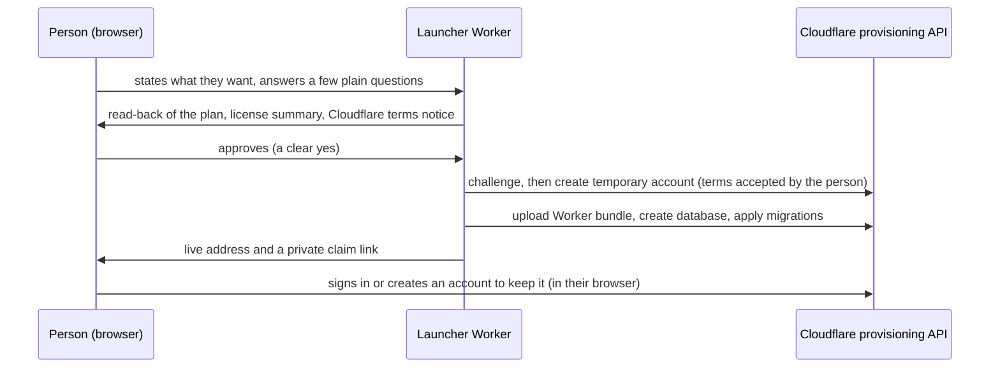

<!-- SPDX-License-Identifier: LicenseRef-Ultrastable-USL-1.0 -->
<!-- Copyright (c) 2026 Rowan Brad Quni-Gudzinas -->

# US-SPEC-19: Front door and packaging

| Field | Value |
|---|---|
| ID | US-SPEC-19 |
| Title | Front door and packaging |
| Version | 0.1.0 (draft) |
| Date | 2026-11-11 |
| Status | Draft |

## 1. Purpose

The first step must not be "open a terminal". The intended person can state what they want and may not know what a code agent is. This specification defines how a person gets from nothing to a running Ultrastable organization, on **Cloudflare Workers, the only supported platform** (`docs/spec/why-cloudflare.md`), with the fewest steps and no code. It also defines how the system packages and documents itself so that what it is, why it is useful, and what it will and will not do are clear at every step.

## 2. The three doors

| Door | For | Terminal or agent needed |
|---|---|---|
| **A. Web launcher** | A person with no technical background | None. A browser only |
| **B. Paste into an agent** | A person already using a coding agent | An AI assistant that can run tools (`agent-setup/SKILL.md`) |
| **C. Developer** | A developer | Terminal, Node, Python, Git, Wrangler |

| ID | Requirement |
|---|---|
| US-19-R01 | Door A MUST be usable with only a web browser. No instruction on it may begin with "open a terminal" or "run this command". |
| US-19-R02 | Doors B and C MUST NOT be presented to a person as the first step unless they have said they use a coding agent or write code. |
| US-19-R03 | All three doors MUST end at the same closing probe (`verify`) and the same console (`US-SPEC-18`). A door that cannot pass the probe MUST say the organization is not verified. |
| US-19-R04 | Every door MUST state, before the person invests time: what Ultrastable does and does not do by default (`SCOPE.md`), that Cloudflare Workers is the platform and why, what it costs, and that a coding agent or the web launcher is needed only to start. |
| US-19-R05 | Every door MUST show the license summary and let the person decide; no door accepts a license, terms of service or privacy policy on the person's behalf. |

## 3. Door A: web launcher

A web page, itself a Worker, that asks the first-run questions of `US-SPEC-16` in a browser, then puts a live preview of the person's organization online using Cloudflare's temporary-account REST API, and hands the person the address and a link to keep it.

| ID | Requirement |
|---|---|
| US-19-R06 | The launcher MUST show Cloudflare's terms and privacy notices and require the person to accept them before any account is created. |
| US-19-R07 | The claim link is a bearer credential. The launcher MUST deliver it only to the person in the page, MUST NOT log it, MUST NOT store it beyond its expiry, and MUST NOT use it. |
| US-19-R08 | The launcher MUST store no personal data beyond the session. The idea text MUST be held only until the preview is created, then discarded. |
| US-19-R09 | The launcher MUST be protected against abuse: a bot check and a rate limit per visitor, and it MUST run within a spend cap of its own. |
| US-19-R10 | The launcher MUST deploy a released, versioned bundle whose hash it shows, built by the repository's CI from tagged source. It MUST NOT build code at request time. |
| US-19-R11 | After the person claims the account, the launcher (or the console) MUST complete the steps a temporary account cannot (the timer, the console key) through steps the person approves. |

## 4. Door B: paste into an agent

`agent-setup/PROMPT.txt` is a short prompt with one blank. It points the agent at `agent-setup/SKILL.md`, which follows the pattern Cloudflare uses for its own setup guides: the agent fetches a skill file, confirms before anything irreversible, never prints secrets, and verifies with probes. The skill states plainly what each path can and cannot do.

| ID | Requirement |
|---|---|
| US-19-R12 | The skill MUST tell the person, early, that an agent is needed to start and not afterwards. |
| US-19-R13 | The skill MUST be linted by tests for the rules that protect a non-coder (no secret handling in chat, confirmations, untrusted-text stance, scope and license stated, probe required). |
| US-19-R14 | The probe MUST treat a Cloudflare challenge page, or an address that is not the Ultrastable Worker, as inconclusive, never as a successful refusal. |
| US-19-R15 | Where a path cannot do something (for example a scheduled tick on a temporary account), the skill MUST say so before the person relies on it. |

## 5. Packaging

| ID | Requirement |
|---|---|
| US-19-R16 | CI MUST publish, for each tagged release, one deployable bundle (the Worker script and the database migrations), its hash, and a list of the Cloudflare products and permissions it needs. |
| US-19-R17 | Every bootstrapped organization MUST receive a plain-language `org/README` for its owner: what is running, what it costs and what stops it, what they will be asked to decide, how to stop and delete it. |
| US-19-R18 | The console MUST offer a Help view built from the documentation, in the person's vocabulary (`US-SPEC-16` R03). |
| US-19-R19 | Documentation MUST be tested: links resolve, every status label names evidence, and requirement IDs cited in code exist. |
| US-19-R20 | Public pages MUST describe Ultrastable as `SCOPE.md` does and MUST NOT promise platforms other than Cloudflare Workers. |

## 6. Platform statement

| ID | Requirement |
|---|---|
| US-19-R21 | Documentation MUST state that Cloudflare Workers is the supported platform and link to `docs/spec/why-cloudflare.md`, which lists the limits of Workers that shape the design and when the platform is not the right choice. |
| US-19-R22 | The portability seams (`US-SPEC-14`) remain a design discipline and the Cloud Run adapter remains a proof of it. Neither is a support commitment. |

### 6.1 The hosted front door (added 2026-11-26 from the code)

The platform's own site runs a fourth way in, more developed than Door A: the person types or speaks an idea on the platform's page and the platform hosts the result on its own account. No temporary account, claim link or terms acceptance on a third party is involved, so R06, R07 and R11 do not apply to it; R01, R04 and R05 do.

| ID | Requirement |
|---|---|
| US-19-R23 | The hosted front door MUST apply the system test before anything is stored or built. An idea that is definitely a one-off MUST be refused in plain words that name what to use instead; a maintained system MUST pass through to the questions. |
| US-19-R24 | On the hosted front door the idea MUST be the person's only step. The platform keeps a launch record, deploys the idea's own system, gives it its own repository from the seed with the idea in the person's words, files each later plain-words change as a work item there, and hands the repository over when the person asks. No step may name a terminal, a coding agent, a key or a hosting account. |
| US-19-R25 | When a step of a hosted launch cannot finish (no model, no room, a refused repository call), the page MUST stay live, the launch record MUST say in plain words what is waited on, the idea MUST be kept and retried by the server, and nothing the person reads may carry backend text. |
| US-19-R26 | A person who copies the template repository MUST be able to start with two actions: use the template, and state the idea in the repository's own form. The seed's workflow writes the idea file from their words, plans, tests, deploys when a hosting sign-in exists, retries daily, and keeps one plain-words owner note with zero manual steps. |

## 7. Failure modes

| Failure | Control |
|---|---|
| A step silently assumes a terminal | R01, R02 |
| A preview looks verified when it is only uploaded | R03, R14 |
| The launcher becomes an open provisioning service for abuse | R09 |
| The claim link leaks | R07 |
| The temporary account cannot run what the real one can | R15; the trial found no cron triggers and a bot challenge until claim |
| Documentation drifts from the code | R19 |

## 8. Conformance tests

| Test | Pass condition |
|---|---|
| T19-1 | The launcher's page, followed by a person with only a browser, reaches a live preview with no step that names a terminal. |
| T19-2 | No account is created without a recorded acceptance of Cloudflare's terms by the person. |
| T19-3 | The claim link appears in the page only, and in no log line, storage key or analytics event. |
| T19-4 | A challenge page or foreign address makes the probe report inconclusive, and the door reports "not verified". |
| T19-5 | The released bundle's hash matches CI's published hash. |
| T19-6 | Every bootstrapped organization contains `org/README` with the five required parts. |

## 9. Reference implementation status

Paths are relative to `workers/` unless they begin with `seed/`, `foundation/`, `site/`, `dashboard/`, `tenants/`, `deploy/`, `doctrine/`, `instances/`, `docs/` or `tests/foundation/`, which are relative to the repository root. Rows marked 2026-11-26 were read against the code and their tests were run on that date.

| Capability | Status |
|---|---|
| Door C: bootstrapper CLI | BUILT (`bootstrap/bootstrap.py`, tests) |
| Door B: skill, paste prompt, closing probe, lint and probe tests | BUILT (`agent-setup/`, `core/test/agent-setup.test.js`). First live trial 2026-11-11: uploaded, not verified; findings recorded in `docs/spec/why-cloudflare.md` |
| Probe reads a challenge page or foreign address as inconclusive | BUILT (`agent-setup/verify.mjs`) |
| Door A: web launcher on the temporary-accounts API | BUILT (`apps/launcher/src/index.js`, `apps/launcher/src/provision.js`, `apps/launcher/src/page.js`; tests `apps/launcher/test/launcher.test.mjs`, `apps/launcher/test/provision.test.mjs`, `apps/launcher/test/pow.test.mjs`, `apps/launcher/test/turnstile.test.mjs`). Tested against a fake of the provisioning API; no live launch is recorded in the repository |
| Released deployable bundle with hash | BUILT as a builder (`tools/release_bundle.mjs`, test `tools/release_bundle.test.mjs`): bundle, migrations, a manifest with the SHA-256 of each and the products and permissions needed; the launcher embeds that bundle and shows its hash (`apps/launcher/build.mjs`). Publication by CI for each tag (US-19-R16, T19-5) is PLANNED: `.github/workflows/release.yml` cuts the tag and the release without attaching the bundle, and changing it is a protected change; tracked as `docs/issues/Q-SPEC-19-release-bundle-published.json` |
| Alarm-driven tick so a temporary account can run it | BUILT (`adapters/cloudflare/src/heartbeat.js`; tests `adapters/cloudflare/src/heartbeat.test.js`, `apps/launcher/test/heartbeat.test.mjs`) |
| Bootstrapper output that deploys unchanged on a temporary account (database id, public address, migrations, no cron) | BUILT (`bootstrap/bootstrap.py` with `--temporary`, `bootstrap/ladder.py`; tests `tests/test_bootstrap_temporary.py`, `tests/test_ladder.py`), with a fake command runner; the live trial is the one recorded under Door B |
| The org record README for the owner (US-19-R17); console Help view; documentation tests | BUILT: owner README (`bootstrap/ownerdoc.py`, test `tests/test_owner_readme.py`); Help view (`core/src/help-data.js` generated by `tools/build_help.mjs` from `docs/help.md`, test `core/test/help.test.js`); documentation tests: links (`core/test/docs.test.js`), status labels name evidence (`tools/spec_truth.py`, `tests/test_selfhost.py`), requirement ids cited in code exist (`tools/req_ids.py`, `tests/test_req_ids.py`) |
| Hosted front door: the system test refuses a definite one-off with HTTP 422 `not_a_fit` before anything is stored (R23); a conversation with a pill input, dictation, rotating suggestions and tap-to-answer questions, with a plain form when scripts are off | BUILT 2026-11-26 (`site/worker.js` `systemTest`, `site/interview.js`, `site/suggest.js`; test `site/site.test.mjs`) |
| Hosted launch: launch record, the idea's own system deployed by the server, its own repository from the seed with the idea in the person's words, plain-words changes filed as work items, hand-over on request, and every failure branch keeping the page live with a plain statement of what is waited on (R24, R25) | BUILT 2026-11-26 (`site/graduate.js`, `deploy/launch-apps.mjs`, `seed/worker/src/apprepos.js`; the stories in `site/launchpath.test.mjs`, and `seed/worker/test/apprepos.test.js`), tested with fakes of GitHub and the deploy route; this audit did not read a live launch |
| Template start: an idea stated in the repository's own form becomes the idea file and a boot with zero manual steps (R26) | BUILT 2026-11-26 (`seed/.github/ISSUE_TEMPLATE/start.yml`, `seed/.github/workflows/bootstrap.yml`, `seed/bootstrap/intake.py`; test `seed/tests/test_happy_path.py`) |
