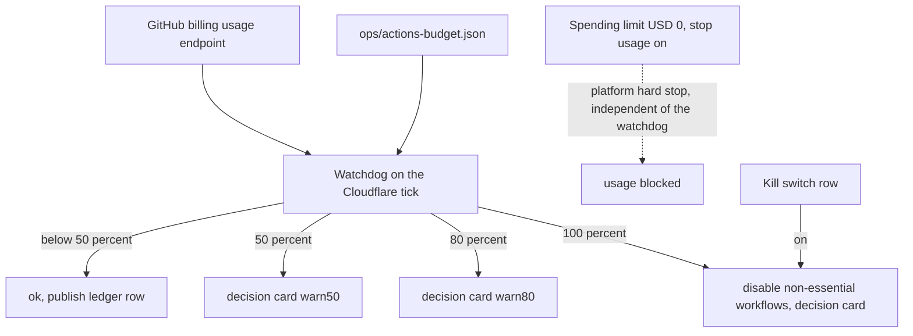

<!-- SPDX-License-Identifier: LicenseRef-Ultrastable-USL-1.0 -->
<!-- Copyright (c) 2026 Rowan Brad Quni-Gudzinas -->

# US-SPEC-24: GitHub as substrate and hard cost control

| Field | Value |
|---|---|
| ID | US-SPEC-24 |
| Title | GitHub as substrate and hard cost control |
| Version | 0.1.0 (draft) |
| Date | 2026-11-11 |
| Status | Draft |

## 1. Purpose

Ultrastable partly runs on GitHub's free organization features: the repository is the record, the issue is the item, the pull request is the change, and the rulesets are the enforcement. The same platform bills by the minute for hosted runners on private repositories, and an earlier fleet spent about USD 1,000 on CI in a period before limits existed. This specification fixes what runs on GitHub, what never does, and the cost rules that make an overrun impossible rather than merely unlikely. It builds on [US-SPEC-09](US-SPEC-09-caps-kill-switches-model-ladder.md) (caps and kill switches), [US-SPEC-07](US-SPEC-07-governance-and-change-path.md) (change path) and [US-SPEC-03](US-SPEC-03-tick.md) (the tick). The plain-language companion is [docs/github-free-org.md](../docs/github-free-org.md).

## 2. Terms

| Term | Definition |
|---|---|
| Substrate | The services Ultrastable uses but does not own: here GitHub's free features. |
| Linux-equivalent minute | A runner minute weighted by its price against the Linux 2-core price (0.006 USD per minute on 2026-11-11). |
| Minutes budget | A monthly cap, per repository and in total, kept in `ops/actions-budget.json`. |
| Spending limit | GitHub's own budget for a metered product with "stop usage when budget limit is reached" on; the platform-side hard stop. |
| Watchdog | A deterministic check that reads billing usage, compares it with the minutes budget and emits a decision. |
| Non-essential workflow | A workflow whose absence does not stop the change path (everything except the test job). |

## 3. What runs where

| GitHub feature | Role in Ultrastable | Runs on |
|---|---|---|
| Issues | Items (work, with a closing probe) | GitHub |
| Pull requests | Changes (draft first, one item each) | GitHub |
| Projects (v2) | Board view of items, a view only; the ledger stays the source of truth | GitHub |
| Discussions | Owner questions that are not gate cards | GitHub |
| Releases | Deployable bundles, versioned and revertable | GitHub storage, deployed by the Cloudflare executor |
| Pages | Bootstrap page and documentation pages | GitHub (public repos only on the Free plan) |
| Actions | Light checks: tests, lint, link check, build of a bundle | GitHub runners, within the minutes budget |
| Rulesets, CODEOWNERS | Enforcement of the change path and protected paths | GitHub (see 6.2 for the private/public difference) |
| Heavy compute, model calls, scheduled work, the tick, the watchdog | Everything that is long, recurring or spends money | Cloudflare (Workers, cron, Queues), never Actions |

## 4. Cost control model

Two independent bounds hold at once: the platform's spending limit at USD 0 with stop-usage on, and the watchdog's budget below it. The watchdog fails early and politely; the spending limit fails hard and late. A cost guard is installed only after it is probed against the real billing response, never against a documented shape (US-SPEC-09 section 4, guard against inverted guards).

## 5. Lessons carried from the reference fleet

An earlier fleet that ran a similar organization on a hosted platform produced these cost and failure modes. Each is a requirement below, not a story.

| Lesson | What happened (reference fleet) | Requirement |
|---|---|---|
| Spend before limits | About USD 1,000 on CI in a period before limits existed | US-24-R20, R21 |
| A breached cap must steer, not stop, and must not grow | The rule that a breached cap adds no worker, schedule or paid call (US-09-R05) | US-24-R24, R26 |
| Scheduler collisions | 201 cron collisions a day measured, the worst 15 at one instant | US-24-R14, R50 |
| Dead-man gaps | A tick slot with no record went unnoticed; redundancy needs an independent check | US-24-R51 |
| Unmeasured members | Of 15 members missing from the monitor roster, four answered a probe; absence from a roster is not proof of idleness | US-24-R52 |
| Frozen monitors | 73 of 83 probe names frozen at one timestamp, 3,342 of 21,076 probe rows 404 for retired members | US-24-R52 |
| Retries cost more than the dear path | A cheap model without valid tool calls made retries dearer than the frontier model | US-24-R53 |
| Inverted guard | A guard whose target was dearer than the status quo raised cost | US-24-R22 |
| Executor that accounts for nothing | 25 scanned, 0 in any outcome bucket | US-24-R54 |
| Cap figures differ by document | Two documents stated two limits for the same cap | US-24-R21 (one file, one number) |
| Reverted by a concurrent redeploy | A purge undone by a second deploy | US-24-R55 |

## 6. Verified platform facts (retrieved 2026-11-11)

Sources are on docs.github.com unless stated. "Observed" means read from the organization with a read-only `gh api` call on 2026-11-11. Full table with URLs: [docs/github-free-org.md](../docs/github-free-org.md).

### 6.1 Cost facts

- Free organizations include USD 12 of compute a month (about 2,000 Linux minutes at 0.006 USD, derived). Standard runners are free in public repositories. Rates per minute: Linux 2-core 0.006, Windows 2-core 0.010, macOS 0.062 USD; each job's time rounds up to a whole minute. Artifact storage 500 MB; cache 10 GB per repository.
- Without a valid payment method on file, usage is blocked once the included usage is consumed. With one, a budget blocks usage only if "stop usage when budget limit is reached" is selected; otherwise it only emails. A budget applies only to usage from its creation onward.
- Observed: the organization has four budgets (git_lfs, codespaces, packages, actions) at amount 0 with `prevent_further_usage: true`. So overage on Actions hard-stops today.
- Observed: November 2026 usage 567 Linux minutes (gross 3.402 USD, discount 3.402 USD, net 0), of which 508 in one repository outside the four named here.
- Usage is readable at `GET /organizations/{org}/settings/billing/usage` (items: date, product, sku, quantity, unitType, pricePerUnit, grossAmount, discountAmount, netAmount, organizationName, repositoryName) and the preview `GET /organizations/{org}/settings/billing/usage/summary`.

### 6.2 Private versus public

| Feature (Free organization) | Private repository | Public repository |
|---|---|---|
| Actions, standard runners | Metered against the USD 12 allowance | Free |
| Pages | Not available (repository must be public) | Available |
| Branch protection, required reviews, code owners, rulesets | Not available; observed: branch protection returns "Upgrade to GitHub Pro or make this repository public" | Not confirmed in the pages read; unverified |
| Code scanning, secret scanning, push protection, dependency review | Need paid code security products | Free |
| Dependabot alerts and updates | Free | Free |
| Scheduled workflows | Run; private restrictions unverified | Disabled after 60 days without repository activity |
| Packages | 500 MB storage, 1 GB transfer a month | Free |
| Codespaces | No included usage shown for Free organizations; unverified | Not applicable |

The practical consequence: the repositories are public, so the public-repository column applies and hosted rulesets bind once applied; enforcement of the change path also rests on the interrupt gate, CODEOWNERS and the CI checks the agents run themselves.

## 7. Normative requirements

### 7.1 Substrate and placement

- **US-24-R01 [L2]** Items MUST be issues, changes MUST be pull requests, and a pull request MUST reference its item; the Ultrastable ledger remains the source of truth and GitHub the mirror.
- **US-24-R02 [L2]** Owner questions that are not gate cards SHOULD be Discussions; gate cards stay in the ledger.
- **US-24-R03 [L2]** A Projects (v2) board SHOULD present items as a view and MUST NOT be a second source of truth.
- **US-24-R04 [L2]** A deployable bundle SHOULD be a Release with a version tag, and a deploy MUST be revertable to the previous Release.
- **US-24-R05 [L2]** Bootstrap and documentation pages MAY be served from Pages, only from public repositories.
- **US-24-R06 [L2]** Heavy compute, model calls, the tick, the watchdog and every recurring job MUST run on Cloudflare. Actions MUST be limited to checks and builds that finish within the job timeout.
- **US-24-R07 [L2]** Rulesets and CODEOWNERS MUST be configured for protected paths where the plan enforces them, and an implementation MUST state which enforcement is advisory on the plan in use.

### 7.2 Workflow hygiene (each enforced by `tools/workflow_lint.py`)

- **US-24-R10 [L2]** Every workflow MUST declare `permissions` (default `contents: read`); wider permission MUST be per job and justified.
- **US-24-R11 [L2]** Every workflow MUST declare `concurrency`, with `cancel-in-progress` for pull requests, or carry a `# no-concurrency: <reason>` comment.
- **US-24-R12 [L2]** Every job MUST declare `timeout-minutes` of at most 15 (the platform default is up to six hours).
- **US-24-R13 [L2]** Workflows MUST use path filters so that documentation-only changes skip the heavy jobs. Where a required check is skipped by a path filter, the implementation MUST make the skipped check count as passing or not require it, because a skipped required check stays pending.
- **US-24-R14 [L2]** A workflow MUST NOT use a `schedule` trigger; recurring work runs from the Cloudflare tick.
- **US-24-R15 [L2]** A workflow SHOULD NOT use a matrix of more than four jobs, and MUST NOT rely on the platform maximum of 256.
- **US-24-R16 [L2]** Workflows MUST run on Linux standard runners only; macOS and Windows runners MUST NOT be used.
- **US-24-R17 [L2]** Dependencies SHOULD be cached (setup actions' cache option) when a lock file exists; caches MUST stay within the 10 GB repository limit.
- **US-24-R18 [L2]** Third-party actions MUST be pinned to a version tag at minimum and SHOULD be pinned to a full commit SHA once the repositories are public; `@main`, `@master` and a bare reference MUST NOT be used.
- **US-24-R19 [L2]** The linter MUST run in CI and on the real workflow files as a test.

### 7.3 Budget, watchdog and kill switch

- **US-24-R20 [L2]** The Actions spending limit MUST be USD 0 with stop-usage on, so overage is a hard stop and not a bill. Raising it is an owner decision and is identity-bound (it spends the owner's money).
- **US-24-R21 [L2]** A monthly minutes budget per repository and in total MUST be kept in one file (`ops/actions-budget.json`), and a ledger row (month, repository, minutes used, budget, ratio) MUST be published each month.
- **US-24-R22 [L2]** The watchdog MUST read the current billing usage endpoint, compute Linux-equivalent minutes per repository, and MUST be tested against a recorded real response, not only a documented shape.
- **US-24-R23 [L2]** At 50 percent and at 80 percent of any repository's or the total budget the watchdog MUST open a decision card with its default already in effect (US-SPEC-06).
- **US-24-R24 [L2]** At 100 percent the watchdog MUST disable the non-essential workflows named in the budget file, keep the test job, and open a decision card; it MUST NOT raise a budget.
- **US-24-R25 [L2]** A kill switch row MUST disable every non-essential workflow on demand; a drill MUST turn it off in every case (US-09-R03).
- **US-24-R26 [L2]** The watchdog exit status MUST be 0 for ok, 1 for a warning and 2 for over, and it MUST run from the Cloudflare tick, not from Actions.

### 7.4 Settings

- **US-24-R30 [L2]** The organization default for the workflow token MUST be read-only and workflows MUST NOT be able to approve pull requests.
- **US-24-R31 [L2]** Workflows from outside contributors MUST require approval before they run.
- **US-24-R32 [L2]** Repositories MUST allow squash merge only and delete the branch on merge.
- **US-24-R33 [L2]** Discussions SHOULD be enabled on the repository that holds owner questions.
- **US-24-R34 [L2]** The script that applies settings MUST print the commands and change nothing unless `--apply` is given.

### 7.5 Public repositories

- **US-24-R40 [L2]** Unlimited standard-runner minutes on public repositories MUST NOT relax any rule in 7.2 to 7.4.
- **US-24-R41 [L2]** `pull_request_target` MUST NOT be used, and secrets MUST NOT be reachable from a job triggered by a pull request from a fork (lint rule W07).
- **US-24-R42 [L2]** The workflow token MUST carry least privilege, and write scopes MUST be granted per job only.
- **US-24-R43 [L2]** Before a repository goes public the owner MUST be shown a checklist covering: secret history scan, enabling push protection and secret scanning, Pages source, rulesets for the default branch, and fork approval policy.
- **US-24-R44 [L3]** No recurring duty MAY depend on a repository's scheduled workflows, because a public repository's schedules stop after 60 days without activity.

### 7.6 Lessons as requirements

- **US-24-R50 [L3]** Recurring work MUST be staggered by a deterministic offset and a collision count MUST be measured.
- **US-24-R51 [L3]** A dead-man check MUST open an item when an expected tick slot has no record, and it MUST be independent of the scheduler it checks.
- **US-24-R52 [L3]** A census of every workflow and runner user MUST be measured before anything is retired, and a monitor with frozen or dead targets MUST file an item.
- **US-24-R53 [L2]** A change that lowers cost MUST be probed on the real path before it is kept, and retries MUST be bounded (US-09-R09).
- **US-24-R54 [L3]** The watchdog and the runner MUST account for every item scanned: the outcome buckets MUST sum to the scanned count.
- **US-24-R55 [L2]** A cost change that is overwritten by a concurrent deploy MUST be detected by a guard that reads the deployed result, not the source.

## 8. Failure modes

| Failure | Effect | Mitigation |
|---|---|---|
| Spending limit left at a positive amount | Overage becomes a bill | R20; setting read back by a probe |
| Workflow without `timeout-minutes` | A hung job bills up to six hours | R12, lint W03 |
| Schedule trigger on a repository with metered minutes | Silent minute burn | R14, lint W04 |
| Superseded pull request runs not cancelled | Duplicate minutes | R11 |
| Path filter skips a required check | Pull request pending forever | R13 |
| Watchdog reads a response shape that changed | Under-count, no alert | R22, recorded real response |
| Watchdog itself runs on Actions | The guard spends the budget it guards | R26 |
| Public repository with `pull_request_target` or secrets in fork runs | Secret exfiltration | R41 |
| Public schedules stop after 60 days | A duty silently ends | R44 |
| Decision card needs an answer | Work stalls | Default already in effect (R23) |

## 9. Conformance tests

- **US-24-T01** Lint a workflow without `permissions`, without `concurrency`, without `timeout-minutes`. Pass: findings W01, W02, W03.
- **US-24-T02** Lint workflows with `schedule`, `pull_request_target`, `@main`, a macOS runner, an unguarded secret in a pull request job. Pass: W04, W05, W06, W08, W07.
- **US-24-T03** Lint the repository's real workflows. Pass: zero findings.
- **US-24-T04** Feed the watchdog 250 of a 500 minute budget, then 400, then 500. Pass: warn50 exit 1, warn80 exit 1, over exit 2 with the non-essential workflows listed.
- **US-24-T05** Feed a macOS row of 30 minutes at 0.062. Pass: counted as 310 Linux-equivalent minutes.
- **US-24-T06** Run the settings script with no flag. Pass: commands printed, no subprocess call made.
- **US-24-T07** Run the watchdog live. Pass: exit status and a decision are produced from the real billing response.
- **US-24-T08** Read `GET organizations/{org}/settings/billing/budgets`. Pass: an Actions budget of 0 with `prevent_further_usage` true.

## 10. Reference implementation status

| Capability | Status |
|---|---|
| Workflow lint (R10 to R14, R16, R18, R19: W01 to W08) | BUILT in `tools/workflow_lint.py`; tests `tests/test_workflow_lint.py`, including the real workflows; CI step in `.github/workflows/ci.yml` (code repository) |
| Hardened `ci.yml` (permissions, concurrency, timeouts, path filters, no schedule) | BUILT, the lint test passes on it |
| Watchdog with 50, 80, 100 percent decisions, exit codes, decision card (R22 to R24, R26 exit status) | BUILT in `tools/actions_budget.py` and `ops/actions-budget.json`; tests `tests/test_actions_budget.py`; run live read-only on 2026-11-11 |
| Spending limit USD 0 with stop-usage (R20) | BUILT as a probe (`core/ghcost/index.js`, tests `core/ghcost/ghcost.test.js`): it reads the budgets endpoint, passes only on an Actions budget of 0 with `prevent_further_usage` true, files a priority-0 item on a fail and records an unreadable endpoint as unknown. The setting was observed in place on 2026-11-11 for Actions, git_lfs, codespaces, packages; the probe has not yet read the live endpoint (T08 not run by this code) |
| Settings script (R30 to R32, R33, R34) | BUILT as a dry run with a unit test in `tools/github_settings.py`; `--apply` is untested and not run |
| Running the watchdog from the Cloudflare tick, monthly ledger publication (R21, R26) | BUILT as an opt-in tick step (`core/ghcost/index.js`, tests `core/ghcost/ghcost.test.js`): usage is read through the code-host port, decided against the budget file, written as one ledger row per month and repository, and each finished month is published once (`/ghcost/ledger`). Not yet wired into `core/org` and not running on the account. R22: tested against the documented field set and the figures observed on 2026-11-11; a recorded real response is not held |
| Kill switch for workflows (R25), per-release deploy revert (R04) | BUILT (`core/ghcost/index.js`, `core/ghcost/public.js`, `core/ghcost/github.js`; tests `core/ghcost/ghcost.test.js`): a switch row disables every non-essential workflow and reads the state back, a drill turns it off in every case and is recorded, a workflow re-enabled from outside is detected and filed (R55); a deploy reverts to the previous Release through `core/deploy/index.js` only when the bundle digest matches its manifest |
| Projects board (R03), Pages (R05) | PLANNED: neither has code; both are settings on the code host |
| Public-repository checklist (R43), SHA pinning (R18 for public), census (R52), dead-man (R51), stagger (R50) | BUILT (`core/ghcost/public.js`, `core/ghcost/census.js`, `core/ghcost/index.js`, tests `core/ghcost/ghcost.test.js`; SHA pinning as lint rule W09 in `tools/workflow_lint.py` with `--require-sha`, tests `tests/test_workflow_sha_pin.py`). The checklist is a gate card whose default keeps the repository private; the dead-man check is a function the host calls from a trigger other than the tick. PLANNED: pinning this repository's own workflows to commit SHAs (they pin version tags; the files are protected paths), and wiring the dead-man check to a second trigger |
| Lessons in the reference fleet (spend caps, dead-man check, census, loop breaker) | RUNNING in the reference fleet, self-reported |
